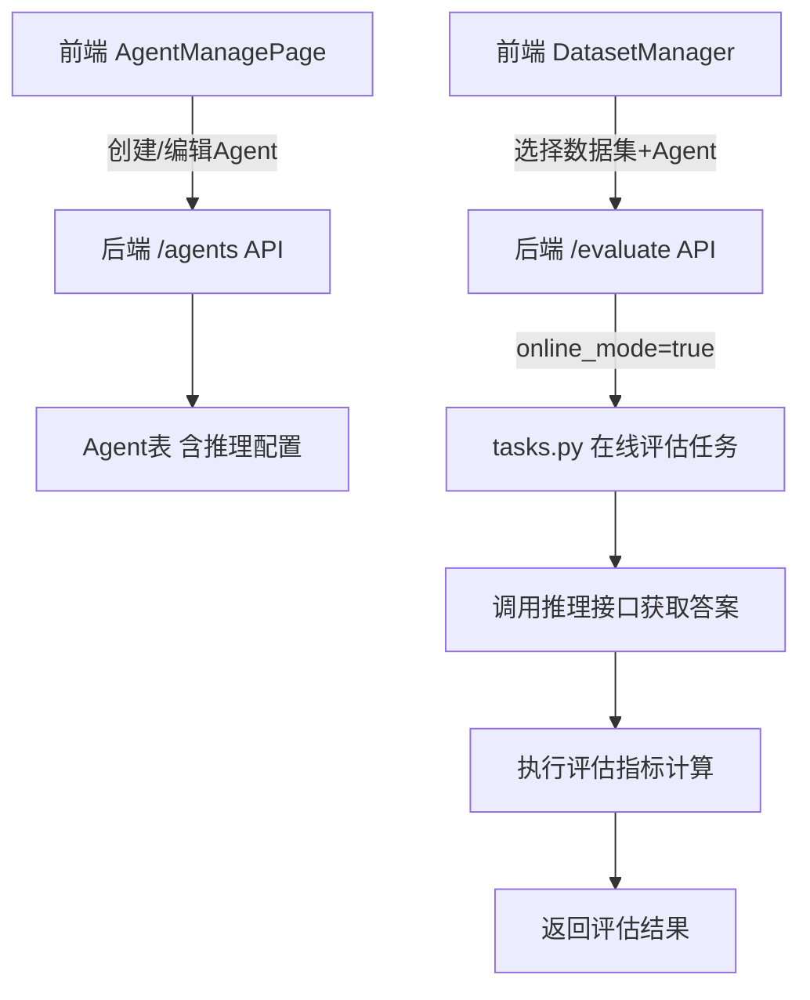

## 产品概述

重构LLM评测系统的Agent管理和评估流程，将推理接口配置从"动态评测集"功能迁移到Agent管理中，并新增在线评估功能。

## 核心功能

1. **Agent推理配置增强**：在Agent管理中添加推理接口配置（URL、认证方式、超时设置等），使每个Agent能够关联其推理服务
2. **在线评估功能**：评估时支持调用Agent的推理接口获取模型答案，实现从数据集（问题+真实答案）到完整评测集的动态生成与评估一体化流程
3. **移除动态评测集模块**：删除独立的"动态评测集"功能，简化系统架构

## 技术栈

- 后端：FastAPI + SQLAlchemy (异步) + SQLite
- 前端：React + TypeScript + Axios

## 实现方案

### 数据模型变更

在 `Agent` 模型中新增推理配置字段（JSON格式存储），复用现有 `InferenceConfig` 结构：

- `inference_config: Column(Text)` - JSON字符串，包含 url, endpoint, headers, auth, timeout, request_delay, payload_template

### 在线评估流程

```
用户选择数据集 + Agent → 系统调用Agent推理接口获取答案 → 临时合并数据 → 执行评估任务
```

关键设计：在线评估不生成新的持久化数据集，而是在评估任务执行时动态获取模型答案，减少数据冗余。

### API变更

1. **Agent API**：扩展 POST/PUT /agents 接口支持推理配置
2. **评估API**：扩展 POST /evaluate 接口，新增 `online_mode` 和 `agent_id` 参数
3. **删除API**：移除 /extended/datasets/generate-dynamic 接口

## 架构设计



## 目录结构

```
backend/
├── database.py          # [MODIFY] Agent模型添加inference_config字段
├── schemas.py           # [MODIFY] 添加InferenceConfigSchema，扩展AgentRegisterRequest/AgentResponse
├── main.py              # [MODIFY] 更新Agent API支持推理配置；更新evaluate接口支持在线模式
├── tasks.py             # [MODIFY] 添加run_online_evaluation_task函数
├── extended_routes.py   # [MODIFY] 删除generate-dynamic接口，保留InferenceConfig模型供schemas使用
└── services/
    └── inference_service.py  # [NEW] 从dynamic_dataset_service.py重构，提供通用推理调用能力

frontend/src/components/
├── AgentManagePage.tsx  # [MODIFY] 添加推理配置表单
└── DatasetManager.tsx   # [MODIFY] 删除动态评测集tab，添加在线评估模式选项
```

## 实现要点

### 后端实现细节

1. **数据库迁移**：Agent表新增字段，需处理已有数据的默认值（空JSON对象）
2. **推理服务复用**：将 `DynamicDatasetService._call_inference_api` 重构为通用 `InferenceService.call_inference` 方法
3. **在线评估任务**：在评估开始前先获取模型答案，然后复用现有评估逻辑
4. **错误处理**：推理接口调用失败时记录错误但仍保留问题记录，评估可继续

### 前端实现细节

1. **Agent配置表单**：折叠式配置面板，包含URL、认证、超时等字段
2. **评估模式切换**：普通评估（数据集已有model_answer）vs 在线评估（调用Agent获取答案）
3. **Agent选择器**：在线评估模式下显示已配置推理接口的Agent列表

### 性能考虑

- 在线评估的推理调用采用串行方式（继承现有逻辑），避免并发压力
- 复用现有SSE实时推送机制展示推理进度
