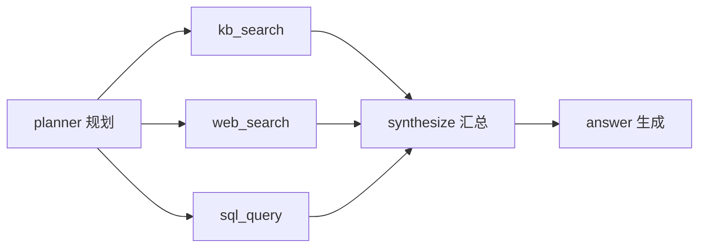

# 过程点配置 — 样例（可直接复制）

> - **§2**：单链路 RAG 类 Agent（意图 → 检索 → 生成）  
> - **§A**：**多工具 Agent**（规划 → 多工具调用 → 汇总生成）← 多工具类型看这里  
> 在 **资源管理 → 过程点配置** 中，先选 Agent 名称，再逐条新增。

---

## A. 多工具 Agent 专用样例

典型链路：**规划选工具 → 串行/并行调用多个 tool → LLM 汇总作答**。



### A.1 推荐埋点（onto-agent）

每个 **tool 调用**单独一个 SPAN，metadata 建议：

```json
{
  "agent.step.id": "tool_kb_search",
  "agent.step.kind": "tool",
  "agent.tool.name": "kb_search",
  "agent.tool.call_index": 1,
  "agent.parent.step.id": "planner",
  "agent.is_retry": false
}
```

| 节点 | `agent.step.id` | `agent.step.kind` | `agent.tool.name` | 说明 |
|------|-----------------|-------------------|-------------------|------|
| 规划 | `planner` | `router` | — | 决定调用哪些工具 |
| 知识库 | `tool_kb_search` | `tool` | `kb_search` | 必达工具示例 |
| 联网 | `tool_web_search` | `tool` | `web_search` | 可选工具 |
| SQL | `tool_sql_query` | `tool` | `sql_query` | 可选工具 |
| 汇总 | `synthesize` | `llm` | — | 多工具结果合并 |
| 作答 | `answer` | `llm` | — | 最终 GENERATION |

并行多工具时：`agent.parent.step.id` 同为 `planner`，`agent.tool.call_index` 递增（1、2、3…）。

> **M2 限制**：每条过程点只判断「是否出现过匹配的 span」，**不能**在一条规则里写「至少调用 2 个不同工具」。若业务要求多个必达工具，请为**每个工具单独建一条必达过程点**（见 A.2）。

---

### A.2 推荐过程点清单（6 条）

复制到过程点配置页即可；按业务删减「可选工具」行。

| 顺序 | 过程点名称 | 必达 | 说明 |
|------|------------|------|------|
| 1 | 规划选工具 | ✅ | 必须先有 planner/router |
| 2 | 发生过工具调用 | ✅ | 任意 `step.kind=tool` |
| 3 | 知识库检索 | ✅ | 核心业务工具 |
| 4 | 联网搜索 | ❌ | 按需开启 |
| 5 | 多源汇总 | ✅ | synthesize 或二次 LLM |
| 6 | 最终作答 | ✅ | GENERATION / answer |

#### A.2.1 规划选工具（order=1，必达）

```json
{
  "mode": "any",
  "rules": [
    {
      "type": "jsonpath",
      "path": "$.attributes.agent.step.id",
      "op": "eq",
      "value": "planner"
    },
    {
      "type": "jsonpath",
      "path": "$.attributes.agent.step.kind",
      "op": "eq",
      "value": "router"
    }
  ]
}
```

#### A.2.2 发生过工具调用（order=2，必达）

> 保证不是「纯 LLM 直出」，至少走了一次 tool。

```json
{
  "mode": "any",
  "rules": [
    {
      "type": "jsonpath",
      "path": "$.attributes.agent.step.kind",
      "op": "eq",
      "value": "tool"
    },
    {
      "type": "metadata",
      "key": "agent.step.kind",
      "op": "eq",
      "value": "tool"
    }
  ]
}
```

#### A.2.3 知识库检索（order=3，必达）

```json
{
  "mode": "any",
  "rules": [
    {
      "type": "jsonpath",
      "path": "$.attributes.agent.tool.name",
      "op": "eq",
      "value": "kb_search"
    },
    {
      "type": "metadata",
      "key": "agent.tool.name",
      "op": "eq",
      "value": "kb_search"
    }
  ]
}
```

#### A.2.4 联网搜索（order=4，非必达）

```json
{
  "mode": "any",
  "rules": [
    {
      "type": "jsonpath",
      "path": "$.attributes.agent.tool.name",
      "op": "eq",
      "value": "web_search"
    }
  ]
}
```

若你还有 **SQL / 计算器 / 代码执行** 等工具，复制 A.2.4，把 `web_search` 换成 `sql_query`、`calculator`、`code_interpreter` 等即可。

#### A.2.5 多源汇总（order=5，必达）

```json
{
  "mode": "any",
  "rules": [
    {
      "type": "jsonpath",
      "path": "$.attributes.agent.step.id",
      "op": "eq",
      "value": "synthesize"
    },
    {
      "type": "jsonpath",
      "path": "$.attributes.agent.step.kind",
      "op": "eq",
      "value": "llm"
    }
  ]
}
```

> 若 Agent 没有单独 synthesize span，只有最终 GENERATION，可把本条 **order 留空** 或合并到 A.2.6，避免误报未命中。

#### A.2.6 最终作答（order=6，必达）

```json
{
  "mode": "any",
  "rules": [
    {
      "type": "jsonpath",
      "path": "$.attributes.agent.step.id",
      "op": "eq",
      "value": "answer"
    },
    {
      "type": "observation_type",
      "op": "eq",
      "value": "GENERATION"
    }
  ]
}
```

---

### A.3 多工具「一条规则匹配多种工具」（OR）

业务上「kb 或 web 至少命中一个」时，**不要**合并成一条必达（M2 无法表达 OR 组合逻辑），应：

- 方案 1：两条都设 **非必达**，合规 Tab（M3+）再看覆盖率；或  
- 方案 2：两条分别必达（更严格）；或  
- 方案 3：单条过程点用 `op: in` 匹配多种 tool name：

**过程点名称**：`外部检索（kb 或 web）`  
**必达**：是  
**顺序**：留空（只要求出现，不强制顺序）

```json
{
  "mode": "any",
  "rules": [
    {
      "type": "jsonpath",
      "path": "$.attributes.agent.tool.name",
      "op": "in",
      "value": ["kb_search", "web_search", "sql_query"]
    }
  ]
}
```

---

### A.4 多工具 API 批量创建示例

```bash
# 1. 规划
curl -s -X POST "http://127.0.0.1:8000/api/checkpoints/templates" \
  -H "Content-Type: application/json" \
  -d '{"agent_name":"你的多工具Agent","name":"规划选工具","order":1,"required":true,"match_rules":{"mode":"any","rules":[{"type":"jsonpath","path":"$.attributes.agent.step.id","op":"eq","value":"planner"}]}}'

# 2. 任意工具
curl -s -X POST "http://127.0.0.1:8000/api/checkpoints/templates" \
  -H "Content-Type: application/json" \
  -d '{"agent_name":"你的多工具Agent","name":"发生过工具调用","order":2,"required":true,"match_rules":{"mode":"any","rules":[{"type":"jsonpath","path":"$.attributes.agent.step.kind","op":"eq","value":"tool"}]}}'

# 3. 必达 kb
curl -s -X POST "http://127.0.0.1:8000/api/checkpoints/templates" \
  -H "Content-Type: application/json" \
  -d '{"agent_name":"你的多工具Agent","name":"知识库检索","order":3,"required":true,"match_rules":{"mode":"any","rules":[{"type":"jsonpath","path":"$.attributes.agent.tool.name","op":"eq","value":"kb_search"}]}}'
```

---

## 1. 推荐 Agent 埋点（RAG 单链路）

过程点规则越稳，Agent trace 里 metadata 越规范。推荐在 Langfuse observation 上写：

```json
{
  "agent.step.id": "intent_parse",
  "agent.step.kind": "router",
  "agent.tool.name": "intent_classifier",
  "agent.logical_agent_id": "onto-qa-prod",
  "agent.version": "v1.0.0"
}
```

各步骤示例：

| 步骤 | `agent.step.id` | `agent.step.kind` | `agent.tool.name` |
|------|-----------------|-------------------|-------------------|
| 意图识别 | `intent_parse` | `router` | `intent_classifier` |
| 知识库检索 | `kb_retrieve` | `tool` | `kb_search` |
| 重排序 | `rerank` | `tool` | `rerank` |
| 答案生成 | `answer_gen` | `llm` | — |
| 规则校验 | `rule_check` | `tool` | `policy_validator` |

---

## 2. 过程点模板样例（RAG 单链路，5 条）

### 2.1 意图识别（必达，顺序 1）

**过程点名称**：`意图识别`  
**顺序**：`1`  
**必达**：是  
**权重**：`1.0`  
**match_rules**：

```json
{
  "mode": "any",
  "rules": [
    {
      "type": "jsonpath",
      "path": "$.attributes.agent.step.id",
      "op": "eq",
      "value": "intent_parse"
    },
    {
      "type": "observation_name",
      "op": "contains",
      "value": "intent"
    }
  ]
}
```

> `mode: any` = 任一规则命中即算通过（JSONPath 优先，name 作兼容降级）。

---

### 2.2 知识库检索（必达，顺序 2）

**过程点名称**：`知识库检索`  
**顺序**：`2`  
**必达**：是  

```json
{
  "mode": "any",
  "rules": [
    {
      "type": "jsonpath",
      "path": "$.attributes.agent.tool.name",
      "op": "eq",
      "value": "kb_search"
    },
    {
      "type": "metadata",
      "key": "agent.tool.name",
      "op": "eq",
      "value": "kb_search"
    },
    {
      "type": "observation_name",
      "op": "contains",
      "value": "retrieve"
    }
  ]
}
```

---

### 2.3 重排序（非必达，顺序 3）

**过程点名称**：`结果重排序`  
**顺序**：`3`  
**必达**：否  

```json
{
  "mode": "all",
  "rules": [
    {
      "type": "jsonpath",
      "path": "$.attributes.agent.step.id",
      "op": "eq",
      "value": "rerank"
    }
  ]
}
```

---

### 2.4 答案生成（必达，顺序 4）

**过程点名称**：`LLM 答案生成`  
**顺序**：`4`  
**必达**：是  

```json
{
  "mode": "any",
  "rules": [
    {
      "type": "observation_type",
      "op": "eq",
      "value": "GENERATION"
    },
    {
      "type": "jsonpath",
      "path": "$.attributes.agent.step.kind",
      "op": "eq",
      "value": "llm"
    }
  ]
}
```

---

### 2.5 规则校验（必达，顺序 5，可选）

**过程点名称**：`合规规则校验`  
**顺序**：`5`  
**必达**：是  

```json
{
  "mode": "any",
  "rules": [
    {
      "type": "jsonpath",
      "path": "$.attributes.agent.tool.name",
      "op": "in",
      "value": ["policy_validator", "rule_engine"]
    },
    {
      "type": "metadata",
      "key": "phase",
      "op": "eq",
      "value": "rule_check"
    }
  ]
}
```

---

## 3. API 创建样例（curl）

将 `你的Agent名称` 换成 Agent 管理里显示的**名称**（不是 logical_agent_id）。

```bash
curl -X POST "http://127.0.0.1:8000/api/checkpoints/templates" \
  -H "Content-Type: application/json" \
  -d '{
    "agent_name": "你的Agent名称",
    "name": "知识库检索",
    "description": "RAG 链路必须出现检索步骤",
    "order": 2,
    "required": true,
    "score_weight": 1.0,
    "match_mode": "rule",
    "enabled": true,
    "match_rules": {
      "mode": "any",
      "rules": [
        {
          "type": "jsonpath",
          "path": "$.attributes.agent.tool.name",
          "op": "eq",
          "value": "kb_search"
        },
        {
          "type": "observation_name",
          "op": "contains",
          "value": "retrieve"
        }
      ]
    }
  }'
```

---

## 4. Preview 试跑样例

创建模板后，在页面填 **Langfuse trace_id**，或调用：

```bash
curl -X POST "http://127.0.0.1:8000/api/checkpoints/templates/{模板ID}/preview" \
  -H "Content-Type: application/json" \
  -d '{
    "trace_id": "你的-langfuse-trace-id",
    "project": "onto-eval"
  }'
```

**预期返回片段**：

```json
{
  "trace_id": "xxx",
  "source": "langfuse",
  "results": [
    {
      "checkpoint_id": "cp_xxx",
      "checkpoint_name": "知识库检索",
      "hit": true,
      "matched_observation_id": "obs_abc",
      "evidence": { "rule_index": 0, "observation_name": "kb_search" }
    }
  ]
}
```

---

## 5. 规则字段速查

| type | op | value 示例 |
|------|-----|-----------|
| `observation_name` | `eq` / `contains` / `regex` | `"retrieve"` |
| `observation_type` | `eq` | `"SPAN"` / `"GENERATION"` |
| `metadata` | `eq` / `contains` / `in` | 需额外 `key` 字段 |
| `jsonpath` | `eq` / `contains` / `in` / `regex` | 需 `path` 以 `$.` 开头 |

| mode | 含义 |
|------|------|
| `any` | 任一 rule 命中即通过 |
| `all` | 全部 rule 命中才通过 |

---

## 6. 最小可跑样例（仅 1 条，快速验证）

若只想验证页面流程，新增一条即可：

- **名称**：`任意步骤存在`
- **顺序**：留空
- **必达**：是
- **match_rules**：

```json
{
  "mode": "any",
  "rules": [
    {
      "type": "observation_type",
      "op": "eq",
      "value": "SPAN"
    }
  ]
}
```

任意含 SPAN 的 trace preview 都应 **hit: true**。

---

## 相关文档

- [M2-过程点配置.md](./M2-过程点配置.md)
- [M2-手工验收清单.md](./M2-手工验收清单.md)
- [onto-agent-observability.md](./onto-agent-observability.md)
