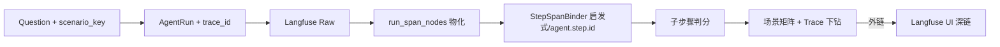

# PO：场景子步骤 ↔ Langfuse Trace 映射 v1

> 样例：`corridor_defense` · 题「针对带状防御区域，调度合理的快艇数量，请生成防御方案」  
> 状态：**Phase ST-2 已完成**；ST-3 Agent 契约（onto-agent）待对接

---

## 1. 目标

| 能力 | 说明 |
|------|------|
| 子步骤判分 | 按场景模板 S1–Sn 对 Agent 输出分步打分（**禁止 GT 参与判分**） |
| Trace 绑定 | 每步关联 Langfuse observation（input/output 预览） |
| Langfuse 直链 | 提供可点击的 **trace_url** / **observation_url**，定位到具体步骤 |
| 下钻分析 | 评测结果 → 场景子步骤 Tab → 矩阵 + Trace 面板 |

---

## 2. 架构（对齐设计范式 P-15 / P-17）



- **判分 / 绑定读路径**：`run_span_nodes` 或 Langfuse API 一次性拉取 observations（评测详情页按需）
- **Langfuse API**：仅证据下钻，非常驻报表 SoR
- **禁止**：用 `ground_truth` 文本给子步骤加分

---

## 3. 判分规则（v1 已落地）

| 步骤类型 | 判分文本来源 |
|----------|--------------|
| S1–S4 过程步 | 仅绑定 span 的 **output**；无 span → 0 分 |
| S5–S8 汇总步 | span output；无 span 时用 **agent_answer** |
| 全部 | `score = 命中关键词数 / 关键词总数`，无 +0.1 加成 |

---

## 4. Trace 绑定（v1 启发式）

配置见 `CORRIDOR_STEP_TRACE_BINDINGS`（`scenario_step_trace_service.py`）：

- `span_name_patterns`：如 `llm:main_iteration`、`tool:ontology_context`
- `output_keywords`：在 observation 文本中计分
- `iteration_lte`：限制早期 iteration（S1/S2）

**长期（ST-3）**：onto-agent 上报 `agent.step.id`，JSONPath 绑定，弃用 name 启发式。

---

## 5. Langfuse 深链

服务：`langfuse_link_service.py`

| 字段 | 格式 |
|------|------|
| 有 project id | `{LANGFUSE_HOST}/project/{id}/traces/{trace_id}` |
| 无 project id | `{LANGFUSE_HOST}/trace/{trace_id}`（Langfuse 短链重定向） |
| 定位步骤 | `{trace_url}?observation={observation_id}` |

project id 解析顺序：`langfuse.projects.json` → Langfuse Public API `/projects`

---

## 6. API

| 方法 | 路径 | 说明 |
|------|------|------|
| GET | `/api/scenario-eval/runs/{run_id}/steps-detail` | 子步骤 + IO + Langfuse 链接 |
| GET | `/api/scenario-eval/tasks/{id}/matrix` | 矩阵（cells 含 `langfuse.trace_url`） |

响应示例字段：

```json
{
  "langfuse": {
    "trace_url": "http://host/project/xxx/traces/yyy",
    "trace_id": "yyy"
  },
  "steps": [{
    "step_key": "S8",
    "score": 0.0,
    "trace_binding": {
      "observation_url": "http://host/project/xxx/traces/yyy?observation=zzz",
      "input_preview": "...",
      "output_preview": "..."
    }
  }]
}
```

---

## 7. 前端

| 组件 | 职责 |
|------|------|
| `ScenarioEvalPanel` | 场景 Tab 入口 |
| `ScenarioMatrixView` | L1/L2 矩阵 + 判分证据 + Langfuse 按钮 |
| `ScenarioStepDrilldown` | 子步骤 IO + **可复制 Trace 链接** |

---

## 8. 任务分解

### ST-1 正式化 Demo（当前 Sprint）✅/🔄

| ID | 任务 | 状态 |
|----|------|------|
| ST-1-1 | 修复判分（禁 GT、span 不回退整答案） | ✅ |
| ST-1-2 | `langfuse_link_service` + API 返回 trace_url | ✅ |
| ST-1-3 | 前端直链 + 复制链接 | ✅ |
| ST-1-4 | 矩阵 cell 带 langfuse | ✅ |
| ST-1-5 | 单测 + 文档 | 🔄 |

### ST-2 数据与导入

| ID | 任务 | 状态 |
|----|------|------|
| ST-2-1 | 数据集列 `scenario_key`（可选） | ⬜ |
| ST-2-2 | 无 GT 题默认 L0 三步模板 | ⬜ |
| ST-2-3 | GT Markdown 半自动抽 steps 草稿 | ⬜ |

### ST-3 Agent 契约

| ID | 任务 | 状态 |
|----|------|------|
| ST-3-1 | onto-agent 上报 `agent.step.id` | ⬜ |
| ST-3-2 | `trace_binding` JSONPath 主路径 | ⬜ |
| ST-3-3 | 物化后写 `scenario_step_span_refs` 表 | ⬜ |

### ST-4 体验增强

| ID | 任务 | 状态 |
|----|------|------|
| ST-4-1 | 评测明细每题快捷入口「场景子步骤」 | ⬜ |
| ST-4-2 | 平台内 Span 树高亮（不跳 Langfuse） | ⬜ |
| ST-4-3 | 跨任务矩阵同步 trace 链接 | ⬜ |

---

## 9. 测试

```bash
cd backend
python -m pytest tests/test_scenario_step_trace.py tests/test_scenario_eval_service.py tests/test_langfuse_link_service.py -q
```

---

## 10. 样例验收

1. 跑 `corridor_defense` 评测题，打开任务详情 → **场景子步骤**
2. L2 点击 S8 单元格 → 展开下钻
3. **未命中**时 S8 得分 **0.00**，命中关键词为空
4. 顶部与步骤内均有 **Langfuse Trace 链接**，点击可在浏览器打开对应 trace / observation
