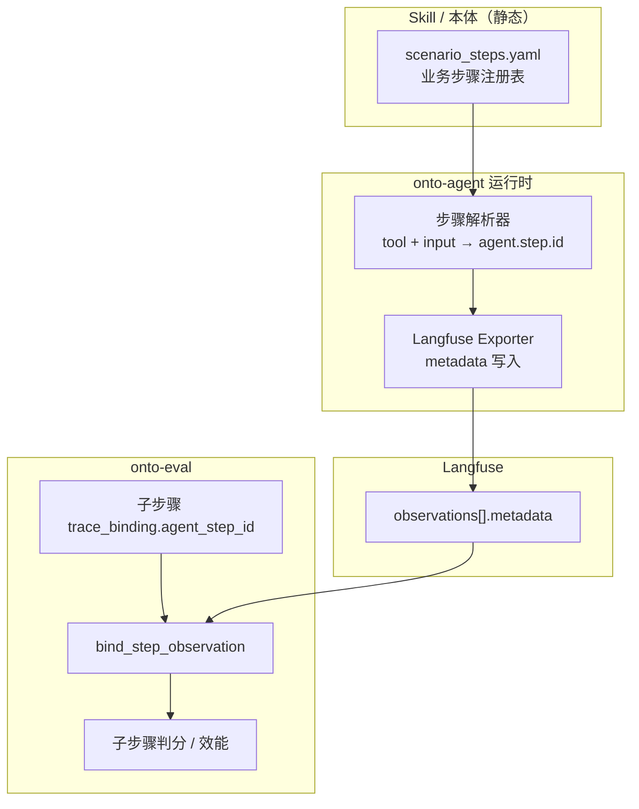

# ST-3：Agent 场景步骤埋点需求规格（模式 A — Skill 操作注册表）

> **文档编号**：ST-3  
> **版本**：v1.0  
> **状态**：待 onto-agent 实现 · onto-eval 侧待联调  
> **需求方 / 消费方**：onto-eval（场景子步骤 Trace 绑定、过程判分、效能统计）
> **实现方**：onto-agent（Langfuse 可观测性、Skill / 本体运行时）
> **关联文档**：[PO-场景子步骤-Trace映射-v1.md](./PO-场景子步骤-Trace映射-v1.md)、[agent-otel-joint-spec.md](./agent-otel-joint-spec.md)、[onto-agent-observability.md](./onto-agent-observability.md)

> **重要声明（v1.22）**：`agent.*` metadata 属于**通用可观测性契约**（写入 Langfuse observation），与 eval Push 双写无关。Agent 双写 Push 功能已完全取消，Trace 物化由 eval `internal_sync` Worker 从 Langfuse API 拉取完成。Trace 业务打点（过程点规则、Operation Registry）由 eval 侧独立维护，不依赖 Agent 运行时资产。

---

## 1. 背景与目标

### 1.1 问题

onto-eval **场景子步骤**（如 N1/N2/N3）需绑定 Langfuse Trace 中的 observation，以支持：

- 子步骤判分（按 Span output 关键词）
- 子步骤运行效能（均时延 / Tokens）
- Trace 下钻与版本对比

当前 v1 **启发式绑定**（`span_name_patterns` + `output_keywords`）精确率低：同 tool 多次调用、schema 加载与业务查询混淆、关键词与 Span 内容错位（见 ECO-001 trace `0803492a…` 实测）。

### 1.2 目标（模式 A）

在 **Skill / 本体操作清单** 中声明**跨题目、跨版本稳定**的业务步骤 ID（`agent.step.id`），Agent 运行时在每条相关 observation 的 **metadata** 中写入该 ID；onto-eval 子步骤通过 `trace_binding.agent_step_id` **精确匹配**，不再依赖 Span 名称启发式。

### 1.3 非目标（本阶段不做）

| 项 | 说明 |
|----|------|
| eval 下发实时步骤指令 | 不在请求中动态指定 N1/N2 映射（模式 C，后续可选） |
| 修改 Langfuse observation `name` 作为契约 | `name` 仍可随实现变化 |
| Agent 自动感知 eval `step_key`（N1/N2） | eval 侧用 `agent_step_id` 桥接，Agent 只认业务 ID |
| 本阶段改造 onto-eval 判分算法 | eval 仅增加/规范 `agent_step_id` 配置与联调验收 |

---

## 2. 术语

| 术语 | 说明 | 示例 |
|------|------|------|
| **eval 子步骤 `step_key`** | 单题场景模板内步骤编号，随题变化 | `N1`, `N2`, `S3` |
| **业务步骤 ID** | Agent / Skill 注册的稳定标识，写入 `agent.step.id` | `eco.query_affected_objects` |
| **操作注册表** | Skill 或本体目录下的步骤定义文件 | `scenario_steps.yaml` |
| **结构步骤 ID** | 运行时内部 ID（现有） | `llm:main:3`, `tool:ontology_context` |
| **绑定** | eval 为子步骤选中一条 observation | `bind_source = agent_step_id` |

**关系**：`eval 子步骤.step_key` ──配置──▶ `trace_binding.agent_step_id` ═══ 等于 ═══ `Langfuse metadata.agent.step.id`

---

## 3. 总体架构



---

## 4. 功能需求（onto-agent）

### 4.1 业务步骤注册表（模式 A 核心）

每个 **Skill** 或 **本体（ontology）** 可携带一份步骤注册表，声明「何种运行时行为对应哪个 `agent.step.id`」。

**文件位置（推荐，可协商）**：

```text
.onto-runtime/workspaces/{workspace_id}/skills/{skill_name}/scenario_steps.yaml
# 或
.onto-runtime/workspaces/{workspace_id}/ontologies/{ontology_id}/scenario_steps.yaml
```

**加载时机**：Agent 启动 / Skill 加载 / 本体 manifest 加载时读入内存；变更后支持热更新（见 API §5.2）。

### 4.2 步骤解析（运行时）

在以下事件产生 **Langfuse observation** 之前，解析出业务 `agent.step.id`：

| 事件 | 必须解析 | 说明 |
|------|----------|------|
| `TOOL_STARTED` | ✅ | 每次 tool 调用独立 ID |
| `LLM_STARTED`（主循环 iteration） | ✅ | 至少终局汇总步；可选每轮 reasoning |
| `TOOL_BATCH_*` | 可选 | 批次 Span 可保留结构 ID |
| `AGENT_LOOP_*` | 可选 | 一般不参与 eval 子步骤绑定 |

**解析输入**（match 条件可用字段）：

| 字段 | 来源 | 示例 |
|------|------|------|
| `tool_name` | tool 逻辑名 | `business_data_search` |
| `tool_input.*` | 工具参数 | `entity`, `resource`, `key`, `query` |
| `iteration` | Agent 轮次 | `3` |
| `phase` | 运行时阶段标记 | `final_answer` |
| `ontology_id` | 当前本体 | `aviation-plm-knowledge-agent` |

**解析规则**：

1. 按注册表条目 **顺序** 匹配；**首条命中**生效。
2. 每条规则含 `match`（条件）与 `step_id`（业务 ID）。
3. 无命中 → **降级**为现有结构 ID（如 `tool:{tool_name}`），并写 `agent.step.id_source = "structural_fallback"`（见 §6.2）。
4. 同一 `step_id` 多次调用须可区分：写 `agent.tool.call_index`（int，从 0 递增，按 `tool_name` 或全局计数，实现方择一并在文档说明）。

### 4.3 Langfuse metadata 写入

在 **create_span / create_llm_span** 时调用 `enrich_agent_otel_metadata`，且 **必须** 出现在 Langfuse UI / Public API 读回的 `observation.metadata` 中（当前线上缺失，属 P0 缺陷）。

### 4.4 Sanitize 白名单（P0）

`LangfuseTraceAdapter._sanitize_dict` 当前将含 `key` 的字段名或值打码为 `[REDACTED]`，导致 `tool_input.key`、`object_key` 无法用于调试与后续扩展。

**需求**：

- 对 **`agent.*` 前缀键**：永不 redact。
- 对业务白名单键（至少）：`entity`, `resource`, `object_key`, `operation_key` — 值可脱敏，但 **键名保留**；eval 联调阶段需能在 output_preview 看到 `object_key: xxx` 文本（已在 output 字符串中，保持即可）。

### 4.5 与现有 `agent.*` 规范关系

本需求 **扩展** [agent-otel-joint-spec.md](./agent-otel-joint-spec.md)：

| 键 | 本需求 |
|----|--------|
| `agent.step.id` | **优先**为注册表 `step_id`；无匹配时为结构 ID |
| `agent.step.kind` | 不变：`tool` / `llm` / `router` |
| `agent.tool.name` | 不变 |
| `agent.tool.call_index` | **新增必填**（tool 类 observation） |
| `agent.scenario.registry_id` | **新增推荐**：注册表内条目 id |
| `agent.scenario.ontology_id` | **新增推荐** |
| `agent.step.id_source` | **新增推荐**：`registry` / `structural_fallback` |

---

## 5. API 定义

### 5.1 数据文件：`scenario_steps.yaml`（Skill 侧契约）

Skill 作者维护；onto-agent 解析；onto-eval **只读消费**（联调 / 配置辅助）。

```yaml
# schema_version: "1.0"
registry_id: "aviation-plm-knowledge-agent"   # 与 ontology_id 或 skill 名对齐
version: "1.0.0"
description: "航空 PLM ECO 变更分析 — 场景步骤注册表"

steps:
  - id: "eco.load_ontology_root"
    label: "加载本体根目录"
    kind: "tool"
    match:
      tool_name: "ontology_context"
      input:
        resource: "root"

  - id: "eco.load_object_schema"
    label: "加载对象 schema"
    kind: "tool"
    match:
      tool_name: "ontology_context"
      input:
        resource: "object"
      # input.key 可选；不写 key 表示任意 object

  - id: "eco.query_eco_header"
    label: "查询 ECO 变更单头"
    kind: "tool"
    match:
      tool_name: "business_data_search"
      input:
        entity: "ECO变更单"

  - id: "eco.query_affected_objects"
    label: "查询 ECO 受影响对象"
    kind: "tool"
    match:
      tool_name: "business_data_search"
      input:
        entity: "ECO受影响对象"

  - id: "eco.query_epart_versions"
    label: "查询 EPart 版本与 MPart 映射"
    kind: "tool"
    match:
      tool_name: "business_data_search"
      input:
        entity: "EPart版本"

  - id: "eco.summarize_answer"
    label: "汇总最终答案"
    kind: "llm"
    match:
      request_label: "main_agent_iteration"
      phase: "final_answer"          # 见 §5.1.1
```

#### 5.1.1 `match` 字段约定

| 字段 | 类型 | 说明 |
|------|------|------|
| `tool_name` | string | 精确等于 |
| `input` | object | 子集匹配：`match.input` 每个 k-v 须与 tool 入参相等 |
| `input_contains` | object | 字符串字段：归一化后 `contains` |
| `request_label` | string | LLM 请求标签 |
| `phase` | string | 运行时阶段，见下表 |
| `iteration_gte` / `iteration_lte` | int | 可选轮次约束 |

**`phase` 枚举（onto-agent 实现）**：

| phase | 判定条件（建议） |
|-------|------------------|
| `final_answer` | 主循环最后一轮 LLM，且 `completion.content` 非空 |
| `reasoning` | 主循环 LLM，`reasoning_content` 非空且非终局轮 |
| `tool_planning` | LLM 输出含 tool_calls 且无终局 content |

#### 5.1.2 约束

- `steps[].id`：全局唯一，格式 `[a-z0-9._-]{3,64}`，**禁止**仅用 eval `step_key`（如 `N1`）。
- 同一 `match` 不得重复；冲突时加载报错并打日志。
- 注册表版本变更须递增 `version` 字段。

---

### 5.2 onto-agent HTTP API（供 eval / 运维 / 联调）

**Base URL**：`{ONTO_AGENT_BASE_URL}`（默认 `http://127.0.0.1:5055`）  
**鉴权**：与现有 agentic API 一致（Bearer Token / Session）。

#### 5.2.1 查询 Skill 场景步骤注册表

```http
GET /agentic/skills/{skill_name}/scenario-steps
```

**Query 参数**：

| 参数 | 类型 | 必填 | 说明 |
|------|------|------|------|
| `workspace_id` | string | 是 | 工作空间 |
| `ontology_id` | string | 否 | 若 Skill 绑定本体，可过滤 |

**Response 200**：

```json
{
  "skill_name": "aviation-plm-knowledge-agent",
  "workspace_id": "eco",
  "registry_id": "aviation-plm-knowledge-agent",
  "registry_version": "1.0.0",
  "schema_version": "1.0",
  "source_path": ".onto-runtime/workspaces/eco/skills/.../scenario_steps.yaml",
  "loaded_at": "2026-06-04T12:00:00Z",
  "steps": [
    {
      "id": "eco.query_affected_objects",
      "label": "查询 ECO 受影响对象",
      "kind": "tool",
      "match": {
        "tool_name": "business_data_search",
        "input": { "entity": "ECO受影响对象" }
      }
    }
  ]
}
```

**Response 404**：Skill 不存在或无注册表文件。

---

#### 5.2.2 按本体查询注册表（ontology 维度）

```http
GET /agentic/ontologies/{ontology_id}/scenario-steps
```

**Query**：`workspace_id`（必填）

**Response**：同 5.2.1，`skill_name` 可为关联 Skill 名或 null。

---

#### 5.2.3 校验注册表（CI / Skill 上传）

```http
POST /agentic/scenario-steps/validate
Content-Type: application/json
```

**Request Body**：

```json
{
  "workspace_id": "eco",
  "registry_yaml": "steps:\n  - id: eco.query_affected_objects\n    ..."
}
```

**Response 200**：

```json
{
  "valid": true,
  "registry_id": "aviation-plm-knowledge-agent",
  "step_count": 6,
  "warnings": []
}
```

**Response 200（有错误）**：

```json
{
  "valid": false,
  "errors": [
    { "path": "steps[2].id", "message": "duplicate step id: eco.query_affected_objects" },
    { "path": "steps[3].match", "message": "ambiguous match overlaps steps[2]" }
  ]
}
```

---

#### 5.2.4 联调探针：最近 Run 的步骤 ID 覆盖度

```http
GET /agentic/observability/runs/{run_id}/step-id-report
```

**Query**：`workspace_id`（必填）

**Response 200**：

```json
{
  "run_id": "agentic-1780543576587-dcbd071a022ba8",
  "trace_id": "7e76a9b8328c55fc9db10d4581dd82a5",
  "observation_count": 12,
  "with_agent_step_id": 10,
  "registry_sourced": 8,
  "structural_fallback": 2,
  "step_ids": [
    {
      "agent_step_id": "eco.query_affected_objects",
      "agent_step.id_source": "registry",
      "observation_name": "tool:business_data_search",
      "tool_call_index": 1,
      "iteration": 3
    }
  ],
  "registry_coverage": {
    "expected_from_registry": 6,
    "hit": 5,
    "missing": ["eco.load_object_schema"]
  }
}
```

> 用途：onto-eval 联调前自检；目标 `registry_sourced / tool+llm_observations ≥ 80%`（与 M-03 验收一致）。

---

### 5.3 onto-eval 侧（消费方，本阶段只读对接）

Agent 就绪后，eval **无需新 API**；消费既有能力：

| 能力 | 路径 / 模块 | 用法 |
|------|-------------|------|
| 单题 Trace 绑定试跑 | `POST /api/scenario-eval/items/{dataset_item_id}/steps/batch-preview-trace` | 验证 `agent_step_id` 绑定 |
| 子步骤配置 | 场景子步骤 CRUD | 写入 `match_rules.trace_binding.agent_step_id` |
| 正式评测 | 现有在线评测流程 | `bind_source = agent_step_id` |

**eval 子步骤配置扩展（JSON 字段）**：

```json
{
  "step_key": "N1",
  "name": "定位 ECO-001 受影响对象",
  "match_rules": {
    "trace_binding": {
      "agent_step_id": "eco.query_affected_objects",
      "span_name_patterns": ["tool:business_data_search"],
      "output_keywords": ["ECO受影响对象", "受影响编码"]
    }
  },
  "gt_expected": {
    "keywords": ["ECO-001", "受影响编码", "变更前EPart", "变更后EPart"]
  }
}
```

**绑定优先级**（已实现）：`agent_step_id` 精确匹配 > 关键词启发式 > 结构 fallback。

---

### 5.4 eval 辅助 API（可选，Phase ST-3b，eval 团队实现）

便于从注册表生成子步骤草稿，**不阻塞 Agent 联调**：

```http
GET /api/scenario-eval/import/agent-scenario-steps
```

| 参数 | 说明 |
|------|------|
| `agent_name` | Agent 名称 |
| `skill_name` 或 `ontology_id` | 注册表来源 |
| `workspace_id` | 转发 onto-agent |

**Response**：`steps[]` 草稿，含建议 `agent_step_id` 与 `label`；人工映射到 `N1/N2/N3` 后入库。

---

## 6. Langfuse Observation 契约（验收快照）

每条 **参与场景绑定的** observation，`metadata` 须满足：

### 6.1 Tool 类

```json
{
  "agent.step.id": "eco.query_affected_objects",
  "agent.step.kind": "tool",
  "agent.step.id_source": "registry",
  "agent.tool.name": "business_data_search",
  "agent.tool.call_index": 1,
  "agent.scenario.registry_id": "aviation-plm-knowledge-agent",
  "agent.logical_agent_id": "155-zc",
  "agent.version": "1.2.0",
  "caller": "main",
  "iteration": 3
}
```

### 6.2 LLM 终局类

```json
{
  "agent.step.id": "eco.summarize_answer",
  "agent.step.kind": "llm",
  "agent.step.id_source": "registry",
  "caller": "main",
  "iteration": 6
}
```

### 6.3 降级类（允许但应减少）

```json
{
  "agent.step.id": "tool:ontology_context",
  "agent.step.kind": "tool",
  "agent.step.id_source": "structural_fallback"
}
```

---

## 7. 参考映射：ECO-001 样题

| eval 子步骤 | 建议 `agent_step_id` | 典型 observation | 判分关键词（eval 配） |
|-------------|----------------------|------------------|------------------------|
| N1 定位受影响对象 | `eco.query_affected_objects` | iter3 `tool:business_data_search` | `ECO-001`, `受影响编码`, `VERSION0003` |
| N2 EPart 版本映射 | `eco.query_epart_versions` | iter5 `tool:business_data_search` | `EPart版本编号`, `VERSION0004` |
| N3 MPart / 汇总 | `eco.summarize_answer` | iter6 `llm:main_iteration` | `A001`, `A101`, `B001`, `B101` |

辅助步骤（可不配 eval 子步骤）：`eco.load_ontology_root`, `eco.load_object_schema`, `eco.query_eco_header`。

---

## 8. 验收标准

### 8.1 onto-agent 单测 / 集成

| ID | 验收项 |
|----|--------|
| AC-01 | 加载合法 `scenario_steps.yaml`，`POST /validate` 返回 `valid: true` |
| AC-02 | 模拟 `business_data_search` + `entity=ECO受影响对象` → metadata `agent.step.id = eco.query_affected_objects` |
| AC-03 | 同一 tool 连续调用两次 → `agent.tool.call_index` 分别为 `0`,`1`（或 1,2，文档说明即可） |
| AC-04 | Langfuse API 读回 observation **含** `agent.step.id`（非仅代码单元测试） |
| AC-05 | 无注册表命中时写 `agent.step.id_source=structural_fallback`，评测不崩溃 |
| AC-06 | `GET .../step-id-report` 对样例 Run 返回 `registry_sourced ≥ 80%` |

### 8.2 跨团队联调（onto-eval 执行，Agent 就绪后）

| ID | 步骤 |
|----|------|
| INT-01 | eval 配置 ECO 题 N1/N2/N3 的 `agent_step_id`（§7） |
| INT-02 | 跑在线评测 1 题，取 `trace_id` |
| INT-03 | 场景子步骤页「Trace 绑定验证」：3/3 绑定，`bind_source=agent_step_id` |
| INT-04 | 子步骤矩阵：N1/N2/N3 过程得分 > 0（关键词与 Span 对齐） |
| INT-05 | 子步骤运行效能表：三步均有均时延 / Tokens（非 `—`） |

**联调输入物（eval 提供）**：

- Agent 名称、workspace_id、dataset_item_id  
- 期望注册表 `registry_id` + `registry_version`  
- 一条 golden `trace_id`

---

## 9. 里程碑建议

| 阶段 | 内容 | 交付物 |
|------|------|--------|
| **M1** | metadata 真正写入 Langfuse + sanitize 白名单 | 镜像 tag + AC-04 |
| **M2** | `scenario_steps.yaml` 解析 + tool 步骤解析 | 样例 yaml + AC-02,03,05 |
| **M3** | HTTP API §5.2.1–5.2.3 | OpenAPI 或本文档 + 单测 |
| **M4** | LLM `final_answer` phase + step-id-report | AC-06 |
| **M5** | 与 onto-eval 联调 INT-01–05 | 联调记录 |

---

## 10. 兼容与版本

| 项 | 策略 |
|----|------|
| 无注册表的 Skill | 行为与现网一致（结构 ID fallback） |
| 旧 eval 配置（仅 patterns） | 继续可用；配置 `agent_step_id` 后优先 |
| 注册表 `schema_version` | 当前 `1.0`；破坏性变更升 major |
| API | `/agentic/skills/.../scenario-steps` 路径版本化：`Accept: application/vnd.onto.scenario-steps.v1+json`（可选） |

---

## 11. 附录 A：onto-agent 建议改动文件

| 模块 | 文件（相对 backend） | 改动要点 |
|------|----------------------|----------|
| 注册表 | 新增 `agentic/scenario/step_registry.py` | 加载 yaml、match 引擎 |
| Tool 事件 | `agentic/tools/events.py` | payload 带解析结果 |
| Exporter | `agentic/observability/exporters/langfuse/exporter.py` | 使用 registry `step_id` |
| 属性 | `agentic/observability/agent_attributes.py` | 扩展字段 |
| Sanitize | `agentic/observability/exporters/langfuse/client.py` | `agent.*` 白名单 |
| API | 新增 `agentic/routes/scenario_steps.py` | §5.2 |
| 样例 | Skill 目录 `scenario_steps.yaml` | §5.1 ECO 样例 |

---

## 12. 附录 B：OpenAPI 片段（skills scenario-steps）

```yaml
openapi: 3.0.3
info:
  title: onto-agent Scenario Steps API
  version: 1.0.0
paths:
  /agentic/skills/{skill_name}/scenario-steps:
    get:
      summary: 获取 Skill 场景步骤注册表
      parameters:
        - name: skill_name
          in: path
          required: true
          schema: { type: string }
        - name: workspace_id
          in: query
          required: true
          schema: { type: string }
      responses:
        "200":
          description: OK
          content:
            application/json:
              schema:
                $ref: "#/components/schemas/ScenarioStepsRegistry"
        "404":
          description: Not found
components:
  schemas:
    ScenarioStepsRegistry:
      type: object
      required: [registry_id, registry_version, steps]
      properties:
        registry_id: { type: string }
        registry_version: { type: string }
        schema_version: { type: string, enum: ["1.0"] }
        steps:
          type: array
          items:
            $ref: "#/components/schemas/ScenarioStepDef"
    ScenarioStepDef:
      type: object
      required: [id, kind, match]
      properties:
        id: { type: string, pattern: "^[a-z0-9._-]{3,64}$" }
        label: { type: string }
        kind: { type: string, enum: [tool, llm, router] }
        match: { type: object, additionalProperties: true }
```

---

## 13. 变更记录

| 版本 | 日期 | 作者 | 说明 |
|------|------|------|------|
| v1.0 | 2026-06-04 | onto-eval | 首版：模式 A + API + ECO 样例 + 联调验收 |

---

**联系人（联调）**：onto-eval 场景子步骤负责人 — Agent 完成 M3 后发起 INT-01。
