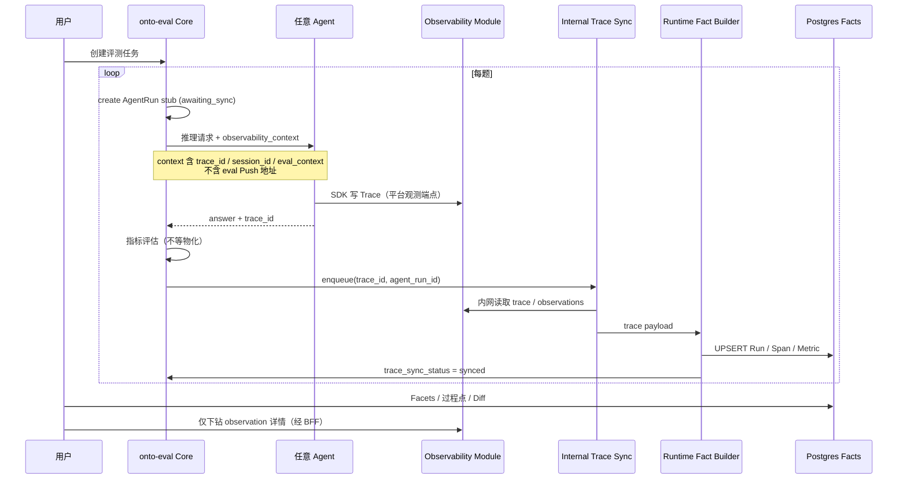

# 备选架构方案 B — Langfuse 内嵌模块与 eval 侧统一物化

> **地位**：相对 [onto-eval评测优化架构设计说明书.md](./onto-eval评测优化架构设计说明书.md)（下称**基线 v1.20**）的**并行备选**，供架构评审与对外 Agent 对接口径使用。  
> **不替代基线**：基线仍为 CTO 审视与当前交付依据；本文描述「第三条路上升为主路径 + Langfuse 平台内化」时的目标态。  
> **关联**：[设计范式.md](./设计范式.md) · [架构评审-P2前战略修正.md](./架构评审-P2前战略修正.md) · [Langfuse-Webhook配置指南.md](./Langfuse-Webhook配置指南.md) · [onto-agent-最小改动清单.md](./onto-agent-最小改动清单.md)

| 项目 | 内容 |
|------|------|
| 文档名称 | 备选架构 B：Langfuse 作为 onto-eval 观测子模块 |
| 版本 | **v0.1** |
| 状态 | **草案 · 待评审** |
| 日期 | 2026-06-04 |
| 基线对照 | 基线 §1.4 边界图 · §5 模块划分 · §7.5 事实流水线 · §15 未采纳方案 |

---

## 0. 一句话摘要

**Langfuse 不再作为「第三方观测系统」单独采购与对接，而是作为 onto-eval 的 `Observability Module` 同栈部署；事实物化由 eval 平台在推理结束后内部触发（内网 Pull / DB 变更监听），Agent 只需「推理 + 写 Trace 到平台发放的观测端点」，无需实现 `onto_eval_push`、无需绑定 onto-agent 专有 sync 契约。**

---

## 1. 动机：基线架构被误读的问题

基线 v1.20 在技术上已区分三条物化路径（Webhook / Agent Push / legacy_pull），但**默认部署与文档示例**绑定 onto-agent 参考实现，导致：

| 现象 | 根因 |
|------|------|
| 第三方 Agent 认为必须实现 Push 双写 | 默认 `FACT_INGEST_MODE=push` + 联调脚本围绕 `onto_eval_push.py` |
| Langfuse 被当作独立产品对接 | 多项目 Key、Webhook 跨网、Agent 与 eval 各配一套 LF 地址 |
| ST-3 / `agent.*` 像准入门槛 | 文档与 OpenAPI 以 first-party 深度集成为样板 |
| 「第三条路」地位过低 | `legacy_pull` 标为 dev/回填，生产主路径未强调 eval 侧闭环 |

**本备选方案的目标**：在**不推翻** Execution Fact Layer、Postgres 分析 SoR、OTel Attributes 契约的前提下，把**集成复杂度从 Agent 收回 eval 平台**，并把 Langfuse **产品边界内化**。

---

## 2. 与基线架构的关系

| 维度 | 基线 v1.20（现行） | 备选 B（本文） |
|------|-------------------|----------------|
| 分析 SoR | Postgres Runtime Facts | **不变** |
| Raw Trace SoR | 外部 Langfuse 实例 | **Langfuse = onto-eval 观测子模块**（同 compose / 同运维域） |
| 物化主路径 | Push（Agent）或 Webhook | **eval 内部 Sync**（推理完成 → 平台调度 → 读内嵌 LF → Builder） |
| Agent Push | 推荐（H-01） | **可选兼容**；新 Agent **不要求** |
| Agent 适配 | onto-agent 最小改动清单 AG-01/02 | **通用接入规范**（见 §6） |
| 设计范式 P-17 | LF 仅证据下钻 | **不变**（UI 仍经 BFF；LF 不对业务方暴露为独立产品） |

**保留的不变约束**（[设计范式.md](./设计范式.md)）：

- P-03～P-05：跨版本契约在 `agent.*` / JSONPath，不在 observation.name  
- P-06：评测热路径**不同步**全量扫 Trace 算分（物化仍异步 Job）  
- P-09：不全量双写 observation 正文进 PG  
- P-15～P-17：Diff / Analytics 读 PG 物化表；LF 模块供证据详情  

---

## 3. 系统边界图（目标态）

```
┌─────────────────────────────────────────────────────────────────────────────┐
│                        onto-eval 平台（统一部署单元）                          │
│                                                                             │
│  ┌──────────────┐   注册/推理    ┌─────────────────────────────────────┐   │
│  │ 任意 Agent   │ ────────────► │ L5 集成层 · Inference Gateway        │   │
│  │ (含 onto-agent│               │ 通用 HTTP / OpenAI-compat / 模板   │   │
│  │  第三方框架) │               └──────────────┬──────────────────────┘   │
│  └──────▲───────┘                              │                             │
│         │ OTel / Langfuse SDK                  │ Run stub + 评估            │
│         │ (平台发放的单一观测端点)              ▼                             │
│         │               ┌─────────────────────────────────────────────┐   │
│         └──────────────►│ Observability Module（原 Langfuse，内嵌）      │   │
│                         │ · Raw Trace / Observation 存储               │   │
│                         │ · 不对业务方单独售卖/单独域名（默认）         │   │
│                         └──────────────┬──────────────────────────────────┘   │
│                                        │ 内网：Public API / PG NOTIFY / 轮询 │
│                                        ▼                                      │
│                         ┌─────────────────────────────────────────────┐   │
│                         │ L3 物化层 · Internal Trace Sync（主路径）     │   │
│                         │ trace_sync_scheduler → runtime_fact_builder │   │
│                         └──────────────┬──────────────────────────────────┘   │
│                                        ▼                                      │
│                         ┌─────────────────────────────────────────────┐   │
│                         │ Postgres · Runtime Facts（分析 SoR）          │   │
│                         └──────────────┬──────────────────────────────────┘   │
│                                        ▼                                      │
│              L2 分析 · L1 体验（评测 / Diff / 过程点 / Trace 探索）          │
└─────────────────────────────────────────────────────────────────────────────┘

  可选兼容（非默认）：
    · Agent Push → /trace/ingest/push（与基线相同，first-party 低延迟）
    · 外接 Langfuse Cloud（混合云 / 迁移期）
```

**与基线边界图（§1.4）的关键差异**：Langfuse 框**移入** onto-eval 大边界；Agent 到 eval 的箭头**仅保留推理**；物化箭头**不再依赖 Agent 回推**。

---

## 4. 模块划分

### 4.1 平台模块（相对基线 §5.2 的调整）

| 模块 ID | 名称 | 职责 | 对业务方可见性 |
|---------|------|------|----------------|
| **M-core** | onto-eval Core | 评测 Pipeline、Agent 注册、指标、过程点、Diff、报表 | ✅ 主产品 |
| **M-obs** | Observability Module | Langfuse 运行时（API + Worker + 专用 DB/schema） | ⚙️ 仅「Trace 探索 / 下钻」；**默认无独立 LF 控制台账号** |
| **M-ingest** | Internal Fact Sync | 推理完成后按 `trace_id` 调度物化；读 M-obs | ❌ 内部 |
| **M-bind** | Trace Binding Registry | `scenario_steps.yaml`、span 规则、金标 → `match_rules`（ST-3 配置面） | ✅ 过程点/场景配置 UI |

基线中的 **L5 Langfuse BFF** 保留，但后端目标从「外网 LF 实例」改为 **M-obs 内网 endpoint**；`langfuse.projects.json` 收敛为**平台内部 project 路由**（按 `logical_agent_id` / 评测任务分 project，对 Agent 透明）。

### 4.2 Observability Module 部署形态（三选一，评审择一）

| 形态 | 说明 | 适用 |
|------|------|------|
| **B1 同栈容器** | `docker-compose` 增加 `langfuse-web` / `langfuse-worker` / 独立 PG 或 schema | 私有化一键部署（**推荐默认**） |
| **B2 进程内 SDK 存储** | 长期：自研精简 Observation 表，兼容 LF Public API 形状 | LF 许可证或运维约束强时 |
| **B3 混合** | 生产内嵌 B1；开发可连 LF Cloud | 迁移过渡期 |

**产品表述**：对外称 **「onto-eval 推理观测」**，Langfuse 作为**实现组件**写在技术附录，不作为对接方名称出现。

---

## 5. 数据流：在线评测（主路径）

### 5.1 序列（第三条路上升为主路径）



### 5.2 与基线 §7.5 路径对照

| 路径 | 基线 v1.20 定位 | 备选 B 定位 |
|------|----------------|-------------|
| A Langfuse Webhook | 可选 | **可选**（M-obs 若支持且同域，可内网 Webhook 到 M-ingest） |
| B Agent Push | **推荐主路径** | **兼容**；onto-agent 可保留，第三方默认不实现 |
| C legacy_pull Worker | dev/回填 | **生产主路径**（ rebranded：`internal_sync`） |

### 5.3 配置项（相对基线）

```env
# 备选 B 默认
FACT_INGEST_MODE=internal_sync
TRACE_SYNC_WORKER_ENABLED=true          # 内网 Worker，非「外拉第三方 LF」
OBS_MODULE_ENDPOINT=http://langfuse:3000  # compose 内网
OBS_MODULE_MODE=embedded                  # embedded | external（迁移）

# 兼容基线（已废弃 v1.22）
FACT_INGEST_MODE=push                     # 已废弃，不再作为物化路径
ONTO_EVAL_PUSH_ENABLED=true               # 已废弃，Agent 无需配置
```

**语义变化**：`internal_sync` 与基线 `legacy_pull` **代码可复用**，但：

- 读的是**同栈 M-obs**，无跨网 SLA、无第三方配额谈判  
- Worker 与 API **默认可启**，不再标 deprecated  
- 调度由 Pipeline 在拿到 `trace_id` 后**立即入队**（仍异步，满足 P-06）

---

## 6. Agent 接入规范（通用 vs 深度）

对外只发布**一张表**，避免与 onto-agent 最小改动清单混用：

| 等级 | 名称 | Agent 必须做什么 | 不需要做什么 | 能力上限 |
|------|------|------------------|--------------|----------|
| **L0** | 黑盒推理 | 返回 `answer`（+ 可选 `trace_id` 字符串） | Langfuse、Push、agent.* | 终局指标；无过程点/Diff |
| **L1** | 标准观测（**默认准入**） | 向平台发放的 OTel/LF endpoint 写 Trace；响应含 `trace_id` | Push eval、scenario_steps、onto-agent sync 专有字段 | 过程点（规则/template）；版本 Diff；异步物化 |
| **L2** | 语义增强 | metadata 写推荐 `agent.*`（step.id / tool.name / version） | Push、registry | aggregate_key 稳定；Semantic Diff 质量高 |
| **L3** | 同构深度（onto-agent） | L2 + 可选 Push + ST-3 联调 API | — | 最低物化延迟；INT 联调探针 |

**双 Push（基线 AG-02）在备选 B 中的定位**：

- **不是**「Langfuse + eval 双写」的通用要求  
- **仅是** L3 优化：Agent 在写 M-obs 之外，额外 POST 结构化 Fact，跳过 Sync 队列  
- 第三方 Agent **L1 即可上线评测**

### 6.1 平台侧代替 Agent 承担的职责

| 原 Agent 侧能力 | 备选 B 归属 |
|-----------------|------------|
| `onto_eval_push.py` | M-ingest Internal Sync |
| `scenario_steps.yaml` 运行时解析 | M-bind（eval 配置）+ Builder 归一化 |
| `trace_id = uuid5(session, run)` 对齐 | Inference Gateway 在 `observability_context` 下发；Agent 原样使用 |
| Langfuse project / Key 管理 | 平台按 Agent 注册自动签发短期 Key 或走网关代理 |
| Webhook 跨网配置 | 同栈内网 optional |

---

## 7. Trace 模型与 ST-3（过程点绑定）

基线 §8.8 OTel Attributes 契约**不变**。备选 B 仅调整 **谁生产 business step id**：

| 策略 | 执行位置 | 说明 |
|------|----------|------|
| 规则绑定 | M-bind + `checkpoint_match_rules` | span_name / jsonpath / keywords（现有 M2） |
| 配置绑定 | M-bind 导入 `scenario_steps.yaml` | **不进 Agent runtime**；Builder 或 Batch Preview 阶段匹配 |
| 语义绑定 | L2 Agent 上报 `agent.step.id` | 精度最高；**推荐但非必须** |

**ST-3 需求规格**中的 HTTP 探针 API 改为 **eval 侧能力**（读 PG + M-obs），Agent 无需暴露 `/agentic/scenario/*`。

---

## 8. 存储架构

| 存储 | 内容 | 备注 |
|------|------|------|
| **M-obs DB** | 全量 Trace / Observation / Score | 基线 Raw SoR；物理上可与 Fact PG 同实例不同 schema |
| **Postgres Facts** | agent_runs、run_span_nodes、checkpoint_results… | 分析 SoR；**不变** |
| **SQLite** | 本地调试 | 可选；M-obs 可用内存/轻量 PG |

**不采纳**：为「内化 LF」而把 observation 全量搬进 Fact PG（仍遵守 P-09）。

---

## 9. 与基线实现的迁移路径

| 阶段 | 动作 | 风险 |
|------|------|------|
| **P0 文档** | 对外发布 L0～L3 接入表；本备选 B 与基线并行陈述 | 低 |
| **P1 部署** | compose 内嵌 Langfuse；`OBS_MODULE_ENDPOINT` 指向内网 | 运维接受同栈升级 |
| **P2 配置** | 新环境默认 `FACT_INGEST_MODE=internal_sync`；旧环境保持 push | 双模式并存 |
| **P3 绑定** | `scenario_steps` 迁入 eval/ontology 仓库；弱化 Agent registry | 与 onto-agent ST-3 代码重复，需取舍 |
| **P4 产品** | Trace 探索 UI 品牌化为「推理观测」；隐藏 LF 管理入口（可选） | 培训成本 |

**onto-agent 已实现的 Push / step_registry**：在备选 B 下作为 **L3 _fast path** 保留，无需回滚。

---

## 10. 风险、取舍与 ADR 备选

### 10.1 优势

- **Agent 对接通用化**：第三方只需 L1（推理 + 写 Trace 到平台 endpoint）  
- **运维一体化**：一个 compose、一套备份、无「LF 挂了 eval 物化全停」的跨组织扯皮  
- **安全面收敛**：观测端点与 eval 同域；无需 Agent 持有 eval ingest URL  
- **与「第三条路」一致**：物化责任在平台，符合 Execution Fact Layer ownership  

### 10.2 代价

| 风险 | 缓解 |
|------|------|
| 平台包体积与 LF 许可证 | B1 容器化；法务评审；长期 B2 可替换 |
| internal_sync 延迟高于 Push | P95 目标仍 60s；L3 Push 补偿；热路径仍不等物化 |
| 基线 ADR-027「禁止默认轮询」的表述冲突 | 新 ADR-B01：**禁止的是跨网拉第三方 LF**；同栈 internal_sync 除外 |
| 多租户 LF project 管理复杂度 | 收敛到平台内部；Agent 无感 |

### 10.3 备选 ADR（待正式登记）

| ADR | 决策 |
|-----|------|
| **ADR-B01** | Langfuse 作为 onto-eval Observability Module 同栈部署；对外不列为独立对接系统 |
| **ADR-B02** | 默认物化路径 = `internal_sync`；Agent Push 降级为 L3 可选 |
| **ADR-B03** | Agent 通用接入 = L1；`agent.*` = L2 推荐；ST-3 registry = 平台配置非 Agent runtime |

---

## 11. 对照基线 §15「为什么没采用其它方案」

| 基线未采纳项 | 备选 B 的态度 |
|--------------|---------------|
| OpenTelemetry 自建为主 | **部分采纳**：M-obs 可逐步替换为自研 Observation 表，API 形状兼容 |
| 全量 Trace 同步到 SQLite | **仍不采纳**；仅摘要物化 |
| Pipeline 内同步物化 | **仍不采纳**；Worker 异步 |
| Langfuse iframe 嵌入 | **仍不采纳**；自有 Trace 探索 + 评测语义 |
| Facets 长期扫 Langfuse | **仍不采纳**；Facets 读 PG，M-obs 仅补详情 |

| 基线已采纳、备选 B 调整项 | 说明 |
|---------------------------|------|
| Agent Push 主路径 | 降为 L3 可选 |
| legacy_pull deprecated | 升级为 internal_sync 主路径 |
| Langfuse 第三方 | 改为内嵌模块 |

---

## 12. 评审结论模板（会议用）

| 问题 | 备选 B 回答 |
|------|-------------|
| Langfuse 还是第三方吗？ | **默认不是**；内嵌为 M-obs；混合云仅为迁移选项 |
| 其他 Agent 要做双 Push 吗？ | **不要**（L1）；onto-agent 可 L3 Push |
| 其他 Agent 要做 ST-3 registry 吗？ | **不要**；平台 M-bind 配置 |
| 第三条路能用吗？ | **能，且应作为默认生产路径**（同栈 internal_sync） |
| 设计范式要改吗？ | **核心不变**；ADR-027 措辞需补充「同栈 sync ≠ 外拉 LF」 |

---

## 13. 变更记录

| 日期 | 版本 | 说明 |
|------|------|------|
| 2026-06-04 | v0.1 | 初稿：Langfuse 内嵌 + internal_sync 主路径 + L0～L3 Agent 分级 |

---

## 附录 A — docker-compose 示意（B1 同栈）

```yaml
# 片段示意，非完整 compose
services:
  onto-eval-api:
    environment:
      FACT_INGEST_MODE: internal_sync
      OBS_MODULE_ENDPOINT: http://langfuse-web:3000
      DATABASE_URL: postgresql+asyncpg://onto_eval:@postgres:5432/onto_eval_fact

  langfuse-web:
    image: langfuse/langfuse:latest
    environment:
      DATABASE_URL: postgresql://langfuse:@postgres:5432/langfuse_obs
    # 仅内网暴露；不对 Agent 单独售卖

  langfuse-worker:
    image: langfuse/langfuse-worker:latest

  postgres:
    image: postgres:16
    # schema: onto_eval_fact + langfuse_obs
```

## 附录 B — 对外一句话（商务/架构口径）

> **onto-eval 是评测与分析平台；推理观测是其内置模块。Agent 只需调用评测推理接口并把 Trace 写到平台提供的观测端点，过程分析、版本对比与过程点判定由平台异步完成，无需为 onto-eval 单独开发 Push 或场景注册表。**
