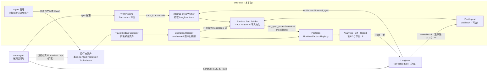
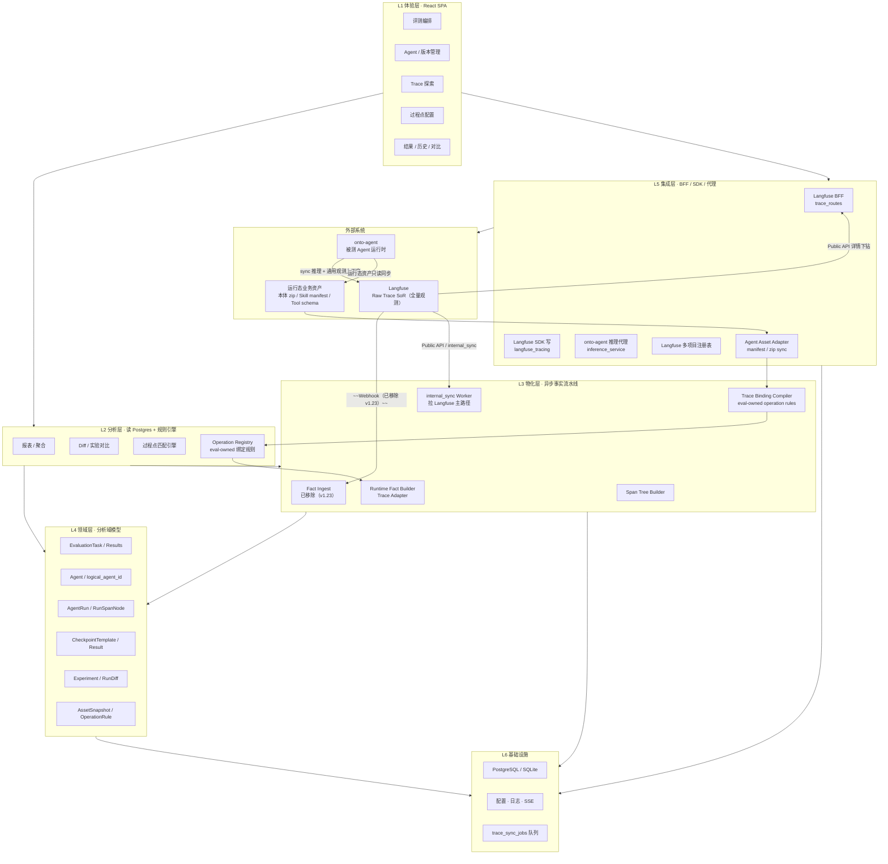
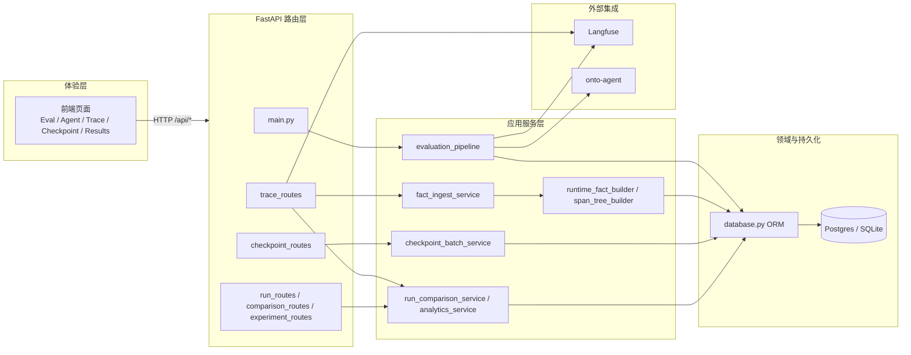
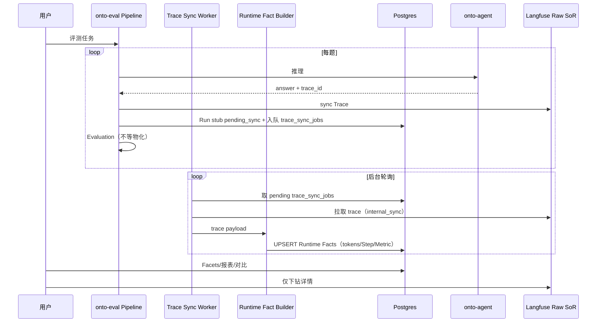

# onto-eval 架构设计说明书

## 文档信息

| 项目 | 内容 |
|------|------|
| 文档名称 | onto-eval 推理观测与分析平台 — 架构设计说明书 |
| 版本 | **v1.25** |
| 状态 | **CTO 审视基线**（P2～P5 代码 ✅；**P2.5 生产门禁 / ingest E2E**仍 OPEN；**§21 GAP 与待办**；**§22 DeepEval Metrics 融合方案**；**§23 四维评估维度体系**；**§24 MCP Server**；**§25 评测报告导出**；**§26 并发与性能优化**） |
| 日期 | 2026-08-13 |
| 修订说明 | v1.25：**四维评估维度体系落地**——质量指标 / 过程一致性 / 运行稳定性 / 场景交付四维 verdict-bar 统一，6 种 gate 门禁先封类别分再封 total，稳定性分重构为质量+性能双子分，`dimension_flags` 维度勾选（023 migration）；新增 **MCP stdio Server**——`evaluate_answer` / `list_metrics` 工具 + `/api/v1/evaluate/single` 单题同步端点 + `EVAL_SINGLE_TOKEN` 鉴权；新增 **8-sheet 评测报告导出**——`/reports/evaluation` 端点 + 指标名与 web 一致；新增 **指标参数动态配置**——`system_configs` 表 + 系统设置页 deepeval 指标参数 CRUD；**评测模式重命名**——关键词评测→Ground_Truth评测，提示词评测→基于Prompt评测（028 migration）；**并发与性能优化**——题目级并发 + Judge 并发 + 推理轮次并发 + LLM 调用 P50/P95/P99 统计 + 忠诚度无知识库 BM25 中性降级；**trace 展示公共模块**——`DrawerShell` + `LangfuseTraceBlock` + `useLangfuseHost`；新增 **使用指引页** `GuidePage`。v1.24：新增 **§22 DeepEval Metrics 融合方案**——引入 DeepEval 声明式指标注册表（28 项指标）与自定义指标（geval/dag/code 三档），通过适配器模式融入在线/离线评测管线，DeepEval 作为可选依赖不侵入既有管线。v1.23：**Webhook/Push 摄入路径全部移除**，`FACT_INGEST_MODE` 配置项已删除，统一使用 Trace Sync Worker 作为唯一物化路径；`awaiting_push`/`awaiting_webhook` 状态统一为 `pending_sync`；v1.22：新增 **eval-owned Trace Binding Compiler / Operation Registry**，由 eval 侧同步 Agent 运行态本体/Skill 资产并编译过程绑定规则，业务团队不维护 trace 埋点；v1.21：CTO 决策更新——Langfuse 作为 onto-eval 观测模块后，onto-agent 双 Push 不再是默认/必需接入链路；`internal_sync` 成为第三方 Agent 默认物化路径，`/trace/ingest/push` 保留为 onto-agent / first-party 快路径。v1.20：**Judge 轮次 Phase2** |
| 关联文档 | **[设计范式.md](./设计范式.md)** · [P2-任务清单.md](./P2-任务清单.md) · **UI Demo：`docs/demo/index.html`** · [架构评审-Execution-Fact-Layer.md](./架构评审-Execution-Fact-Layer.md) · [架构评审-领域模型-评测与观测解耦.md](./架构评审-领域模型-评测与观测解耦.md) · [架构评审-P2前战略修正.md](./架构评审-P2前战略修正.md) · [架构评审-已知系统耦合-C01-C04.md](./架构评审-已知系统耦合-C01-C04.md) · [架构评审-重构风险-RF01-RF03.md](./架构评审-重构风险-RF01-RF03.md) · [Langfuse-Webhook配置指南.md](./Langfuse-Webhook配置指南.md) · [onto-agent-observability.md](./onto-agent-observability.md) · [备选架构-Langfuse独立部署与PG合一.md](./备选架构-Langfuse独立部署与PG合一.md) |

### 文档目录（对照清单）

| 序号 | 章节 | 本文档位置 |
|------|------|------------|
| 1 | 系统目标 | §1 |
| 2 | 当前业务场景 | §2 |
| 3 | 用户角色 | §3 |
| 4 | 当前约束 | §4 |
| 5 | 模块划分 | §5（含 §5.1 分层图、§5.2 各层功能说明） |
| 6 | 技术栈 | §6 |
| 7 | 数据流 | §7（含 §7.5 异步事实流水线） |
| 8 | Trace 模型 | §8（含 §8.8 OTel Attributes） |
| 9 | Evaluation 模型 | §9 |
| 10 | Diff 模型 | §10（含 §10.8 五类扩展谱系） |
| 11 | 存储架构 | §11 |
| 12 | 当前技术债 | §12 |
| 13 | 已知问题 | §13 |
| 14 | 为什么这样设计 | §14 |
| 15 | 为什么没采用其它方案 | §15 |
| 16 | 当前 M1/M2 实现内容 | §16 |
| 17 | M3/M4/M5 规划 | §17 |
| 18 | 未来演进方向 | §18 |
| 19 | 当前风险 | §19 |
| 20 | 当前假设 | §20 |
| 21 | **CTO 审视：GAP 与待办** | **§21**（v1.19） |
| 22 | **DeepEval Metrics 融合方案** | **§22**（v1.24） |
| 23 | **四维评估维度体系** | **§23**（v1.25） |
| 24 | **MCP Server 与单题评测端点** | **§24**（v1.25） |
| 25 | **评测报告导出** | **§25**（v1.25） |
| 26 | **并发与性能优化** | **§26**（v1.25） |
| — | **P2.5 部署与 CI** | [P2.5-部署与CI.md](./P2.5-部署与CI.md) · [G-01-PG切换Runbook.md](./G-01-PG切换Runbook.md) · [G-06-生产VM部署步骤.md](./G-06-生产VM部署步骤.md) |
| — | **设计范式（宪法）** | [设计范式.md](./设计范式.md) |
| — | **P2 用户待办** | [P2-用户待办汇总.md](./P2-用户待办汇总.md) |
| — | **P2 任务清单** | [P2-任务清单.md](./P2-任务清单.md) |
| — | **P2 前战略修正 / Webhook** | [架构评审-P2前战略修正.md](./架构评审-P2前战略修正.md) · [Langfuse-Webhook配置指南.md](./Langfuse-Webhook配置指南.md) |
| — | **系统耦合 / 重构风险** | [C01-C04](./架构评审-已知系统耦合-C01-C04.md) · [RF01-RF03](./架构评审-重构风险-RF01-RF03.md) |
| — | **轻量部署备选 C** | [备选架构-Langfuse独立部署与PG合一.md](./备选架构-Langfuse独立部署与PG合一.md) |

> **治理**：任何需求/建议实现前对照 [设计范式.md](./设计范式.md)。超出 Invariant 时须用该文档 §5.3 模板**明示冲突**；AI 与研发同等适用（`.cursor/rules/onto-eval-design-paradigm.mdc`）。

---

## 1. 系统目标

### 1.1 总体目标

构建**面向 Agent 时代的推理观测与分析平台**（onto-eval），在评测场景下实现：

1. **可评测**：对 onto-agent 等消费者 Agent 进行批量/在线评测，输出多维度质量分数。
2. **可观测**：推理过程写入 Langfuse，在评测语境下按任务、题目、版本筛选与下钻。
3. **可对比**：支持多版本 Agent 在同题上的分数、成本、过程合规与路径差异分析。
4. **可演进**：以 **Execution Fact Layer**（AgentRun / RunStep / RunMetric / CheckpointResult）为分析域，Langfuse 仅 Collector + 证据下钻，避免「Langfuse 套壳 UI」。

### 1.2 分项目标（与需求清单对应）

| 需求域 | 目标 | 阶段 |
|--------|------|------|
| Langfuse Trace 融合 | 评测写入规范 + BFF 读 + 探索页 | P0（M1）✅ |
| Agent 多版本对比 | 版本注册、筛选、实验报告、**三层驾驶舱**（Outcome→因子→过程点） | P0 ✅ / P3 增强 |
| 推理路径对比 | Span Tree 物化 + Metric/Event Diff + 双树 UI（MVP） | P3–P4 |
| 耗时 / tokens / 评分统计 | Run 摘要物化 + 任务/版本聚合；质量指标与运行效率指标分层展示 | P1–P3 |
| 推理质量评估 | 现有 faithfulness / relevancy / correctness 等 | 已有 |
| Agent 优化分析 | 过程点 + 对比报告 +（未来）RCA 摘要 | P2–P5 |

### 1.3 非目标（边界）

- 不替代 Langfuse 成为全公司级 APM。
- 不在首期自建全量 Trace 存储与 OLAP 平台。
- 不承诺生产环境 7×24 实时告警（可未来扩展）。

### 1.4 系统边界图（v1.12 目标态）



**当前默认（P2.5 / v1.23）**：`docker-compose.yml` 含 **PostgreSQL 16** + app；`DATABASE_URL` 默认 `postgresql+asyncpg://...@postgres:5432/onto_eval_fact`；评测 Pipeline 写 Langfuse；eval 侧通过 **internal_sync Worker** 物化 Trace（**唯一物化路径**）；**Webhook/Push 摄入路径已全部移除（v1.23）**，不再依赖外部推送；Facets 优先 Run 表。SQLite 仅作本地调试回退（见 `.env.example`）。

#### 1.4.1 CTO 决策：Langfuse 模块化后的轻量部署与 Agent Push 取消

生产已采用轻量方案 C：**Langfuse v3.173.0 OSS 继续独立部署，onto-eval 复用 Langfuse PostgreSQL 实例并新增 `onto_eval_fact` database**。Langfuse 的 ClickHouse / Redis / MinIO / worker 继续由 Langfuse 栈管理；onto-eval 的 `Runtime Fact Builder`、`run_span_nodes`、`run_metrics`、`checkpoint_results` 继续作为分析事实层保留。

在该决策下，onto-agent 的"双 Push"已**完全取消**（非降级可选），减少对 Agent 的依赖，保证对各种 Agent 评测的通用性：

```text
唯一物化路径（internal_sync）：
  Agent → Langfuse SDK 写 Trace
  onto-eval → internal_sync Worker 拉 Langfuse trace
  Runtime Fact Builder → run_span_nodes / run_metrics / checkpoint_results

注：Webhook/Push 摄入路径已全部移除（v1.23），不再依赖外部推送。
```

架构边界：

- **所有 Agent（含 first-party）均不要求实现 `onto_eval_push`**。`/trace/ingest/push` 端点已废弃，不再维护。
- Trace 业务打点（`agent.*` attributes、步骤埋点等）由 **eval 侧** 实现，不依赖 Agent 侧维护任何 eval 专属埋点契约。
- 过程评测依赖 **Langfuse trace + Runtime Fact Builder + eval-owned Operation Registry**，不依赖 Push，也不要求业务 Skill / 本体团队维护 trace 埋点。
- `internal_sync` Worker 为默认物化路径，可能带来短暂 `pending_sync`，但不影响最终过程评测；由 Worker 重试与 UI 状态表达兜底。

#### 1.4.2 CTO 决策：eval-owned 业务打点与 Trace Binding

**组织边界**：Skill / 本体由各业务团队负责，业务团队不应被要求维护 `agent.step.id`、`scenario_steps.yaml` 或任何 eval 专属 trace 埋点。Trace 业务打点的治理责任在 **onto-eval**。

v1.22 采用 **eval-owned Trace Binding Compiler + eval 侧打点注入**：

```text
eval 侧独立维护 Operation Registry（打点规则）
  → eval 在推理 context 中注入业务 metadata / 在 Builder 后处理时添加操作识别
  → Runtime Fact Builder / Trace Adapter 在物化时匹配 observation
  → run_span_nodes 写入 eval.operation.id / binding_rule_id / confidence
  → 过程点、场景子步骤、Diff 绑定 eval.operation.id
```

关键原则：

- **不实时解析热路径 zip**：资产变化时编译 registry；评测运行时只读已版本化规则，保证性能、复现和审计。
- **不要求业务团队埋点**：业务团队维护本体/Skill 原始资产；eval 侧从资产中生成操作清单和匹配规则。
- **Agent 平台只提供通用上下文**：trace 中保留 tool name、script/action path、input 摘要、父子结构、token/latency；这些属于平台级观测，不是业务埋点。
- **`agent.step.id` 降为增强项**：若 Agent 已上报，可作为高置信规则输入；若未上报，eval 仍可通过 Operation Registry 后置打标。
- **无本体 Agent 单独处理**：有 tool schema/OpenAPI 时扫描工具清单；纯黑盒 Agent 走 trace 样本推荐 + 人工确认。

---

## 2. 当前业务场景

### 2.1 三件套协作关系

| 系统 | 角色 |
|------|------|
| **onto-agent** | 消费者 Agent 运行时；评测对象；提供 sync 推理与工作空间 |
| **Langfuse** | 推理 Trace/Observation 存储与查询 |
| **onto-eval** | 评测编排、Agent 注册、结果分析、过程点配置、Trace 探索 |

### 2.2 典型业务流（今天已在跑）

**场景 A：离线评测**

1. 上传/管理评测集（题目 ± 标准答案）。
2. 选择已有答案或仅题目，配置 LLM 评估模型，创建评测任务。
3. 系统按题计算指标，结果入库，SSE 展示进度。

**场景 B：在线评测（主路径）**

1. 在 Agent 管理中注册 Agent（含推理 URL、鉴权、工作空间、payload 模板）。
2. 同一逻辑 Agent 可注册多个 **version**（发版用「新版本」，不改旧记录）。
3. 评测页选择数据集 + Agent，触发在线任务。
4. 系统调用 onto-agent 获取 `model_answer`，同时经 SDK 写 Langfuse Trace。
5. 再对答案跑评估指标，写入 `evaluation_results`。
6. 用户在结果页查看分数；在 Trace 探索按 `task_id` / 题目 / Agent 名称筛选下钻。

**场景 C：过程点配置（M2）**

1. 按 Agent 名称（逻辑 Agent）配置过程点模板与 `match_rules`。
2. 对单条 Langfuse `trace_id` 试跑 preview（尚未批量接入评测流水线）。

**场景 D：运行态资产同步与 Operation Registry（v1.22）**

1. 消费者 Agent 在自身平台上传本体 zip / Skill 包，业务团队不维护 trace 埋点。
2. eval 的 Agent 管理页点击「同步运行态资产」：读取 manifest（优先）或 zip（兜底），记录 `asset_hash`、版本与解析日志。
3. Trace Binding Compiler 生成 eval-owned `operation_id` 与 match_rules，用户在 UI 上一键启用或调整显示名/优先级。
4. 场景子步骤配置页下拉选择 `eval_operation_id`，而非手填 `agent.step.id`。
5. 后续评测运行时只用已版本化 registry 归一 trace，不再实时解析 zip。

**场景 E：多项目 Langfuse**

1. 通过 `langfuse.projects.json` 配置多项目 Key。
2. Trace 探索切换 project，写入项目可配置 `LANGFUSE_WRITE_PROJECT`。

### 2.3 当前尚未闭环的场景

- 评测完成后**自动**过程点合规评估与 Tab 展示（原 M3）。
- 同题多版本**物化报告**（分数 + token + 合规一行对比）（原 M5）。
- Step 路径级 Diff 报表（原 M4）。
- 生产流量持续观测（非评测任务驱动）。
- Trace Binding Compiler / Operation Registry 的产品化 UI 与表结构（v1.22 规划）。

---

## 3. 用户角色

| 角色 | 核心目标 | 平台应提供 |
|------|----------|------------|
| **Agent 开发者** | 发版回归、定位失败步骤 | 版本对比、Step diff、Trace 下钻 |
| **Prompt / 工作流工程师** | 改 prompt/工具链后验证行为 | 同题对比、过程点合规、检索/工具差异（中期） |
| **AI 评测人员** | 批量评测、可复现报告 | 任务矩阵、分数+耗时+token+合规率 |
| **Agent 产品 / 业务负责人** | 能力是否达标 | 版本胜率、关键场景通过率 |
| **CTO / 管理层** | 投入产出与风险 | 跨任务/Agent 汇总（需聚合层） |

**看 Trace 的主要动机（评测语境）**：评测归因 > Agent/Prompt 调优 > 过程合规 > 多版本/成本对比 > 单次 Debug >> 线上 SLA。

---

## 4. 当前约束

### 4.1 技术约束

| 约束 | 说明 |
|------|------|
| 数据库 | SQLite 异步单库，适合中小任务量，分析查询与并发有限 |
| Trace 存储 | 依赖 Langfuse 实例可用性；Public API 分页与扫描有上限 |
| 前端代理 | Vite 将 `/api` rewrite 为无前缀路径，后端须双挂载路由 |
| 浏览器安全 | 不可直连 onto-agent/Langfuse，须经 BFF/后端代理 |
| Langfuse SDK | v4+ `propagate_attributes` 写入规范，与 UI 版本需匹配 |
| onto-agent 协议 | 以 `/agentic/runs/sync` 为主，observation 命名未完全标准化 |

### 4.2 组织与产品约束

| 约束 | 说明 |
|------|------|
| 里程碑节奏 | v2.1 已交付 M1/M2；**战略暂停**原 M3/M4/M5 编码，待 P1 评审 |
| 团队规模 | 倾向 MVP + Job 表，不首期引入 Kafka/Flink |
| 多项目 | 至少支持 3 个 Langfuse 项目 Key（配置文件） |
| Agent 版本模型 | 一行一版本；名称与 `logical_agent_id` 业务绑定 |

### 4.3 合规与安全约束

- Langfuse / onto-agent API Key 仅服务端配置，不下发前端。
- 评测数据与 Trace 可能含业务题干，部署需内网或受控环境。

### 4.4 依赖约束

- Langfuse PostgreSQL 必须就绪，否则 Public API 可能返回误导性 401。
- onto-agent 可达性、Token 有效性直接影响在线评测与拉工作空间列表。
- **事实摄入**：默认由 **`internal_sync` Worker** 物化（无需额外配置）；Langfuse Webhook 为可选等价路径。Agent 双写 Push 已取消，不再作为摄入路径。

### 4.5 运维 SLO（目标，P2 验收）

| 指标 | 目标 | 说明 |
|------|------|------|
| ingest → Builder 完成 | P95 &lt; 60s | `internal_sync` Worker 至 `trace_sync_status=synced` |
| 评测热路径 | 不阻塞物化 | Pipeline 不等 Builder |
| Langfuse 不可用 | 评测可写 trace；分析空态有产品规则 | TD-P2-09 |

---

## 5. 模块划分

### 5.1 架构分层总览

onto-eval 与 **onto-agent**、**Langfuse** 协作，整体采用「**体验 → 分析 → 物化 → 领域 → 集成 → 基础设施**」六层模型。上层只依赖下层能力；**读分析**以 Postgres Runtime Facts 为主，**写热路径**经 Langfuse Collector，**证据下钻**回 Langfuse Public API。

#### 5.1.1 三系统协作分层图



#### 5.1.2 onto-eval 内部分层依赖图



#### 5.1.3 分层职责一览（简表）

| 层级 | 核心职责 | 主要消费者 | 关键约束 |
|------|----------|------------|----------|
| **L1 体验层** | 评测人员操作入口；展示分数、Trace、过程点与对比结果 | 开发者、评测员、产品 | 不直连 Langfuse / onto-agent；经 BFF |
| **L2 分析层** | 在物化事实上做聚合、Diff、过程点判定、实验统计 | 体验层、报告 API | **读 PG 为主**；Langfuse 仅下钻证据 |
| **L3 物化层** | 将 Raw Trace 转为 Runtime Facts | 分析层、评测 Pipeline 后置 | v1.23 起 **internal_sync Worker 唯一物化路径**；Webhook/Push 已移除 |
| **L4 领域层** | 稳定分析域实体与关系（Run、Span、Checkpoint 等） | 物化层写、分析层读 | 不以 Langfuse observation.name 为跨版本强绑定 |
| **L5 集成层** | 对外系统协议适配、鉴权、多项目 Key 路由 | Pipeline、Trace 探索、Preview | API Key 仅服务端 |
| **L6 基础设施** | 存储、配置、可观测、异步队列 | 全栈 | P2 目标 **Postgres 为分析 SoR** |

### 5.2 各层与模块功能说明

#### 5.2.1 外部协作系统

| 模块 | 功能介绍 |
|------|----------|
| **onto-agent** | 被测消费者 Agent 的运行时。评测时接收 onto-eval 下发的题目与推理配置，执行 sync 推理；通过 OTel/Langfuse SDK 产出 Trace；可选向 onto-eval **Push** 结构化 Span/Fact，供物化层消费。 |
| **Langfuse** | 推理 Trace / Observation 的**原始存储 SoR（System of Record）**。承担全量观测写入与 Public API 查询；onto-eval 通过 BFF 做筛选、Facets 与单条 Trace 下钻，**不做**全量分析计算。 |

#### 5.2.2 L1 体验层（前端）

| 模块 | 组件 / 入口 | 功能介绍 |
|------|-------------|----------|
| **评测编排** | `EvalPage`、`DatasetManager`、`UploadPage` | 管理评测集（题目、标准答案）；创建离线/在线评测任务；配置评估 LLM；通过 SSE 展示任务进度。 |
| **Agent 管理** | `AgentManagePage` | 注册被测 Agent（推理 URL、鉴权、工作空间、payload 模板）；维护 **logical_agent_id** 与多 **version**；绑定 Langfuse 项目；测试连通性。 |
| **Trace 探索** | `LangfuseTraceExplore`、`TraceMonitorPage` | 按 Langfuse 项目、task_id、Agent、版本筛选 Trace；查看 observations 树；作为过程点 Preview 与问题归因的入口。 |
| **过程点配置** | `ProcessCheckpointPage` | 按逻辑 Agent 配置过程点模板、`match_rules`、顺序与必填项；对单条 trace_id **试跑匹配**（Preview）；支持拖拽排序。 |
| **结果与历史** | `ResultsPage`、`EvalDetailModal`、`HistoryPage`、`EvalDetailPage` | 展示评测分数、质量指标明细、运行效率明细、单题详情；查询历史任务与结果；**EvalDetailPage 四维工作台**（v1.25：左树+右抽屉，四维 verdict-bar）。 |
| **Run 对比 / 实验** | `RunComparePanel` 等 | （P3+）同题多 Run 对比、Diff 摘要、实验报告；读物化 Span Tree 与 Diff 结果。 |
| **系统设置** | `SystemSettingsPage`、`MetricsCatalog` | LLM 模型、全局参数等运维向配置；**指标参数 CRUD**（v1.25：deepeval 声明式指标参数动态配置）。 |
| **使用指引** | `GuidePage` | **v1.25 新增**：7 步垂直时间线引导新手快速上手。 |
| **报告归档** | `ReportArchivePage` | **v1.25 新增**：8-sheet xlsx 评测报告列表、预览、下载。 |
| **trace 公共组件** | `DrawerShell`、`LangfuseTraceBlock`、`useLangfuseHost` | **v1.25 新增**：trace 展示块与抽屉外壳统一，11 处下钻入口复用（指标抽屉/场景交付/过程一致性/子步骤抽屉等）。 |

#### 5.2.3 L2 分析层（后端服务）

| 模块 | 路径 | 功能介绍 |
|------|------|----------|
| **报表与聚合** | `services/analytics_service.py`、`run_analytics_view.py` | 基于 `agent_runs` / 分析视图做任务级、版本级 token、耗时、分数聚合；区分质量评分与运行效率读模型；为结果页与实验报告提供统计读模型。 |
| **Diff / 对比** | `services/run_comparison_service.py`、`services/diff/*` | 对两次 AgentRun 计算 Structural / Metric / Checkpoint / Semantic / Outcome 等 Diff；通过 `diff_registry` 可扩展计算器。 |
| **Diff 摘要** | `services/diff_summary_service.py` | 将多类 Diff 结果压缩为 UI 可读的对比摘要。 |
| **过程点引擎** | `services/checkpoint_match_rules.py`、`checkpoint_batch_service.py` | 解析 `match_rules` JSON；在 observations / Span 树上判定 hit、顺序与证据；支持单条 Preview 与批量评测后置评估。 |
| **四维结论构建** | `services/task_dimension_verdict_service.py`、`services/dimension_verdict_constants.py` | **v1.25**：构建四维 verdict（质量/过程一致性/运行稳定性/场景交付），三态判定（pass/warn/fail/na/disabled），gate 门禁透传；详见 §23。 |
| **质量总分计算** | `services/quality_score_service.py` | **v1.25**：result+process+stability 三类加权（0.6/0.2/0.2），gate 先封类别分再封 total，稳定性双子分；详见 §23。 |
| **评测报告导出** | `services/export_report_service.py`、`report_routes.py` | **v1.25**：8-sheet xlsx 导出（评估总览/未通过题目汇总/题目详情/质量指标/过程一致性/场景子步骤/运行稳定性/关键发现与建议）；详见 §25。 |
| **系统配置** | `services/system_config_service.py` | **v1.25**：指标参数（metric_params）+ 运行时阈值（latency/tokens）CRUD，进程级缓存。 |
| **Operation Registry** | 规划：`services/trace_operation_registry.py` | eval-owned 业务操作注册表；由本体/Skill/Tool 资产编译而来，供过程点、场景子步骤与 Diff 绑定。 |
| **实验聚合** | `services/experiment_service.py` | 管理实验维度（同题多版本）；聚合胜率、合规率与成本对比。 |
| **Facets 聚合** | `services/agent_run_facets.py`、`trace_facets.py` | Trace 探索筛选项：优先读 `agent_runs` 物化表，降级扫描 Langfuse。 |
| **语义节点** | `services/semantic_node_service.py` | 将 Span 树抽象为语义层节点，供 Semantic Diff 与 RCA 类分析使用。 |

#### 5.2.4 L3 物化层（事实流水线）

| 模块 | 路径 | 功能介绍 |
|------|------|----------|
| **Fact Ingest** | `services/fact_ingest_service.py`、`trace_routes.py` `/ingest/*` | **已移除（v1.23）**：Webhook/Push 端点已删除，功能由 Trace Sync Worker 替代。 |
| **Fact 调度** | `services/fact_ingest_schedule.py` | 统一入队 Trace Sync Worker（`pending_sync`），解耦评测热路径与物化。 |
| **Trace Binding Compiler** | 规划：`services/trace_binding_compiler.py` | eval 侧独立维护 Operation Registry，不依赖 Agent 运行态资产同步。 |
| **Runtime Fact Builder** | `services/runtime_fact_builder.py` | 从 Raw trace / Push 载荷 **UPSERT** Run 摘要、Metric、Checkpoint，并通过 Trace Adapter 写入 `eval.operation.id`。 |
| **Span Tree Builder** | `services/span_tree_builder.py`、`span_tree_service.py` | 将 Langfuse observations 转为 `run_span_nodes` 树（含 sibling_order、OTel attributes）；支撑 Structural Diff 与双树 UI。 |
| **internal_sync Worker** | `services/trace_sync_worker.py`、`backfill_trace_sync_service.py` | v1.21 默认主路径：拉 Langfuse API 并送 Builder；当前代码枚举名仍为 `legacy_pull`。 |
| **物化状态** | `services/fact_materialization_status.py` | 跟踪 Run 物化阶段（pending_sync / synced / failed / skipped），供监控与重试。 |

#### 5.2.5 L4 领域层（核心实体）

| 实体 | 表 / 模型 | 功能介绍 |
|------|-----------|----------|
| **EvaluationTask** | `evaluation_tasks` | 评测任务：绑定数据集、Agent、评估模型与任务状态；一次批量或在线评测的编排单元。 |
| **EvaluationResult** | `evaluation_results` | 单题评测结果：分数、指标 JSON、关联 `agent_run_id` 与 trace_id。 |
| **Agent** | `agents` | Agent 注册表：名称、`logical_agent_id`、version、推理配置、`langfuse_project`；一行一版本。 |
| **AgentRun** | `agent_runs` | 单次推理执行事实：trace_id、tokens、耗时、被测推理模型快照、物化状态、eval_context；分析域 Run 的根。 |
| **RunSpanNode** | `run_span_nodes` | Run 下 Span 树节点：observation 映射、OTel attributes、确定性 IO 元数据（可选）。 |
| **AgentAssetSnapshot / OperationRule** | 规划表 | Agent 运行态资产版本、hash、编译日志与 eval-owned operation 规则。 |
| **ProcessCheckpointTemplate** | `process_checkpoint_templates` | 过程点模板：match_rules、顺序、必填、绑定 logical_agent_id。 |
| **CheckpointResult** | `checkpoint_results` | 单次 Run 上某过程点的命中结果与 evidence。 |
| **Experiment / RunDiff** | `experiments`、`run_diffs`（规划） | 实验与对比产物：多 Run 分组的统计与 Diff 持久化（P3+）。 |
| **ScenarioEvalTemplate** | `scenario_eval_templates` | 场景 QA 子步骤模板：按 `scenario_key` 绑定数据集/题目匹配规则（场景 C）。 |
| **ScenarioEvalStep / ScenarioStepResult** | `scenario_eval_steps`、`scenario_step_results` | 场景专属关键子步骤定义与单 Run 打分持久化。 |

#### 5.2.5.1 M6 评测工作台（v1.14；v1.25 重构为四维）

**入口**：`EvalDetailPage` 左树 + 右抽屉；四维 verdict-bar 顶部统一展示。Tab 顺序固定为 **评测指标 → 过程一致性 → 运行稳定性 → 场景交付**（不参与评分的维度置后）。

| 场景 | 用户 | 视图组件 | 下钻路径 | API / 服务 |
|------|------|----------|----------|------------|
| **A 场景子步骤版本对比**（原多版本评测 + 场景 QA 融合） | Agent 开发者 / 业务测试 | `ScenarioDeliveryView` · `ScenarioStepDrilldown` | L1 场景综合分（题目×版本）→ L2 子步骤矩阵（含 Δ 列）→ L3 判分证据 + semantic/structural diff；可选 Span 树对比 | `GET /api/scenario-eval/tasks/{task_id}/matrix` · `task_scenario_matrix_service` · `get_task_diff_highlights` |
| **B 推理思维链** | Agent 开发者 / 调试 | `RunComparePanel` · `RuntimePerformanceReport` | 双 Run Span 树对齐 / 单题 Run 推理链下钻 → 过程点 + Langfuse Trace 外链 | `GET /api/comparisons/{id}/span-trees` · `GET /tasks/{id}/performance-report` · `span_tree_service` |
| **C 过程一致性** | Agent 开发者 | `ProcessConsistencyView` | 多轮 trace 链条对比 → 必达点徽章 + 基准链缺失标分母 | `GET /tasks/{id}/detail` · `process_consistency_service` |
| **D 运行稳定性** | Agent 开发者 / 性能优化 | `RuntimeStabilityView` | 任务汇总 → 单题 Run 明细 / 多轮稳定性 → 推理链；质量稳定性 + 性能稳定性双子分 | `GET /tasks/{id}/performance-report` · `quality_score_service` |
| **E 质量指标**（质量指标 Tab） | Agent 开发者 | 指标明细矩阵表 + 类别均分 tooltip | 指标行点击 → 紫色描边选中态 + 右侧抽屉（指标评语 / Judge reason / trace 下钻） | `GET /api/tasks/{id}/detail` · `quality_score_service` |

**trace 下钻公共组件**（v1.25）：所有抽屉统一走 `DrawerShell` + `LangfuseTraceBlock` + `useLangfuseHost`，hex 清零，11 处入口复用。

**首个场景样例**：`scenario_key=corridor_defense`（带状通道防御），GT 来源 `skills/GroudTruth.md`，启动时 `ensure_corridor_template` 自动 seed。

**UI Demo（浏览器）**：`docs/demo/index.html` → `eval-scenarios-ui-demo*.html`（与 Canvas 设计稿等价，便于评审）。

**运维需配置项（非代码阻塞）**：生产 Langfuse 外链域名由运维在 Langfuse 项目配置；开发期前端经 `/api/trace/health` 动态读取 `host`。

#### 5.2.5.2 评估结果页质量 / 效率分层（v1.17）

**产品原则**：质量指标回答"答案好不好"，运行效率指标回答"运行贵不贵、慢不慢"。二者在 UI 与评分口径上分层展示，避免用户把 `推理时延` / `Tokens` 误理解为正确性一类质量评审。

| 区域 | 展示内容 | 当前实现 | 中期演进 |
|------|----------|----------|----------|
| **质量评价指标** | `correctness`、`answer_relevancy`、`faithfulness`、脚本类质量指标 | 雷达图 + 质量指标明细表（详情「质量指标」Tab）；不再混入 runtime 指标 | 支持质量指标分组、权重说明 |
| **运行时指标概览** | 平均推理时延、总 Tokens、达标率、效率分 | 独立卡片；时延统一 `formatDuration`；任务级目标可人工调整 | 历史 P75/P90 推荐目标，用户确认后应用 |
| **运行效率明细** | 单题推理时延、总 Tokens、LLM Tokens、工具 Tokens、Trace 状态 | 详情「运行效能」Tab 单题 Run 明细；结果页「运行时效率明细」摘要 | Builder 从 observations/Push 聚合 `tokens_llm`、`tokens_tool` |
| **运行效能报告（P0）** | 任务级 LLM/工具调用合计、单题 Run 明细与推理链下钻；同题多轮对比（条件展示） | `GET /tasks/{id}/performance-report` + 详情「运行效能」Tab | — |
| **运行效能增强（P1）** | 过程点效能归因、跨任务效能对比、P75/P90、Token 构成 | `checkpoint_cost_attribution`、`performance_summaries` | — |
| **运行效能增强（P2）** | 过程点配置页历史 P75、目标/历史对比、主循环轮次、合规下钻、场景子步骤效能、跨任务合规率 | `GET /checkpoints/historical-performance`；`target_comparison`；`step_performance_summary` | — |
| **被测推理模型** | Agent 实际推理使用的大模型与版本 | `AgentRun.inference_model_*` 快照；历史/详情/结果页展示 | 同 Agent + 同评测集 + 不同推理模型选型对比 |

**短期实现边界**：

- `推理时延`、`tokens_total` 可作为 runtime 指标参与效率状态与达标率，但**不参与质量总分/雷达图**。
- `runtime_metric_targets` 仅为任务级目标，保存后只重算 runtime 指标，不重跑 Agent、不重跑 LLM Judge。
- **Judge 轮次（v1.20）**：创建任务不再暴露 `run_count`；Pipeline `JUDGE_RUN_COUNT=1`；多轮稳定性仅通过 `inference_rounds` + 运行效能对比表达。
- `tokens_llm` / `tokens_tool` 已在 UI 与 API 中预留字段；若当前上游未上报，显示"未上报"，不回填为 0。
- **四维 verdict-bar（v1.25）**：ResultsPage 与详情页统一 verdict-bar 范式，四维 verdict 三态（pass/warn/fail/na/disabled）；详见 §23。
- **稳定性分双子分（v1.25）**：质量稳定性 0.5 + 性能稳定性 0.5；单轮推理 stability 维度 disabled，权重 0.2 并入 result；详见 §23。
- **Gate 门禁（v1.25）**：6 种 gate（low_result_score / quality_metric_pass_rate_low / safety_pass_rate_low / quality_variance_high / required_checkpoint_pass_rate_low / process_consistency_fail），先封类别分再封 total，维度独立；详见 §23。
- **dimension_flags（v1.25）**：用户发起评测时勾选维度（quality 恒真，scenario/process_consistency/stability 可选），未勾选维度 verdict 返回 `disabled`，权重并入 result；详见 §23。

**CTO 视角取舍**：先把"质量 / 效率"信息架构做正确，再补采集协议；不为 tokens 细分提前引入复杂 OLAP 或全量 Trace 存储。

#### 5.2.6 L5 集成层

| 模块 | 路径 | 功能介绍 |
|------|------|----------|
| **主 API / 评测入口** | `main.py`、`tasks.py` | Agent CRUD、数据集、评测任务创建与恢复；LLM 模型管理；onto-agent 工作空间代理；挂载各子路由。 |
| **单题同步评测端点** | `main.py` `POST /api/v1/evaluate/single` | **v1.25 新增**：单题同步评测，不进任务队列不落库；`EVAL_SINGLE_TOKEN` 环境变量鉴权（`X-Eval-Token` header）；供 MCP Server 调用；详见 §24。 |
| **评测 Pipeline** | `services/evaluation_pipeline.py` | 在线评测主流程：调 onto-agent 推理（`inference_rounds` 轮）→ 写 Langfuse Trace → 创建 AgentRun → **每题每质量指标 Judge 1 次** → SSE 进度；**不阻塞**物化完成；**v1.25：题目级并发 + Judge 并发 + 推理轮次并发**（详见 §26）。 |
| **推理代理** | `services/inference_service.py`、`onto_agent_client.py` | 封装 onto-agent HTTP 调用、Docker 内 host 解析、超时与错误处理；**v1.25：消费者 Agent token 过期自动刷新 + 回写 DB + 禁用 API 缓存**。 |
| **LLM 调用客户端** | `evaluators/llm_client.py` | **v1.25**：LLM 调用精确计时 + P50/P95/P99 统计 + 慢请求告警；评测模式重命名（judging_mode：Ground_Truth评测 / 基于Prompt评测）；忠诚度无知识库 BM25 中性降级 + LLM 自包含事实一致性校验。 |
| **MCP Server** | `mcp/mcp_server.py`、`mcp/backend_client.py`、`mcp/config.py` | **v1.25 新增**：stdio MCP server 注册 `evaluate_answer` / `list_metrics` 工具，封装 `/api/v1/evaluate/single` 端点；详见 §24。 |
| **Agent Asset Adapter** | 规划：`services/agent_asset_adapter.py` | 读取运行态本体/Skill manifest/zip 与 tool schema；只读同步资产 hash 与操作候选。 |
| **Langfuse 写入** | `services/langfuse_tracing.py` | 评测 Context 埋点：TraceContext、metadata、tags、`propagate_attributes` 规范。 |
| **Langfuse BFF** | `trace_routes.py` | 多项目列表、health、traces/sessions 列表、单 trace 详情、ingest、sync job 管理；浏览器唯一 Langfuse 出口。 |
| **Langfuse 读客户端** | `services/langfuse_client.py`、`langfuse_project_registry.py` | Public API 封装、多项目 Key 路由、重试与错误归一。 |
| **Langfuse 项目元数据** | `services/langfuse_project_meta.py` | 从 Langfuse 同步项目 display name；供 Agent 绑定与 Trace 探索下拉。 |
| **OTel 属性归一** | `services/otel_attributes.py` | 统一 onto-agent 上报的 attributes 键名与 aggregate_key，供过程点 rules 与 Diff 使用。 |
| **eval 上下文** | `services/eval_context.py`、`eval_session.py`、`dataset_items.py` | 评测会话 ID、题目稳定 ID、Context JSONB；保证跨版本对比与 Facets 一致。 |
| **扩展 / 过渡** | `extended_routes.py`、`otel_service.py` | 本地 OTel trace 接收等过渡能力。 |

#### 5.2.7 L6 基础设施

| 模块 | 功能介绍 |
|------|----------|
| **PostgreSQL / SQLite** | 分析 SoR 与评测业务库；P2 目标全面迁 Postgres；SQLite 为过渡单机部署。 |
| **配置中心** | `.env`、`langfuse.projects.json`：多项目 Key、写入项目、Ingest 模式、Webhook secret。 |
| **日志** | 统一 structured log（DATABASE / LANGFUSE / PIPELINE 等域）。 |
| **SSE** | 评测任务进度实时推送至前端。 |
| **trace_sync_jobs** | legacy_pull 异步队列表与重试计数。 |
| **部署** | Docker + Nginx：前端静态资源、 `/api` 反代后端；见安装部署文档。 |

#### 5.2.8 典型调用链（帮助理解分层）

| 场景 | 分层穿越顺序 |
|------|----------------|
| **在线评测** | L1 EvalPage → L5 Pipeline → 外部 onto-agent + Langfuse 写 → L4 AgentRun stub → L3 internal_sync/Webhook → Builder + Trace Adapter → L4 物化完成 → L2 聚合 → L1 结果页 |
| **Trace 探索** | L1 LangfuseTraceExplore → L5 trace_routes → L2 Facets（优先 L4 agent_runs）→ 必要时 L5 Langfuse API 下钻 |
| **过程点 Preview** | L1 ProcessCheckpointPage → L5 checkpoint_routes → L2 checkpoint_match_rules + Operation Registry → L4 模板 +（L3 物化 Span 或 L5 Langfuse trace） |
| **场景子步骤版本对比** | L1 `ScenarioEvalPanel` → L5 `scenario_routes` `/matrix` → L2 `task_scenario_matrix_service` + `diff_summary_service` → L4 ScenarioStepResult + RunDiff |
| **推理链下钻** | L1 `RunComparePanel` → L5 `comparison_routes` → L2 `span_tree_service` → L4 RunSpanNode + CheckpointResult；Trace 外链 Langfuse |
| **过程点合规（质量指标 Tab）** | L1 `EvalDetailModal` 质量指标 Tab → `checkpoint_report` → `CheckpointRunCompare` |
| **版本对比（实验）** | L1 RunComparePanel → L5 comparison_routes → L2 run_comparison_service → L4 RunSpanNode + RunDiff |

### 5.3 后端模块（代码路径索引）

| 模块 | 路径/包 | 职责 | 状态 |
|------|---------|------|------|
| 主 API | `main.py` | Agent CRUD、评测、LLM 模型、onto-agent 工作空间代理；**v1.25：`POST /api/v1/evaluate/single` 单题同步评测端点 + `EVAL_SINGLE_TOKEN` 鉴权** | 生产 |
| 评测任务 | `tasks.py` | 在线/离线/恢复入口；在线委托 Pipeline | 生产 |
| 评测 Pipeline | `services/evaluation_pipeline.py` | 在线：推理→Run stub→指标→结果；不阻塞物化，终态 enrich 由 Builder 单写；**v1.25：题目级并发 + Judge 并发 + 推理轮次并发（信号量替代全局限速）** | **P1 ✅ / v1.25 并发 ✅** |
| 评测 Session ID | `services/eval_session.py` | `build_eval_session_id` / `parse_eval_session_id` | **P1 ✅** |
| eval_context | `services/eval_context.py` | 评测 Context JSONB 读写 | **v1.10 ✅** |
| dataset 稳定 ID | `services/dataset_items.py` | `normalize_dataset_items` / `dataset_item_id` | **v1.11 ✅** |
| **四维结论构建** | `services/task_dimension_verdict_service.py` | **v1.25**：四维 verdict（质量/过程一致性/运行稳定性/场景交付）三态判定 + gate 透传 | **v1.25 ✅** |
| **质量总分计算** | `services/quality_score_service.py` | **v1.25**：result+process+stability 加权（0.6/0.2/0.2）+ gate 先封类别分再封 total + 稳定性双子分 | **v1.25 ✅** |
| **维度阈值常量** | `services/dimension_verdict_constants.py` | **v1.25**：6 种 gate 类型集 + verdict 阈值 + 指标中文名映射 | **v1.25 ✅** |
| **评测模式** | `services/evaluation_mode.py` | **v1.25**：`dimension_flags`（quality 恒真，scenario/process/stability 可选）+ `capabilities` 过滤 | **v1.25 ✅** |
| **评测报告导出** | `services/export_report_service.py`、`report_routes.py` | **v1.25**：8-sheet xlsx 导出 + 指标名与 web 一致 + 报告归档 | **v1.25 ✅** |
| **系统配置** | `services/system_config_service.py` | **v1.25**：指标参数（metric_params）+ 运行时阈值 CRUD + 进程级缓存 | **v1.25 ✅** |
| **LLM 调用客户端** | `evaluators/llm_client.py` | **v1.25**：LLM 调用 P50/P95/P99 统计 + 慢请求告警 + 评测模式重命名（基于Ground_Truth/基于Prompt） | **v1.25 ✅** |
| **忠诚度评估** | `evaluators/faithfulness.py` | **v1.25**：无知识库 BM25 中性降级 + LLM 自包含事实一致性校验 + 量词/角色越界/格式分离 | **v1.25 ✅** |
| **MCP Server** | `mcp/mcp_server.py`、`mcp/backend_client.py`、`mcp/config.py` | **v1.25**：stdio MCP server 注册 `evaluate_answer` / `list_metrics` 工具 + 配置热加载 | **v1.25 ✅** |
| **Fact Ingest** | `services/fact_ingest_service.py`、`trace_routes.py` | **已移除（v1.23）**：Webhook/Push 端点已删除 | **v1.10 ✅ → v1.23 移除** |
| Fact 调度 | `services/fact_ingest_schedule.py` | 统一入队 `pending_sync` | **v1.10 ✅ → v1.23 简化** |
| Trace Sync Worker | `services/trace_sync_worker.py` | **internal_sync** 拉 Langfuse；当前代码枚举 `legacy_pull`；**v1.25：观测数稳定性检查 + 429 重试 + drain 并发保护 + 失败分类标签** | **v1.21 主路径 / v1.25 强化** |
| Runtime Fact Builder | `services/runtime_fact_builder.py` | 物化 Run 摘要、Span/Metric/Checkpoint；接入 Trace Adapter 注入 eval.operation.id | **P2 ✅ / v1.22 ✅ A4** |
| Trace Binding Compiler | `services/trace_binding_compiler.py` | eval 侧独立维护 Operation Registry，不依赖 Agent 资产同步 | **v1.22 ✅ 代码** |
| Operation Registry | `trace_operation_rules` + `agent_asset_snapshots` + `services/operation_registry_service.py` | eval-owned `operation_id`、match_rules、asset_hash、confidence 策略 | **v1.22 ✅ 代码** |
| Agent Asset Adapter | `services/agent_asset_adapter.py` | 只读解析本体/Skill/Tool schema → AssetCatalog | **v1.22 ✅ 代码** |
| Trace Adapter | `services/trace_adapter.py` | Builder 物化时查 Registry → 注入 eval.operation.id；**v1.25：flag_modified 强制标记 dirty** | **v1.22 ✅ 代码 / v1.25 强化** |
| Backfill | `services/backfill_span_metrics.py` | 历史任务重跑 Builder（Span+Metric+Checkpoint+op.id） | **v1.22 ✅ 代码** |
| SyncJob | `trace_sync_jobs` + API | internal_sync 队列（代码枚举 legacy_pull） | **P1.5 / v1.21 主路径** |
| Trace BFF | `trace_routes.py` | 项目、health、traces、facets、ingest | M1+ |
| 过程点 | `checkpoint_routes.py` | 模板 CRUD、validate-rules、preview | M2 |
| Langfuse 写 | `services/langfuse_tracing.py` | TraceContext、metadata、tags | 生产 |
| Langfuse 读 | `services/langfuse_client.py`、`trace_facets.py` | Public API；facet **降级**；**v1.25：网络错误重试 + 分离超时 + 项目别名** | M1 |
| Langfuse 深链 | `services/langfuse_link_service.py`、`langfuse_project_meta.py` | **v1.25**：深链 project_id 用真实 cxxx ID；run 级别精确 host | **v1.25 ✅** |
| Facets（P1） | `services/agent_run_facets.py` | 优先 `agent_runs`；降级 Langfuse | **P1 ✅** |
| 过程点规则 | `checkpoint_match_rules.py` | JSONPath 匹配 `attributes` | M2→P2 |
| OTel 属性 | `services/otel_attributes.py`、`otel_mapping_engine.py` | 归一化、`aggregate_key`；**v1.25：OTel 属性映射适配层**（并行工具聚合埋点质量低的匹配） | **✅ / v1.25 适配** |
| AgentRun 服务 | `services/agent_run_service.py` | Run 创建/完成；stub 落库 | **P1 ✅** |
| RunSpanNode ORM | `database.py` | Span 树 + 确定性 IO 字段；Builder 写树 **P2** | **ORM ✅** |
| Span Tree Builder | `services/span_tree_builder.py` | observations → `run_span_nodes`；**v1.25：工具调用次数从 GENERATION output.tool_calls 提取** | **P2 ✅** |
| Diff 服务 | `services/diff_service.py`（规划） | 五类 Diff | **P3–P5** |
| **版本驾驶舱（legacy）** | `services/version_cockpit_service.py`、`experiment_routes.py` | Outcome/因子/过程点读模型；**API deprecated**，由场景矩阵替代 | **deprecated** |
| **场景子步骤评测** | `services/scenario_eval_service.py`、`scenario_routes.py` | scenario_key 模板 + 打分 schema；**v1.25：LLM judge 改 0-10 整数刻度 + checklist/example 固化降随机性 + trace_binding 持久化** | **P1-C/D ✅ / v1.25 强化** |
| **Span 双树联动** | `services/span_tree_service.py` | timeline、checkpoints、trace_id；**v1.25：批量 span-tree 接口替代逐 run 请求** | **P0-B ✅ / v1.25 优化** |
| 扩展/过渡 | `extended_routes.py` | 本地 OTel trace | 维护 |

### 5.4 前端模块（代码路径索引）

| 模块 | 组件 | 职责 | 状态 |
|------|------|------|------|
| 评测 | `EvalPage`、`DatasetManager`、`UploadPage` | 任务创建、在线评测；**v1.25：评测模式重命名（基于Ground_Truth/基于Prompt）+ 维度勾选 + Langfuse 项目下拉联动 + 防重复提交锁** | 生产 |
| Agent | `AgentManagePage` | 注册、版本、推理配置、工作空间；**v1.25：agent_swarm 自动探测 + host 一致性校验 + 连通性预检** | 生产 |
| Trace | `LangfuseTraceExplore`、`TraceMonitorPage` | M1 探索、过渡本地 trace | M1 |
| 过程点 | `ProcessCheckpointPage` | 模板配置、preview | M2 |
| 结果 | `ResultsPage`、`EvalDetailModal`、`HistoryPage`、`EvalDetailPage` | 分数与历史；**EvalDetailPage 四维工作台**（左树+右抽屉，四维 verdict-bar）；**v1.25：服务端筛选 + 多标签页并存 + 骨架屏** | 生产 |
| 场景版本对比 | `ScenarioDeliveryView`、`ScenarioStepDrilldown`、`RunComparePanel` | L1–L3 场景矩阵 + diff 摘要 + Span 联动；**v1.25：数值卡片按阈值着色 + 步骤列固化** | **P1 ✅ / v1.25 强化** |
| 过程一致性 | `ProcessConsistencyView` | **v1.25**：多轮 trace 链条对比 + 必达点徽章 + 基准链缺失标分母 + `DrawerShell` 重构 | **v1.25 ✅** |
| 运行稳定性 | `RuntimeStabilityView` | **v1.25**：质量+性能双子分 + 图例点击隐藏/显示 + 数值卡片阈值着色 | **v1.25 ✅** |
| 四维结论 | `DimensionVerdictBar`、`DimensionVerdictBadgesCell` | **v1.25**：四维 verdict-bar（详情页/结果页）+ 历史列表紧凑徽章 | **v1.25 ✅** |
| trace 公共组件 | `DrawerShell`、`LangfuseTraceBlock`、`useLangfuseHost` | **v1.25**：trace 展示块 + 抽屉外壳 + host hook，11 处下钻入口复用 | **v1.25 ✅** |
| 使用指引 | `GuidePage` | **v1.25**：7 步垂直时间线引导新手 | **v1.25 ✅** |
| 报告归档 | `ReportArchivePage` | **v1.25**：8-sheet xlsx 报告列表/预览/下载 | **v1.25 ✅** |
| 报告/对比 | `AgentRunReportPage` 等 | 扩展报告 | 规划 |

---

## 6. 技术栈

| 层级 | 技术 | 说明 |
|------|------|------|
| 前端 | React + TypeScript + Vite + Axios | 端口默认 3000/3001，代理后端 |
| 后端 | FastAPI + Python 3.x | 异步路由与任务 |
| ORM | SQLAlchemy 2.x（async）+ aiosqlite / **asyncpg** | SQLite 过渡；**P2 分析 SoR = Postgres** |
| 分析库 | **PostgreSQL 14+**（P2 目标） | Runtime Facts、`v_run_analytics`；见 §11.1 |
| 评测 | 自研 evaluators + 可选 BM25 | faithfulness / relevancy / correctness 等 |
| 观测写 | Langfuse Python SDK v4+ | `start_as_current_observation` |
| 观测读 | Langfuse Public HTTP API | 经 `httpx` BFF |
| 推理 | httpx/aiohttp 调 onto-agent | `InferenceConfig` JSON 存 Agent 表 |
| 实时推送 | SSE（sse-starlette） | 评测进度 |
| 部署 | Docker + Nginx（可选） | 见安装部署文档 |
| 测试 | pytest + httpx ASGI | Mock Langfuse / 内存 SQLite |

---

## 7. 数据流

### 7.1 在线评测数据流（P1 过渡态 / v1.4 目标态）

**P1 过渡态（已实现）**：

```
用户 → 创建 EvaluationTask
  → tasks.run_online_evaluation_task → evaluation_pipeline.run_online_evaluation_pipeline
      loop 每题:
        ① 推理 + 同步写 Langfuse Trace
        ② 同步写 agent_runs stub（trace_id；短期可从 sync 响应补 `tokens_total`，终态由 Builder/Push 单写）
        ③ `trace_sync_status=pending_sync`（统一入队 Trace Sync Worker）
        ④ 指标评估 → evaluation_results（含 agent_run_id）
        ⑤ SSE
```

> **注意**：`internal_sync` Worker 为**唯一物化路径**（v1.23 起 Webhook/Push 已全部移除），Run 初始状态为 `pending_sync`，Worker 自动拉取 Langfuse trace 并物化。无需 Agent Push。`tokens_total` 由 Builder 唯一写入（COUP-C04 / ADR-033），Pipeline 不写头表。见 §7.5。

**v1.12 目标态（写路径与物化分离）**：

```
用户 → 创建 EvaluationTask
  → Pipeline:
        ① 推理 + 写 Langfuse（热路径）
        ② 写 agent_run stub + eval_context（含 dataset_item_id）
        ③ trace_sync_status=pending_sync（统一入队 Trace Sync Worker）
        ④ 指标评估（不等待物化）
  → internal_sync Worker 拉 Langfuse trace → Runtime Fact Builder → UPSERT Postgres
  → 或 ~~Langfuse Webhook（已移除 v1.23）~~
```

**离线/恢复**：离线评测仅涉及质量指标（`evaluation_results`），不写 `agent_runs` / `run_span_nodes`（运行效能、场景子步骤等在线专属能力不适用离线场景）；恢复任务在线段复用 `execute_online_inference_with_run`。

### 7.2 Trace 探索数据流（M1 当前 / P1 目标）

**M1 当前**：

```
用户 → 选择 Langfuse project + task_id（推荐）
  → GET /api/trace/facets（扫描 Langfuse trace 聚合题目/Agent/版本）
  → GET /api/trace/sessions 或 /api/trace/traces（筛选）
  → GET /api/trace/traces/{id}（详情 + observations）
```

**P1 目标**（评审采纳）：

```
用户 → 选择 task_id
  → GET /api/trace/facets
      → 优先：SELECT 聚合 agent_runs（按 task_id / dataset_id）
      → 降级：仅当该 task 无 Run 或显式 ?source=langfuse 时，走 Langfuse 扫描（兼容历史任务）
  → traces/sessions 列表仍可混合 Langfuse 查询；筛选维度与 facets 一致
  → 详情仍走 Langfuse trace_id
```

### 7.3 过程点 Preview 数据流（M2）

```
用户 → 配置模板 → POST validate-rules
  → POST templates/{id}/preview(trace_id)
      → BFF 拉 Langfuse trace → checkpoint_match_rules 匹配
```

### 7.4 目标数据流（v1.23 终态）

```
推理结束 → sync 写 Langfuse
         → Pipeline 写 Run stub（无 enrich）+ pending_sync + 入队 trace_sync_jobs
         → EvaluationResult 关联 agent_run_id（不等物化）
后台 Worker 轮询 trace_sync_jobs
         → 拉 Langfuse trace（internal_sync，唯一物化路径）
         → Runtime Fact Builder 补全（tokens/Step/Metric）→ UPSERT Postgres
         → trace_sync_status=synced
         → Builder → checkpoint_results（P2）
任务完成 → 报表/Facets/Diff 读 Postgres（视图 + 事实表）
用户下钻 → BFF 按 trace_id 读 Langfuse
```



### 7.5 事实物化流水线（v1.12 核心架构）

#### 7.5.1 链路总览

| 阶段 | 组件 | 输入 | 输出 |
|------|------|------|------|
| 1 | onto-agent | 用户题目 | 推理结果 + trace_id |
| 2 | Langfuse SDK | 埋点 | **Raw Trace SoR** |
| 3 | **Trace Sync Worker**（默认主路径） | `trace_sync_jobs` + `trace_id` | 拉 Langfuse API，路由到 Builder，更新 `trace_sync_status` |
| 3′ | **Fact Ingest**（兼容快路径） | Webhook / onto-agent Push | 路由、低延迟物化、`trace_sync_status` |
| A | Trace Binding Compiler | 运行态本体/Skill/Tool 资产 | **Operation Registry**（eval-owned） |
| 4 | Runtime Fact Builder + Trace Adapter | trace payload + Run stub + Operation Registry | **Runtime Facts** + `eval.operation.id` |
| 5 | Postgres | 结构化事实 + Registry | Facets、报表、Diff、过程绑定 |
| 6 | 分析层 | PG **视图 + 事实表** | Analytics / Diff |

#### 7.5.2 Trace Sync Worker 职责（internal_sync，唯一物化路径）

- **入口**：Pipeline 在拿到 `trace_id` 后创建 `trace_sync_jobs`。
- **触发**：`TRACE_SYNC_WORKER_ENABLED=true`（默认开启）。
- **动作**：通过 Langfuse API 拉取 trace → `Runtime Fact Builder` → 更新 `trace_sync_status=synced`。
- **适用**：所有 Agent（含 first-party）默认且唯一路径；Agent 只需写 Langfuse trace，不需要 Push 到 onto-eval。
- **幂等**：以 `trace_id` / `agent_run_id` 为业务键；Worker 失败可重试。
- **状态流**：

```text
pending_sync → syncing → synced
                        ↘ failed
```

#### 7.5.3 Fact Ingest 职责（已废弃 v1.23）

> **v1.23 起**：`/trace/ingest/webhook` 和 `/trace/ingest/push` 端点已移除，`FACT_INGEST_MODE` 配置项已删除。所有物化统一由 Trace Sync Worker（§7.5.2）完成。

- ~~**入口**：`POST /trace/ingest/webhook`、`POST /trace/ingest/push`~~ — 已移除
- ~~**触发**：Langfuse Trace 结束 Webhook；和/或 onto-agent / first-party Agent 推理后异步 Push~~ — 已移除
- ~~**动作**：`ingest_trace_payload()` → 调用 Builder；更新 `trace_sync_status=synced`~~ — 已移除
- ~~**配置**：`FACT_INGEST_MODE=push` 时作为主路径~~ — 已移除
- **替代**：所有物化统一由 Trace Sync Worker（§7.5.2）完成，以 `trace_id` / `agent_run_id` 为业务键幂等处理。

#### 7.5.3.1 Push 与过程评测的边界

Push 是 **trace/fact 的运输方式**，不是过程评测的语义来源。过程评测依赖：

```text
Langfuse trace
  → Runtime Fact Builder
  → run_span_nodes
  → checkpoint_results / scenario_step_results
```

因此，取消双 Push 强依赖不会天然破坏过程评测；真正影响过程评测精度的是 trace 是否完整、Trace Adapter 是否能从 Operation Registry 匹配到稳定业务操作、以及 Agent 平台是否保留 tool/script/action 等通用上下文。`agent.step.id` 是增强输入，不是业务团队必须维护的唯一语义来源。

#### 7.5.4 Trace Binding Compiler / Operation Registry 职责（v1.22）

- **入口**：Agent 管理页或后台任务同步运行态资产（ontology zip、Skill manifest、tool schema、script/action 清单）。
- **触发**：Agent 首次接入、资产 hash 变化、用户手动"重新编译绑定规则"。
- **动作**：
  - 只读解析资产，生成 `operation_id`、展示名、来源路径、match_rules、priority。
  - 保存 `asset_hash`、`registry_version`、编译日志，保证评测结果可复现。
  - 对无本体 Agent，退化为 tool schema/OpenAPI 扫描；纯黑盒 Agent 走 trace 样本推荐 + 人工确认。
- **不做**：不要求业务 Skill / 本体团队写 trace 埋点；不在每次评测热路径解压/解析 zip。
- **UI**：Agent 管理中"同步资产/生成操作清单"；场景子步骤配置中下拉绑定 `eval_operation_id`。

#### 7.5.5 Runtime Fact Builder 职责

- **输入**：Ingest 或 legacy Worker 提供的 trace；Pipeline 预写的 `agent_runs` stub。
- **动作**：
  - 补全 `tokens_total`、`ended_at`（**唯一 enrich 写源**，ADR-033）
  - 构建 **`run_span_nodes`**（`semantic_role`、`aggregate_key`；`allow_legacy=false` 默认）
  - 调用 Trace Adapter：按 Operation Registry 写入 `eval.operation.id`、`binding_rule_id`、`binding_confidence`、`binding_reason`
  - （P2）`run_metrics`、`checkpoint_results`
- **原则**：不全量复制 observation 正文；下钻走 Langfuse（P-09）。

#### 7.5.6 Postgres 事实分层

| 分类 | 表 | 说明 |
|------|-----|------|
| **Runtime Facts** | `agent_runs`、`run_span_nodes`、`run_metrics` | Builder 物化；Analytics 读 **视图**（RF-01） |
| **Operation Registry** | `trace_operation_rules` / `agent_asset_snapshots`（规划） | eval-owned 绑定规则、资产版本、编译日志 |
| **Semantic / 评测** | `evaluation_results`、`checkpoint_results`、`run_diffs` | 评测分、合规、对比 |
| **编排** | `evaluation_tasks`、`agents`、`datasets`、模板表 | SQLite→PG 迁移中 |

#### 7.5.7 API 读路径约定

| 能力 | 主数据源 | 降级 |
|------|----------|------|
| Facets / 筛选 | Postgres `agent_runs` / `eval_context` | `source=langfuse` |
| 版本报表 / Analytics | **`v_run_analytics` 视图** + 事实表 | 禁止裸扫 KV（RF-01） |
| Trace 详情 | Langfuse BFF | — |
| 路径对比 MVP | 双 Span Tree UI（P4） | — |
| 版本回归 | **重新发起评测任务**或**版本实验对比**（Diff） | 非单 Run Re-run |

#### 7.5.7 与 P1 过渡态的关系

| P1 已实现 | v1.12 调整 |
|-----------|------------|
| Pipeline 写 `agent_runs` stub（SQLite） | enrich **仅 Builder**；Pipeline **不写 token**（COUP-C04） |
| Facets 优先 `agent_runs` | P2 迁 **Postgres**；禁止默认 `scan_traces` |
| P1.5 SyncJob + Worker | v1.23 起升级为 **internal_sync** 唯一物化主路径；Webhook/Push 已全部移除 |
| 评测不等待物化 | **维持**；`pending_sync` 需 UI（TD-P1-05） |

---

## 8. Trace 模型

### 8.1 平台侧抽象

Trace 在 onto-eval 中**不是**一等持久化实体，而是：

| 概念 | 说明 |
|------|------|
| **TraceRef** | 对 Langfuse trace 的引用（`trace_id` + `project`） |
| **AgentRun**（规划 P1） | 评测语境下的一次推理锚点，1:1 关联 `trace_id`；物化时间、token、Agent 快照 |
| **Session** | Langfuse `sessionId` = `{task_id}:{question_id}`（`question_id` 为**数据集内**题目序号，见 §8.6） |

### 8.2 Langfuse 物理模型（使用 subset）

| 字段/概念 | 用途 |
|-----------|------|
| `trace.id` | 全局唯一，preview/下钻主键 |
| `trace.sessionId` | 对齐评测题目 |
| `trace.metadata` | 见 §8.3 |
| `trace.tags` | 筛选 agent/version/task |
| `observations[]` | 过程点匹配、Step diff 原料 |
| `input` / `output` | 题干/答案摘要、失败归因 |

### 8.3 写入规范（v2.1 已实施）

**session_id（评测专用，ADR-025）**：

- **仅当** `origin=evaluation`：`{task_id}:{question_id}` — **必须**经 `build_eval_session_id` 生成；解析用 `parse_eval_session_id`（ADR-013）。
- **禁止**将上述格式作为全平台唯一 session 规范；`origin=live` 时 session 由 workspace/request 或 onto-agent 约定（见 [架构评审-领域模型-评测与观测解耦.md](./架构评审-领域模型-评测与观测解耦.md)）。

**tags**：

- `onto-eval`
- `logical_agent:{logical_agent_id}`
- `version:{agent_version}`
- `task:{task_id}`

**metadata（字符串键值）**：

| key | 含义 |
|-----|------|
| `onto_eval_task_id` | 评测任务 ID |
| `onto_eval_question_id` | 题目序号（**dataset 内** 0 起，见 §8.6） |
| `onto_eval_question` | 题干摘要（≤500 字） |
| `onto_eval_run_index` | 多轮运行序号 |
| `agent_id` | 可评测版本 ID |
| `logical_agent_id` | 逻辑 Agent |
| `agent_version` | 版本号 |
| `agent_name` | 业务展示名 |
| `dataset_id` | 数据集 ID |

**实现位置**：`backend/services/langfuse_tracing.py`（`TraceContext` + `propagate_attributes`）。

### 8.4 读取与筛选（M1 / P1）

**M1（当前）**：

- BFF 将前端筛选转为 Public API 查询 + 服务端二次过滤（`agent_name`、`agent_version` 等）。
- Facets **仅**通过 `trace_facets.scan_traces` 扫 Langfuse，受 `TRACE_FACET_SCAN_MAX_ITEMS` 上限约束。

**P1（目标）**：

- Facets **主路径**：按 `task_id`（及可选 `dataset_id`）从 `agent_runs` 聚合 distinct `question_id`、`agent_id`/版本、`agent_name`。
- **降级路径**：该 task 下 `agent_runs` 为空、或请求 `source=langfuse`、或健康检查要求补全历史 trace 时，才调用 `scan_traces`。
- Trace 列表/详情仍读 Langfuse；Facets 与报表类接口不再默认全量扫 trace。

### 8.5 与 onto-agent 的映射

一次 `/agentic/runs/sync` ≈ Langfuse 上一个 trace（含 generation/span）。语义契约以 **§8.8 OTel Attributes** 为准，**不**再要求 `name` / `type+name` 跨版本稳定。

### 8.6 `question_id` 唯一性语义（评审明确）

| 维度 | 约定 |
|------|------|
| **唯一性范围** | `question_id` 在**单个 dataset 内**唯一，表示该数据集 JSON 数组的**从 0 起的题目序号**；**不是**全局唯一 ID |
| **业务主键（题目）** | `(dataset_id, question_id)`；跨数据集允许同为 `0` |
| **任务内引用** | `evaluation_task` 绑定一个 `dataset_id`，故任务内常用 `(task_id, question_id)` 即可唯一定位一题 |
| **与 session_id** | `session_id = {task_id}:{question_id}` 在「一任务一数据集」前提下有效；禁止跨任务复用同一 `question_id` 语义 |
| **禁止误用** | 不得将 `question_id` 当作全局题目 UUID |
| **稳定键（C-01，P2）** | `eval_context.dataset_item_id`（条目 UUID，上传时 `normalize_dataset_items`）；`question_key`（内容哈希，跨库对齐辅助） |
| **跨任务对齐** | 必须以 `dataset_item_id` 或 `question_key` 对齐；**不得**仅依赖 `question_id` 下标 |

**与现状代码对齐**：`tasks.py` 在线/离线评测以 `q_idx` 写入 `evaluation_results.question_id`；`langfuse_tracing` 写入 `onto_eval_question_id` 与 metadata `dataset_id` 一致。

### 8.7 AgentRun = Span Tree（v1.5，评审采纳）

> **废弃**：`StepSequence` / `run_steps` 平铺列表（丢失父子并行关系，无法表达工具嵌套与分支）。

#### 8.7.1 模型

- 每个 **AgentRun** 在库中对应 **一棵完整的 Span Tree**（根 = trace 根 observation 或虚拟 root）。
- 节点来自 Langfuse `observations[]`，经 Builder 归一化为 `run_span_nodes`（邻接表：`parent_id` + `sibling_order`）。
- Run 头表 `agent_runs` 存摘要（token、耗时、状态）；**树结构存子表**，不塞 JSON 大数组。

```
AgentRun (1)
  └── run_span_nodes (N)
        ├── node_id, parent_id, sibling_order
        ├── observation_id (Langfuse 原 id，可空)
        ├── node_type, name（**弱引用**，展示用）
        ├── attributes JSON（**强契约**，OTel 语义，见 §8.8）
        ├── aggregate_key（可选，由 attributes 推导，非 name 拼接）
        └── latency_ms, tokens, status, depth
```

#### 8.7.2 `aggregate_key`（聚合 Diff / Facets，弱契约）

- **禁止**默认 `event_key = f"{type}:{name}"` 作为跨版本唯一键（name 随实现漂移）。
- **推荐**：`aggregate_key = attributes["eval.operation.id"]`（由 eval Operation Registry 后置打标）或 `attributes["agent.step.id"]`；再退化到 `agent.tool.name` 等通用上下文。
- 无规范 attributes 时，Builder 可降级用 `langfuse.type` + 哈希(name)，并打标 `attributes_incomplete=true`（仅过渡）。

#### 8.7.3 与 Langfuse 的关系

| 层级 | 存储 |
|------|------|
| 全量 IO、原始 observation | Langfuse Raw SoR |
| 树拓扑 + 摘要字段 | Postgres `run_span_nodes` |
| 节点正文 diff | **MVP 不做**；UI 按 `observation_id` 下钻 Langfuse |

### 8.8 解耦业务语义：Attributes + Operation Registry 范式（v1.22，重构方向 4）

#### 8.8.1 原则

1. **拥抱属性语义**：span 的语义由 **Attributes**（键值字典）表达，而非显示名称 `name`。
2. **eval 侧拥有业务绑定**：`eval.operation.id` 由 onto-eval 根据运行态本体/Skill/Tool 资产编译出的 Operation Registry 后置打标；业务团队不维护 trace 埋点。
3. **Agent 平台义务**：onto-agent（及后续 Provider）只需稳定提供通用观测上下文，如 tool name、script/action path、input 摘要、父子结构、token/latency；不要求知道 N1/N2/N3 或 eval 过程点。
4. **Builder 义务**：Builder 将 Langfuse `metadata` + observation 字段 + Operation Registry 匹配结果**归一化为** `attributes` 字典落库；规则引擎、Diff 聚合**只读字典**。
5. **拒绝强绑定 `name`**：M2 已支持 `metadata` 键匹配，v1.7 起过程点以 **JSONPath / `eval.operation.id`** 为主路径；`observation_name` 规则仅兼容旧模板。

#### 8.8.2 推荐属性命名空间

前缀 `eval.` 由 **onto-eval Trace Adapter** 写入，作为过程点、场景子步骤和 Diff 的首选稳定键：

| Attribute | 类型 | 说明 | 示例 |
|-----------|------|------|------|
| `eval.operation.id` | string | eval 侧稳定业务操作 ID | `voice.customer_feedback.parse` |
| `eval.binding.rule_id` | string | 命中的 Operation Registry 规则 | `tor_8f3a` |
| `eval.binding.confidence` | number | 匹配置信度 | `0.96` |
| `eval.binding.reason` | string | 可展示的命中原因 | `matched script_name 客户声音结构化解析.py` |

前缀 `agent.` 由 **Agent 平台层**尽量提供，作为 registry 匹配输入和增强键：

> 注意：`agent.step.id` 不再是业务团队必须维护的字段。若 Agent 平台能基于内部工作流提供它，eval 会优先使用；否则 eval 从本体/Skill 资产生成的 `eval.operation.id` 作为主键。

| Attribute | 类型 | 说明 | 示例 |
|-----------|------|------|------|
| `agent.step.id` | string | Agent 平台可选稳定步骤标识（增强项） | `planner`, `retrieve`, `answer` |
| `agent.step.kind` | string | 步骤大类 | `tool`, `llm`, `router` |
| `agent.tool.name` | string | 工具逻辑名（非 Python 函数名） | `web_search`, `sql_query` |
| `agent.script.path` | string | 脚本或 action 路径（供 eval registry 匹配） | `客户声音结构化解析.py` |
| `agent.tool.call_index` | int | 同工具第几次调用 | `0`, `1` |
| `agent.is_retry` | bool | 是否重试 | `true` / `false` |
| `agent.logical_agent_id` | string | 与 eval 域对齐 | 已有 metadata |
| `agent.version` | string | Agent 版本 | 已有 metadata |

> 完整通用观测契约见 [onto-agent-observability.md](./onto-agent-observability.md)。**未上报 `agent.step.id` 不阻塞精确绑定**；只要 trace 保留 tool/script/action 等可区分上下文，eval 侧 Operation Registry 仍可后置生成 `eval.operation.id`。若连通用上下文也缺失，过程点与 Structural Diff 仅能最佳努力。

#### 8.8.3 Attributes 字典与存储

**归一化管道**（Runtime Fact Builder）：

```
Langfuse observation
  → 合并 trace.metadata + observation.metadata + 标准 OTel 字段
  → Trace Adapter 匹配 Operation Registry
  → attributes: Dict[str, str|int|bool]（值均规范为可 JSON 序列化）
  → 注入 eval.operation.id / eval.binding.*
  → 写入 run_span_nodes.attributes (JSONB)
```

**Operation Registry / 映射表**（DB 配置为主，文件配置可选）：

- 将运行态资产（本体 action、Skill script、tool schema）编译为 `eval.operation.id` 与 match_rules。
- 可兼容遗留键名（如内部 `nodeName`）映射到 `agent.step.id` 或 `eval.operation.id`。
- 便于 eval 侧治理过程绑定，而非要求业务团队或 Agent 业务代码维护埋点。

#### 8.8.4 过程点 `match_rules` v2（JSONPath）

**目标**：规则针对 **Metadata/Attributes 字典** 做 JSONPath（或 JSON Pointer）匹配，**不**绑定死 `observation.name`。

```json
{
  "mode": "all",
  "version": "2.0",
  "rules": [
    {
      "type": "jsonpath",
      "path": "$.attributes.eval.operation.id",
      "op": "eq",
      "value": "voice.customer_feedback.parse"
    },
    {
      "type": "jsonpath",
      "path": "$.attributes.agent.tool.name",
      "op": "eq",
      "value": "execute_script"
    },
    {
      "type": "jsonpath",
      "path": "$.attributes.eval.binding.confidence",
      "op": "gte",
      "value": 0.8
    }
  ]
}
```

| 能力 | M2 现状 | v1.7 目标 |
|------|---------|-----------|
| `observation_name` / `observation_type` | ✅ | **兼容只读**，新模板禁用为首选 |
| `metadata` 单键 `key` | ✅ | 并入 jsonpath `$.attributes.{key}` |
| **JSONPath 点分路径** | ✅ Preview（`$.attributes.*`） | P2 Builder 落库后对 `run_span_nodes` 同规则；v1.22 首选 `$.attributes.eval.operation.id` |

Preview / 批量评估：优先对 `run_span_nodes.attributes.eval.operation.id` 求值；未物化时可对内存中 observation 应用同一 Operation Registry 临时归一化，**无需**要求业务团队维护埋点。

> **实现说明**：扁平键 `eval.operation.id` / `agent.step.id` 在求值前会嵌套为 `attributes.eval.operation.id` / `attributes.agent.step.id` 路径；落库 JSONB 仍保留扁平键名。

#### 8.8.5 对 Diff / 聚合的影响

| 能力 | 原 v1.5–1.6 | v1.7 |
|------|--------------|------|
| `event_agg_diff` | 按 `event_key`（常来自 type:name） | 按 **`eval.operation.id` / `aggregate_key`** 分组 |
| `span_tree_ui` 高亮 | 同名 `event_key` | 同 `eval.operation.id`；无命中再看 `agent.step.id` 或 JSONPath |
| Structural 自动 diff | 拓扑 | 拓扑 + 可选属性差异摘要（非全文） |

#### 8.8.6 架构自省（对「name 强契约」的修正）

早期将 `observation.name` / `type + name` 作为跨团队契约，在 **M2 赶工期** 下可以理解，但长期会导致：

- onto-agent 重构即过程点全盘失效；
- 与 OTel/Langfuse 生态默认模型背离；
- 平行工具调用无法仅靠 name 区分。

**结论**：该强契约为**过渡妥协**，v1.7 起文档与 P2 实现以 **Attributes + JSONPath** 为准；若产品再要求「必须匹配某显示名」，架构上应**拒绝**或仅作可选兼容规则。

---

## 9. Evaluation 模型

### 9.1 现有持久化模型

| 表/实体 | 说明 |
|---------|------|
| `evaluation_tasks` | 任务：dataset、agent_id、`inference_rounds`（Agent 推理 K 轮）、llm_model、状态机；`run_count` **已废弃**（DB 列保留，新任务恒为 1）；**v1.25：`enable_process_consistency` / `enable_stability` / `auto_scenario_score` 维度勾选列（023 migration）；`judging_mode` 重命名为基于Ground_Truth/基于Prompt（028 migration）** |
| `evaluation_results` | 每题每指标汇总：score/avg_score、pass、question、agent_answer、inference_duration_ms 等；**v1.25：`eval_method` 扩展枚举（llm / deepeval / custom_geval / custom_dag / custom_code）** |
| `evaluation_rounds` | Judge 明细（**新任务仅 1 条/result**；历史多 Judge 任务只读保留）；**v1.25：`reason` 字段完整 Judge 点评落库（/api/tasks/{id}/detail 取）** |
| `evaluation_scripts` | 自定义脚本指标 |
| `custom_metrics` | **v1.25 新增（021 migration）**：自定义指标（geval/dag/code 三档），`EvaluationTask.custom_metric_ids` JSON 字段关联 |
| `system_configs` | **v1.25 新增（025 migration）**：指标参数（`metric_params.{key}`）+ 运行时阈值全局默认 |
| `scenario_step_results` | **v1.25（027 migration）**：新增 `trace_binding` 列，持久化场景子步骤 trace 绑定结果 |
| `trace_sync_jobs` | **v1.25（026 migration）**：新增物化完整性列，synced 但 span_nodes=0 自动重跑 |

### 9.1.1 推理轮次 vs Judge（v1.20）

| 概念 | 字段 / 常量 | 语义 | UI |
|------|-------------|------|-----|
| **Agent 推理轮次** | `evaluation_tasks.inference_rounds` | 同题同 Agent **重复跑 K 次**，测输出/Trace/Step **稳定性**；运行效能指标**每轮各算** | 在线评估「Agent 运行次数」 |
| **质量 Judge** | `JUDGE_RUN_COUNT = 1`（Pipeline 常量） | 对**代表轮**（`run_index=0`）答案，每质量指标 **Judge 1 次**（LLM `temperature=0`） | 详情「LLM Judge：每题每指标 1 次」 |
| ~~Judge 重复次数~~ | ~~`run_count`~~ | **Phase1/2 已下线**：同答案多次 Judge 无业务增量 | 已从创建页移除 |

**进度步数（在线）**：`K 推理 + K×runtime 指标数 + 质量指标数×1`（见 `compute_online_progress_total`）。

**稳定性对比**：同题多轮 → 「运行效能」Tab → Step 对齐表 / 多轮稳定性；**不**再配置「Judge 多轮」。

### 9.2 评估维度（v1.25 四维体系）

**四维评估维度体系**（详见 §23）：

| 维度 | 标识 | 评分来源 | 权重 |
|------|------|----------|------|
| **质量指标** | `quality` | result_score（质量指标加权） | 0.6（stability 不可用时并入） |
| **过程一致性** | `process_consistency` | process_score（必达点通过率） | 0.2 |
| **运行稳定性** | `runtime_stability` | stability_score（质量稳定性 + 性能稳定性） | 0.2 |
| **场景交付** | `scenario_delivery` | 场景子步骤通过率（不计入 total，独立 verdict） | — |

**质量指标项**（v1.24 引入 DeepEval 后扩展）：
- **原生 3 项**：`faithfulness`（忠诚度，可 BM25）、`answer_relevancy`（回答相关性）、`correctness`（正确性）
- **DeepEval 25 项**（可选依赖）：bias / toxicity / hallucination / json_correctness / contextual_precision 等（详见 §22.5）
- **自定义 3 档**：geval（自然语言）/ dag（决策树）/ code（沙箱）

**dimension_flags**：用户发起评测时勾选维度（`quality` 恒真，`scenario` / `process_consistency` / `stability` 可选）；未勾选维度 verdict 返回 `disabled`，权重并入 result。

**verdict 三态**：`pass` / `warn` / `fail` / `na`（不适用）/ `disabled`（未启用）。

**Gate 门禁**：6 种 gate 先封类别分再封 total，维度独立（一维 gate 不翻转另一维 verdict）；详见 §23。

评估输入：题目、标准答案（若有）、Agent 回答。与 Trace **无强制外键**，靠 `task_id` + `question_id` 弱关联（`question_id` 见 §8.6，数据集内序号）。

### 9.3 过程点与评测的关系（目标态）

| 类型 | 模型 | 说明 |
|------|------|------|
| 质量分 | EvaluationResult | LLM/脚本打分 |
| 过程合规 | CheckpointResult（规划） | 规则命中，可加权为过程分 |
| 成本 | AgentRun（P1） | `started_at`/`ended_at` 区间耗时、`tokens_total` |

**目标**：`evaluation_results.agent_run_id` → 串联 Trace 与分数。

### 9.4 离线 vs 在线（能力边界）

| 能力 | 离线评估 | 在线评估 |
|------|----------|----------|
| model_answer 来源 | 评测集预填 | Onto-Agent 实时推理 |
| agent_name 展示 | Judge 模型名 | Agent.name |
| LLM Judge 质量指标 | ✅ | ✅ |
| 自定义脚本 / BM25 | ✅ | ✅ |
| Agent 推理 | ❌ | ✅ |
| 运行效能（时延 / Tokens） | ❌ | ✅ |
| Trace / Langfuse 物化 | ❌ | ✅ |
| 过程点合规 | ❌ | ✅ |
| 场景子步骤（Trace 型） | ❌ | ✅ |
| 质量总分 | **仅结果分** | 结果分 + 过程分（默认 0.6 / 0.2 / 0.2，stability 不可用时并入 result） |
| AgentRun 写入 | ❌（不创建 stub） | ✅ |
| `evaluation_mode` | `offline` | `online` |
| `capabilities` | `["quality"]`（默认）；**v1.25：开启 Langfuse 回放后扩展为含 scenario/checkpoint** | `["quality","runtime","trace","scenario","checkpoint"]` |
| **Langfuse 回放** | **v1.25**：未配置 Langfuse 答案源时不再校验 Langfuse 可用性；配置后继承源任务 `llm_model` 对齐场景子步骤 LLM judge | — |
| **judging_mode** | `Ground_Truth评测` / `基于Prompt评测`（v1.25 重命名） | — |

**实现约束（P0–P2）：**

- `POST /evaluate` 在 `online_mode=false` 时拒绝 runtime 指标，固定 `inference_rounds=1`，忽略 `agent_id`。
- 离线 Pipeline 不调用 `_run_auto_scenario_scoring`，不创建 `AgentRun`，不写 runtime 类 `EvaluationResult`。
- 前端结果页 / 详情 Modal 按 `capabilities` 隐藏运行效能、场景子步骤、过程点 Tab。

### 9.5 长任务可观测性与部分结果（EVAL-UX）

**SSE 事件（`/stream/{task_id}`）：**

| 事件 | 含义 |
|------|------|
| `task_phase` | Pipeline 启动（题数、指标数、总步数） |
| `progress_tick` | 当前阶段：inference / runtime / judge |
| `inference_start` / `inference_complete` / `inference_error` | Agent 推理 |
| `inference_heartbeat` | 推理等待 ≥30s 心跳 |
| `judge_start` | 单题单指标 Judge 开始 |
| `cot_update` / `metric_result` | Judge 过程与得分 |

**部分结果 API：** `GET /result/{id}?partial=1` 在 `processing|paused|pending` 时返回已落库 `details`、`completed_question_ids`、`partial_quality_score`（预览，非终态）。

**前端：** 任务监控页展示阶段文案与推理日志；「查看已完成结果」打开详情 Modal（`isPartial`）；「在结果页查看（进行中）」使用 `ResultsPage partialMode`。

---

## 10. Diff 模型（v1.5：Tree + 分级 Diff）

### 10.1 设计原则（评审采纳）

1. **AgentRun 必须支持多场景对比**，锚点是 Run（含 Span Tree），不是 Langfuse trace_id 临时筛选。
2. **放弃 StepSequence 平铺**：Agent 推理是树（并行工具、嵌套 span），列表会丢失拓扑，导致 path_diff 误报/漏报。
3. **Diff 分级**：按 **五类业务谱系**（§10.8）可扩展；MVP 做 Outcome / Cost / Behavioral / Structural（聚合+双树 UI）；Semantic 在物化层就绪后接入。
4. **扩展机制**：`RunComparison` → 多条 `RunDiff(diff_type, payload, schema_version)`；新增类型 = 注册 `DiffCalculator`，不改 AgentRun 主模型。

### 10.2 对比场景（`comparison_scope`）

| 场景 | 典型入参 | 说明 | MVP |
|------|----------|------|-----|
| **版本实验** | 同 `task_id` + 同 `question_id` + 多 `agent_id` | 主场景：同题多版本 | ✅ |
| **多轮运行** | 同上 + 不同 `run_index` | 稳定性/方差 | ✅ metric |
| **同版本多题** | 同 `agent_id` + 同 task 下多 `question_id` | 错题分析 | 报表，非 RunComparison 主路径 |
| **跨任务** | 同 `dataset_id` + `question_id` + 多 task | 回归对比 | P4+ |

**RunComparison**（规划）：

```
RunComparison
  ├── comparison_scope: version_experiment | multi_round | ...
  ├── task_id, question_id, run_index?
  ├── left_run_id, right_run_id   # 或 run_ids[] 支持 N 路
  └── produces → RunDiff[]（多条，按 diff_type）
```

### 10.3 Diff 类型与 MVP 边界

> 对外产品与 API 以 **§10.8 五类谱系** 为主分类；`diff_type` 与之一一对应（`metric_diff` 仅作兼容别名，新实现请用 `outcome_diff` / `cost_diff`）。

| 业务类（§10.8） | `diff_type` | 输入数据 | 存储域 | 阶段 | MVP |
|----------------|-------------|----------|--------|------|-----|
| **Outcome** | `outcome_diff` | `evaluation_results` | Semantic | P3 | **✅** |
| **Cost** | `cost_diff` | `agent_runs` + `run_span_nodes` 聚合 | Runtime | P3 | **✅** |
| **Behavioral** | `checkpoint_diff` | `checkpoint_results` | Semantic | P2 | P2 |
| **Structural** | `event_agg_diff` | `run_span_nodes` 按 `attributes` / `aggregate_key` | Runtime | P3–P4 | **✅** |
| **Structural** | `span_tree_ui` | 两棵 `run_span_nodes` 全树 | Runtime | P4 | **✅ UI** |
| **Structural** | `structural_diff` | 两树拓扑（自动摘要） | Runtime | P5+ | 否 |
| **Semantic** | `semantic_diff` | `run_semantic_nodes` 或 LLM Judge | Semantic+Raw | P5+ | 否 |
| （兼容） | `metric_diff` | 等同 outcome+cost 合并 payload | — | P3 | 可保留别名 |
| （可选） | `answer_diff` | 最终答案文本 | Semantic | P3 | 可选 |
| ~~废弃~~ | ~~`path_diff`~~ | ~~StepSequence 平铺~~ | — | — | — |

#### 10.3.1 `outcome_diff` payload 示例

```json
{
  "diff_type": "outcome_diff",
  "schema_version": "1.0",
  "left_run_id": "run_a",
  "right_run_id": "run_b",
  "payload": {
    "metrics": {
      "correctness": { "left": 0.82, "right": 0.91, "delta": 0.09, "passed_left": true, "passed_right": true },
      "faithfulness": { "left": 0.75, "right": 0.80, "delta": 0.05 }
    }
  }
}
```

#### 10.3.1b `cost_diff` payload 示例

```json
{
  "diff_type": "cost_diff",
  "schema_version": "1.0",
  "payload": {
    "run_level": {
      "latency_ms": { "left": 3200, "right": 4100, "delta": 900 },
      "tokens_total": { "left": 1200, "right": 980, "delta": -220 }
    },
    "by_aggregate_key": [
      {
        "aggregate_key": "tool:web_search",
        "attribute_path": "agent.tool.name",
        "left": { "count": 2, "latency_ms_sum": 800, "tokens_sum": 0 },
        "right": { "count": 0, "latency_ms_sum": 0, "tokens_sum": 0 }
      }
    ]
  }
}
```

> `cost_diff.payload.by_event_key` 与 `event_agg_diff` 可共用聚合逻辑；落库时可写两条 `RunDiff` 或合并展示，由产品决定。

#### 10.3.2 `event_agg_diff` payload 示例（Structural · 聚合层）

```json
{
  "diff_type": "event_agg_diff",
  "payload": {
    "events": [
      {
        "aggregate_key": "step:answer",
        "attribute_path": "agent.step.id",
        "left": { "count": 2, "latency_ms_sum": 800, "tokens_sum": 0 },
        "right": { "count": 0, "latency_ms_sum": 0, "tokens_sum": 0 }
      },
      {
        "aggregate_key": "step:answer",
        "attribute_path": "agent.step.id",
        "left": { "count": 1, "latency_ms_sum": 2100, "tokens_sum": 900 },
        "right": { "count": 1, "latency_ms_sum": 3500, "tokens_sum": 1100 }
      }
    ]
  }
}
```

#### 10.3.3 `span_tree_ui`（MVP：人机协同）

- API：`GET /api/runs/{id}/span-tree` 返回嵌套树或 `{nodes, edges}`。
- 对比页：**左 Run 树 | 右 Run 树**，同层折叠、按 `agent.step.id`（或 `aggregate_key`）高亮对齐节点（**不做**自动 patch 文本）。
- 节点点击：`observation_id` → Langfuse 详情抽屉（IO 仍在 Raw SoR）。
- **价值**：覆盖「工具少调了一次」「规划顺序变了」等平铺 diff 难以表达的场景，且研发成本可控。

### 10.4 RunDiff 存储（规划）

```json
{
  "id": "diff_xxx",
  "comparison_id": "cmp_xxx",
  "diff_type": "outcome_diff | cost_diff | checkpoint_diff | event_agg_diff | semantic_diff | ...",
  "schema_version": "1.0",
  "left_run_id": "run_aaa",
  "right_run_id": "run_bbb",
  "payload": { },
  "created_at": "..."
}
```

| 字段 | 说明 |
|------|------|
| `comparison_id` | 一次对比会话；可含多种 `diff_type` 各行 |
| `schema_version` | payload 契约版本，便于五类扩展时前端兼容 |
| `left_run_id` / `right_run_id` | 双侧锚点；N 路对比可用 `run_ids[]` 扩展表或 JSON |

> `span_tree_ui` **不落库** diff 结果（或仅记 `comparison_id` + 查看元数据）；视图态由两树 API 实时加载。

#### 10.4.1 Diff 计算注册表（规划）

```python
# services/diff_registry.py — 示意
DIFF_CALCULATORS = {
    "outcome_diff": OutcomeDiffCalculator,      # 读 evaluation_results
    "cost_diff": CostDiffCalculator,            # 读 agent_runs + span 聚合
    "checkpoint_diff": CheckpointDiffCalculator,
    "event_agg_diff": EventAggDiffCalculator,
    "semantic_diff": SemanticDiffCalculator,    # P5+
}
# RunComparisonService.compare(...) 遍历注册表，各产出一条 RunDiff
```

新增 Diff 类：**实现 Calculator + 注册 + 文档 payload schema**，无需修改 `agent_runs` / `run_span_nodes` 主结构。

### 10.5 与过程点的关系

- 过程点规则 v2 对 **`run_span_nodes.attributes`** 做 JSONPath 匹配（§8.8.4）；**不**以 `observation.name` 为主契约。
- 批量合规在 Builder 写 `checkpoint_results`；对比时用 `checkpoint_diff`（Behavioral diff）。
- 单节点合规与 Span Tree 一致，**无需** StepSequence 中转。

### 10.6 评审自评：为何采纳 Tree + 分级 Diff

| 论点 | 结论 |
|------|------|
| 平铺 StepSequence 不适合 Agent | **采纳**：多工具并行、子 Agent 嵌套只能用树 |
| AgentRun 需支撑多场景 diff | **采纳**：RunComparison 显式 scope + 统一 Run/树数据源 |
| MVP 不做全自动 path_diff | **采纳**：降低引擎与契约依赖；双树 UI 更适合探索期 |
| Metric + Event 聚合 Diff 先行 | **采纳**：与业务「哪版更好/哪步更贵」问题对齐，易测易解释 |
| 远期再做 `span_tree_diff` 自动拓扑 | **保留为 P5+**，有 UI 使用数据后再做 |

### 10.7 当前状态

- M1：Trace 探索人工筛选，无 RunDiff。
- P1：`agent_runs` 头表，**无** `run_span_nodes`。
- P3+：交付 `outcome_diff` / `cost_diff` / `event_agg_diff`；P4 双树 UI；P5+ `semantic_diff`。

### 10.8 Agent Diff 五类扩展谱系（v1.6）

平台对外统一用下列 **五类** 描述 Agent 对比能力；与 `RunComparison` + 多条 `RunDiff` 对齐，便于产品、研发扩展。

| 类 | 英文 | 回答的问题 | `diff_type` / 能力 | 主数据源 | 阶段 |
|----|------|------------|-------------------|----------|------|
| **结果差异** | Outcome | 哪版分更高、是否通过 | `outcome_diff` | `evaluation_results` | P3 MVP |
| **成本差异** | Cost | 哪版更慢、更费 token、工具成本结构 | `cost_diff`（+ 可选与 `event_agg` 共用聚合） | `agent_runs`、`run_span_nodes` | P3 MVP |
| **行为差异** | Behavioral | 过程点/规则合规是否一致 | `checkpoint_diff` | `checkpoint_results` | P2 |
| **结构差异** | Structural | 走了哪些步骤、拓扑是否一致 | `event_agg_diff`、`span_tree_ui`、远期 `structural_diff` | `run_span_nodes`（Span Tree） | P3–P5 |
| **语义差异** | Semantic | 推理链/论证是否等价、为何不同 | `semantic_diff` | `run_semantic_nodes` + Langfuse 下钻 | P5+ |

#### 10.8.1 架构是否满足五类扩展

| 类 | 满足度 | 说明 |
|----|--------|------|
| Outcome | **✅** | Semantic 层已有评测结果；`agent_run_id` 关联 |
| Cost | **✅** | Run 头表 + 树节点聚合；建议与 Outcome 分 `diff_type` 便于报表 |
| Behavioral | **✅** | 过程点 JSONPath 匹配 `attributes`（§8.8），与树节点 1:1 |
| Structural | **✅** | Span Tree 即 step graph；MVP 用聚合+双树 UI，自动拓扑 diff 可选 |
| Semantic | **⚠️ 需补表** | 不宜扫 Langfuse 做对比；需 Builder 写入节点推理摘要 |

#### 10.8.2 扩展原则（开闭）

1. **对比锚点不变**：始终是 `left_run_id` / `right_run_id`（或 N 路 `run_ids`），不随 Diff 类型改变。
2. **一类 Diff 一行 RunDiff**（`span_tree_ui` 除外）：可单独缓存、重算、展示 Tab。
3. **Runtime vs Semantic 分离**：Outcome/Behavioral 不从 trace 反推；Cost/Structural 不混评测分。
4. **Semantic 与 Structural 分工**：Structural = 做了什么步骤；Semantic = 步骤内推理/论证含义。

#### 10.8.3 `run_semantic_nodes`（P5 规划，支撑 Semantic diff）

| 字段 | 说明 |
|------|------|
| `id` | 主键 |
| `agent_run_id` | 外键 |
| `observation_id` | 对应树节点 |
| `reasoning_summary` | Builder 或 **受控** LLM 抽取（**≤1KB**，非 2KB） |
| `embedding_id` | 可选，向量检索用 |
| `generator_meta` | 可选：model、prompt_version、cost |

**生成策略（RF-03 / ADR-036）**：

- **Tier 0**：仅 `run_span_nodes.semantic_role` + `aggregate_key`（无 LLM）。
- **Tier 1**：模板摘要（Builder，仅 `node_type ∈ {generation, llm}`）。
- **Tier 2**：LLM Judge **仅**在 `RunComparison` 触发，结果写 `run_diffs`，**不**默认全树生成。

`run_semantic_nodes` **仅**用于 embedding / Judge 缓存，非全树语义主存。

- **LLM Judge**：输入两侧 **≤1KB 摘要** + 题干，输出差异说明（写入 `RunDiff.payload`）。
- **Embedding**：节点向量距离聚合（成本高，非首期）。

Raw 全文 IO 仍在 Langfuse；Semantic diff **默认读 PG 摘要**，下钻才打开 Langfuse。

`semantic_diff` 可选实现路径（P5）：

#### 10.8.4 五类与废弃能力对照

| 废弃/暂缓 | 替代 |
|-----------|------|
| `StepSequence` 平铺 | `run_span_nodes` Span Tree |
| `path_diff`（平铺编辑距离） | Structural：`event_agg_diff` + `span_tree_ui` + 可选 `structural_diff` |
| `content_diff`（含糊） | 更名为 `semantic_diff`，并依赖 `run_semantic_nodes` |
| `metric_diff` 二合一 | 拆为 `outcome_diff` + `cost_diff`（实现可共用一个 `compare()` 内两次计算） |

---

## 11. 存储架构

### 11.1 三域存储（v1.4）

| 域 | 技术 | 角色 | 内容 |
|----|------|------|------|
| **Raw Trace** | Langfuse | 观测 SoR（唯一全量） | trace、observations、原始 IO |
| **分析事实** | **Postgres**（P2 目标） | 平台分析 SoR | Runtime Facts + Semantic Facts |
| **编排过渡** | SQLite（P1 当前） | 评测编排 + Run 过渡 | 任务、Agent、模板、`agent_runs`（迁 PG 前） |

**原则**：

1. Langfuse **仅**承担 Raw Trace SoR；报表/Facets/Diff **默认不扫** Langfuse Public API。
2. 分析事实由 **Trace Sync Worker（internal_sync）→ Runtime Fact Builder** 异步物化至 Postgres（v1.23 起唯一物化路径，Webhook/Push 已全部移除，ADR-027）。
3. P1 在评测 Pipeline **同步**写 SQLite `agent_runs` stub 为**过渡**；enrich 仅 Builder；P2 迁 PG（ADR-014/015）。

**读路径**：Analytics / Diff / Report → Postgres；Trace 详情下钻 → Langfuse BFF。

### 11.2 当前表（SQLite）

- `datasets`、`agents`、`evaluation_tasks`、`evaluation_results`、`evaluation_rounds`
- `evaluation_scripts`、`llm_models`
- `process_checkpoint_templates`（M2）

### 11.3 规划表

**Runtime Facts（Builder 产出，P2 起主存 Postgres）**

- `agent_runs`（P1 过渡 SQLite ✅）— 见 §11.3.1
- `run_span_nodes`（P2）— 每 Run 一棵 Span Tree，**废弃** `run_steps` 平铺
- `trace_refs`（P2）— `trace_id`、project、session_id 索引
- `trace_sync_jobs`（P1.5）— 同步任务队列与状态

**Semantic Facts（评测与分析结论）**

- `checkpoint_results`（P2，可由 Builder 批量写入）
- `run_comparisons`、`run_diffs`（**已实现 ✅**，按 diff_type 多行；原 P3–P5 规划已交付，见 §21 GAP-05；工作流层新增 `role_roster_diff` 见 [工作流评测适配方案.md](./工作流评测适配方案.md)）
- `run_semantic_nodes`（P5，支撑 **Semantic diff**）
- `experiment_summaries`（P3，可选）

#### 11.3.1 `agent_runs` 表（P1，评审修订）

一次在线推理对应一行；与 Langfuse `trace_id` **1:1**（首期假设，见 §20）。

**v1.4 生命周期**：

| 阶段 | 写入方 | 字段完整度 |
|------|--------|------------|
| 推理开始 | Pipeline | `started_at`、`agent_snapshot`、`status=running` |
| 推理结束 | Pipeline `complete_agent_run` | `trace_id`、`root_trace_id`、有界 snapshot（含 usage 细分）；**不写** `tokens_total`（COUP-C04） |
| 物化完成 | Ingest → Runtime Fact Builder | tokens、Span、Metric、Checkpoint；`trace_sync_status=synced` |

| 字段 | 类型 | 必填 | 说明 |
|------|------|------|------|
| `id` | TEXT (UUID) | ✓ | 主键 |
| `origin` | TEXT | ✓ | `evaluation` \| `live` |
| `eval_context` | JSONB | | **评测 Context**（v1.10）：`task_id`/`dataset_id`/`question_id`/`run_index`；生产为空；PG 上 GIN 索引 |
| `task_id` | TEXT | | **废弃中**镜像列；新代码以 `eval_context` 为准（ADR-028） |
| `dataset_id` | TEXT | | 同上 |
| `question_id` | INTEGER | | 同上 |
| `run_index` | INTEGER | | 同上 |
| `agent_id` | TEXT | ✓ | 可评测版本 ID（`agents.id`） |
| `logical_agent_id` | TEXT | | 逻辑 Agent 族 |
| `agent_version` | TEXT | | 版本号 |
| `agent_name` | TEXT | | 写入时展示名（冗余，供 Facets/报表） |
| `trace_id` | TEXT | | Langfuse trace id；可空=推理失败未落 trace |
| `root_trace_id` | TEXT | | C-03：主 trace，默认与 `trace_id` 相同；1:N 时为多 trace 之首 |
| `langfuse_project` | TEXT | | 多项目场景 |
| `status` | TEXT | ✓ | `pending` / `running` / `success` / `failed` |
| `started_at` | DATETIME | ✓ | 推理开始（平台侧墙钟，写入时打点） |
| `ended_at` | DATETIME | | 推理结束；与 `started_at` 算 `duration_ms` |
| `tokens_total` | INTEGER | | 从 trace 汇总或 onto-agent 响应；失败可为 NULL（P2 以 `run_metrics` 为准） |
| `input_snapshot` | JSON/TEXT | | **有界**输入摘要（题目等）；非 Langfuse 全文（v1.8） |
| `output_snapshot` | JSON/TEXT | | **有界**输出摘要（最终 answer）；证据下钻走 Langfuse |
| `agent_snapshot` | JSON/TEXT | ✓ | 写入时刻 Agent 配置快照（见下） |
| `trace_sync_status` | TEXT | | `pending_sync` / `syncing` / `synced` / `failed` / `skipped` |
| `error_message` | TEXT | | 失败摘要 |
| `created_at` | DATETIME | ✓ | 行创建时间 |

**`agent_snapshot` 建议结构**（JSON，控制体积 ≤ 8KB）：

```json
{
  "agent_id": "ag_xxx",
  "logical_agent_id": "la_xxx",
  "agent_version": "1.2.0",
  "agent_name": "客服助手",
  "inference_config_hash": "sha256:...",
  "workspace_id": "ws_xxx",
  "model": "gpt-4o"
}
```

> 目的：Agent 表后续被编辑时，历史 Run/对比/报表仍可复现「当时用的哪一版配置」，满足实验可复现（ADR-009）。

**索引建议**：

- `(task_id, question_id, agent_id, run_index)` UNIQUE（同一任务同一题同一版本同一轮一条 Run）
- `(task_id)`、`(dataset_id, question_id)` 供 Facets 聚合

### 11.4 配置与密钥

> **权威模板**：[`.env.example`](../.env.example)（与 `backend/config.py` 同步维护）。  
> 摄入运维详见 [Langfuse-Webhook配置指南.md](./Langfuse-Webhook配置指南.md)。  
> **v1.16**：~~摄入端点（Push / Webhook / Drain）不提供 Token 或 HMAC 验签~~ — **v1.23 起端点已全部移除**（见 §7.5.3），物化统一由 Trace Sync Worker 完成；生产依赖网络隔离或反向代理 ACL。

#### 11.4.1 非环境变量来源

| 来源 | 内容 |
|------|------|
| `langfuse.projects.json` | 多项目 Public/Secret Key（gitignore；复制 `langfuse.projects.example.json`） |
| `agents.inference_config` | onto-agent 连接信息（JSON，存 DB） |

#### 11.4.2 环境变量总表（与 `.env.example` 逐行对照）

| 变量 | 默认 | 说明 | `.env.example` |
|------|------|------|----------------|
| **大模型** | | | |
| `GLM_API_KEY` | 空 | 智谱 API Key | § 大模型 |
| `GLM_BASE_URL` | 智谱官方 URL | API 基址 | § 大模型 |
| `GLM_MODEL` | `glm-4.7` | 模型名 | § 大模型 |
| `DEFAULT_LLM_MODEL` | `glm` | 默认 LLM 提供方 | § 大模型 |
| **数据库** | | | |
| `DATABASE_URL` | 见 config | SQLite 过渡；P2 目标 `postgresql+asyncpg://...` | § 数据库 |
| **评测** | | | |
| `ENABLED_METRICS` | faithfulness 等 | 逗号分隔启用指标 | § 评估指标 |
| **onto-agent** | | | |
| `ONTO_AGENT_BASE_URL` | `http://localhost:5055` | 被测 Agent 服务地址 | § Onto Agent |
| `ONTO_AGENT_API_TOKEN` | 空 | onto-agent API Token | § Onto Agent |
| `ONTO_AGENT_WORKSPACE` | 空 | 默认工作空间（可选） | § Onto Agent |
| `ONTO_AGENT_TIMEOUT` | `1800` | 推理超时（秒） | § Onto Agent |
| **Langfuse** | | | |
| `LANGFUSE_HOST` | 空 | Langfuse 实例 URL | § Langfuse |
| `LANGFUSE_PUBLIC_KEY` | 空 | 单项目 Public Key（兼容） | § Langfuse |
| `LANGFUSE_SECRET_KEY` | 空 | 单项目 Secret Key（兼容） | § Langfuse |
| `LANGFUSE_PROJECTS_FILE` | 空 | 多项目 JSON 文件路径 | § Langfuse |
| `LANGFUSE_PROJECTS` | 空 | 多项目 JSON 数组（env 内联，少用） | 注释示例 |
| `LANGFUSE_DEFAULT_PROJECT` | `default` | 默认项目 id | § Langfuse |
| `LANGFUSE_WRITE_PROJECT` | 空→default | **评测埋点写入**项目 | § Langfuse |
| `LANGFUSE_SYNC_PROJECT_NAMES` | `true` | 从 Langfuse API 同步项目展示名 | § Langfuse |
| `LANGFUSE_REQUEST_TIMEOUT` | `30` | Public API 超时（秒） | § Langfuse |
| **Trace BFF** | | | |
| `TRACE_LIST_PAGE_SIZE` | `100` | 探索页默认每页条数 | § Langfuse |
| `TRACE_LIST_PAGE_SIZE_MAX` | `200` | 每页上限 | § Langfuse |
| `TRACE_FACET_SCAN_PAGE_SIZE` | `100` | Facets 扫描分页 | § Langfuse |
| `TRACE_FACET_SCAN_MAX_ITEMS` | `5000` | Facets 扫描 trace 上限 | § Langfuse |
| **事实摄入（v1.10+）** | | | |
| `TRACE_SYNC_WORKER_ENABLED` | `true` | Trace Sync Worker 开关（唯一物化路径，默认开启） | § 事实摄入 |
| `BUILDER_ALLOW_LEGACY_AGGREGATE_KEY` | `false` | 禁 `legacy:*` 聚合（C-02） | § 事实摄入 |
| `TRACE_SYNC_POLL_INTERVAL_SEC` | `10` | legacy Worker 轮询间隔 | § 事实摄入 |
| `TRACE_SYNC_BATCH_SIZE` | `20` | legacy Worker 批大小 | § 事实摄入 |
| `TRACE_SYNC_MAX_ATTEMPTS` | `5` | legacy Job 最大重试 | § 事实摄入 |
| **日志** | | | |
| `LOG_LEVEL` | `INFO` | 日志级别 | § 日志 |
| `LOG_FILE_MAX_SIZE` | `10` | 单文件上限（MB） | § 日志 |
| `LOG_FILE_BACKUP_COUNT` | `5` | 滚动备份份数 | § 日志 |
| `LOG_DIR` | `./backend/logs` | 日志目录（相对项目根） | § 日志 |

#### 11.4.3 生产最小集（internal_sync 主路径）

| 必配 | 变量 |
|------|------|
| Langfuse 写读 | `LANGFUSE_HOST` + Key（单项目或 `LANGFUSE_PROJECTS_FILE`） |
| 摄入 | `TRACE_SYNC_WORKER_ENABLED=true`（默认） |
| 推荐 | `LANGFUSE_WRITE_PROJECT` |

`internal_sync` Worker 为默认主路径，自动拉取 Langfuse trace 并物化；无需 Agent Push。

#### 11.3.2 `trace_sync_jobs`（P1.5 规划）

| 字段 | 说明 |
|------|------|
| `id` | 主键 |
| `agent_run_id` | 关联 Run |
| `trace_id` | 可选，推理后补全 |
| `task_id` | 评测任务 |
| `status` | pending / running / success / failed |
| `attempts` | 重试次数 |
| `last_error` | 失败摘要 |
| `created_at` / `processed_at` | 入队与完成时间 |

#### 11.3.3 `run_span_nodes`（P2 规划，Runtime Fact — Span Tree）

> v1.5 **替代** 原 `run_steps` 平铺表；文档与新建代码不得再引入 `StepSequence` 作为主模型。

| 字段 | 说明 |
|------|------|
| `id` | 主键（平台侧） |
| `agent_run_id` | 外键，索引 |
| `parent_id` | 父节点；根为 NULL 或指向虚拟 root |
| `sibling_order` | 同层兄弟排序（0 起） |
| `depth` | 冗余深度，便于 UI 缩进 |
| `observation_id` | Langfuse observation id（下钻用） |
| `node_type` | span / generation / event / tool 等 |
| `name` | Langfuse 显示名（**非**匹配契约） |
| `attributes` | JSONB，OTel 语义字典（§8.8） |
| `aggregate_key` | 由 attributes 推导（§8.7.2）；Builder 默认禁 `legacy:*` |
| `semantic_role` | 如 `planner` / `tool` / `llm` / `answer`；来自 OTel 或映射（RF-03） |
| `step_index` | DFS 冗余列，供 Diff SQL |
| `status` | 可选 |
| `latency_ms` / `tokens` | 可选 |
| `started_at` / `ended_at` | 可选 |
| `summary_text` | 可选，**≤1KB**；仅 llm/generation 节点（P5，RF-03） |
| `is_deterministic_io` | BOOLEAN；P5 L1 回放（ADR-029） |
| `mock_response_payload` | JSONB；确定性 IO 缓存（ADR-029） |

**约束**：`(agent_run_id, observation_id)` UNIQUE（若 observation_id 非空）；树无环；删除 Run 时级联删节点。

**索引建议**：`(agent_run_id, parent_id, sibling_order)`、`(agent_run_id, aggregate_key)`；JSONB 上对 `attributes.agent.step.id` 可选 GIN（PG）。

> ~~`event_key`~~（v1.6）由 **`aggregate_key`** 替代；禁止默认 `type:name` 拼接。

#### 11.3.4 `run_metrics`（P2，Execution Fact Layer）

**写模型（KV + 维度，ADR-034 / RF-01）**：

| 字段 | 说明 |
|------|------|
| `id` | 主键 |
| `agent_run_id` | 外键，索引 |
| `metric_key` | 命名空间键，如 `eval.faithfulness`、`runtime.tokens_total` |
| `source` | `runtime` / `evaluation` |
| `value_num` | REAL，可空（标量指标首选） |
| `value_json` | JSONB，可空（复合标量） |
| `dims` | JSONB，低基数维度，如 `{"round":1}` |
| `value` | TEXT 遗留兼容；新写入优先 `value_num` |

**唯一约束（PG）**：`(agent_run_id, metric_key, source, dims_hash)` 或等价。

**读模型（P2 必交付）**：

- 视图 **`v_run_analytics`**：透视常用列（tokens、latency、faithfulness 等）；**报表禁止裸扫 KV 表**。
- 热指标冗余：`agent_runs.tokens_total` 由 Builder 维护。

> Analytics **只读视图 + 头表** + `agent_runs`（ADR-023、RF-01）。

#### 11.3.5 `checkpoint_results`（P2）

| 字段 | 说明 |
|------|------|
| `id` | 主键 |
| `agent_run_id` | 外键 |
| `checkpoint_id` | 过程点模板 ID |
| `pass` | 是否通过 |
| `evidence` | 可选 JSON（observation_id 列表，非全文） |

#### 11.3.6 ~~`run_steps`~~（已废弃，v1.5）

原平铺方案仅作历史参考；由 **`run_span_nodes`**（RunStep 逻辑）替代。

#### 11.3.7 `agent_run_trace_refs`（P3 规划，C-03 扩展）

| 字段 | 说明 |
|------|------|
| `agent_run_id` | 外键 |
| `trace_id` | Langfuse trace |
| `role` | `root` / `sub_agent` / `retry` 等 |
| `sort_order` | 合并顺序 |

P2 仍以 `root_trace_id` + 1:1 假设交付；多 trace 映射表不阻塞 P2 Release Gate。

#### 11.3.7 `run_semantic_nodes`（P5 规划，Semantic Facts）

见 §10.8.3。与 `run_span_nodes` 通过 `(agent_run_id, observation_id)` 关联，可选 1:1 扩展节点。

### 11.5 演进路径

| 阶段 | 方案 |
|------|------|
| P1（当前） | SQLite：`agent_runs` + 编排表；Pipeline 同步写 Run |
| P1.5 | `trace_sync_jobs` + Worker 骨架；评测后入队；仍写 SQLite |
| **P2** | **PostgreSQL**；Builder 物化 **`run_span_nodes` 树**；迁 Facets/报表 |
| P3 | `outcome_diff` + `cost_diff` + 实验报告；`event_agg_diff` 首批 |
| P5 | `run_semantic_nodes` + `semantic_diff` |
| P4 | **双 Span Tree 对比 UI**（`span_tree_ui`）；`checkpoint_diff` 展示 |
| P5+ | 可选自动 `span_tree_diff` / `content_diff` |
| P6 | 可选 OLAP 导出（Parquet/ClickHouse） |

---

## 12. 当前技术债

> **刷新日期**：2026-06-01（**v1.19 P2.5 工程收口**）  
> **原则**：已落地项只出现在 §12.6；未实现项不得标「已缓解」。评审依据：[Execution-Fact-Layer](./架构评审-Execution-Fact-Layer.md)、[领域模型解耦](./架构评审-领域模型-评测与观测解耦.md)、[P2-任务清单](./P2-任务清单.md)、**§21**。

### 12.0 总览

| 类别 | 开放条数（约） | 状态（v1.19） |
|------|----------------|---------------|
| P0 阻断 | 5 → **2** | TD-P0-03/04/05 **已缓解**；TD-P0-01/02 **部分缓解**（代码 ✅，生产 PG/E2E OPEN） |
| 已知耦合 C-01～C-04 | 4 | C-04 **已收口**（COUP-C04：Pipeline 不写 token 头表，Builder 唯一写入源） |
| 重构风险 RF-01～RF-03 | 3 | RF-01 **已缓解**（`v_run_analytics`）；RF-02 **已取消**；RF-03 P5 |
| P1 高优 | 6 → **4** | TD-P1-05 **已缓解**；TD-P1-07 **部分**；TD-P1-01/02/03/04/06/08 见 §21 |
| P2 计划内 | 12 → **3** | TD-P2-01～05/09/12/13 **已缓解**；TD-P2-06/07/08/10 **部分** |
| P3+ 路线图 | 4+ | 未变 |
| **已缓解** | 见 §12.6 | — |

---

### 12.1 P0 — 阻断（不做则「观测平台」不成立）

| ID | 技术债 | 影响 | 缓解 |
|----|--------|------|------|
| TD-P0-01 | **领域模型未解耦**：`task_id`/`question_id` 必填 + 全局 `session_id=task:question` | 生产流量无法入库；与 §1.1/§18.2 冲突 | P2 **B-07～B-09**；ADR-024～026；§14.23 |
| TD-P0-02 | **Execution Fact Layer 未物化**（仅 Run 头表 + 补 token） | 仍是 Langfuse 探索套壳；无法 SQL 做 Diff/Analytics | **部分缓解**：Builder + 事实表代码 ✅；**compose 默认 PG ✅**；**生产 VM 执行 G-01 / ingest E2E 仍 OPEN** → §21 GAP-01 |
| TD-P0-03 | **Checkpoint 未接入评测流水线** | 过程点仅 M2 preview，无批量 `checkpoint_results` | **✅ 已缓解**（P2 E-01～E-03；Builder 批量 + 评测钩子） |
| TD-P0-04 | **读路径契约未落地**（P-15～P-17） | Facets/报表默认可降级 `scan_traces`；无 Diff 只读 Step | **部分缓解**：G-01～G-05 代码 ✅；**生产 PG 切换前** Facets 仍可能走 SQLite/Langfuse 降级 |
| TD-P0-05 | **Langfuse API 拉取（internal_sync）**为唯一主路径 | 需保证 Worker 稳定性与 Langfuse 配额 | **当前主路径**：Trace Sync Worker（`TRACE_SYNC_WORKER_ENABLED` 默认开启）；Worker 需监控告警 |

---

### 12.2 P1 — 高优（评测主路径与数据一致性）

| ID | 技术债 | 影响 | 缓解 |
|----|--------|------|------|
| TD-P1-01 | **指标双轨**：`evaluation_results` 与规划 `run_metrics` 并存 | Analytics 无单一读源；JOIN 复杂 | P2 **F-01～F-04** |
| TD-P1-02 | ~~Pipeline / Builder 双轨 enrich~~ | ~~短期 Pipeline 会从 sync 响应写 `tokens_total` 以改善结果页体验；Span/Metric/Checkpoint 仍待 Builder~~ | **已关闭（COUP-C04）**：Pipeline 不再写 `run.tokens_total`，Builder 为唯一写入源（ADR-033） |
| TD-P1-03 | ~~离线评测不写 AgentRun~~ → **设计决策**：离线评测仅涉及质量指标，不涉及运行效能/场景子步骤 | ~~离线任务 Facets 只能扫 Langfuse~~ → 非问题：离线评测无需 AgentRun / Span / Token | **已关闭**：v1.22 确认离线评测只写 `evaluation_results`，不写 `agent_runs` |
| TD-P1-04 | **恢复任务评估段未 Pipeline 化** | `tasks.py` 与 Pipeline 分叉维护 | P2 **H-04** |
| TD-P1-05 | **trace 物化滞后不可见**（无前端展示 `trace_sync_status`） | 用户见 Facets 有题但 token/Step 仍空 | **✅ 已缓解**（D-05/D-07 + EvalDetailModal 徽章） |
| TD-P1-06 | **onto-agent 未稳定上报 `agent.*`** | 过程点/Structural 退回 name 降级 | **OPEN**：联合 [onto-agent-observability.md](./onto-agent-observability.md)；**E-05**；见 §21 GAP-03 |
| TD-P1-07 | **Tokens 细分未上报** | 用户无法区分 LLM tokens 与工具调用 tokens；成本归因不足 | **部分缓解**：sync 响应 + `output_snapshot` 已有 `tokens_llm`/`tokens_tool`；**Builder 未聚合**；`tokens_tool=0` 占位与「未上报」语义冲突 → §21 GAP-02 |
| TD-P1-08 | **运行时目标仅任务级人工配置** | 不同业务场景阈值差异大；当前无历史建议 | 中期按 Agent/数据集/场景计算 P75/P90 建议目标，用户确认后应用 |

---

### 12.3 P2 — 计划内（Execution Fact + 分析 SoR）

| ID | 技术债 | 影响 | 缓解 |
|----|--------|------|------|
| TD-P2-01 | 无 **`run_span_nodes`**（RunStep / Span Tree） | Structural/过程点无拓扑落库 | **✅ 已缓解**（B-02、C-02～C-04） |
| TD-P2-02 | 无 **`run_metrics` 表** | RunMetric / Analytics 契约空 | **✅ 已缓解**（B-04、F-*、`v_run_analytics`） |
| TD-P2-03 | 无 **`checkpoint_results` 表**批量写入 | Behavioral diff 无数据 | **✅ 已缓解**（B-05、E-02） |
| TD-P2-04 | `agent_runs` 缺 **`input_snapshot`/`output_snapshot`** | 报表无平台侧 IO 摘要 | **✅ 已缓解**（B-01、C-05、D-01；含 usage 细分写入 snapshot） |
| TD-P2-05 | **Runtime Fact Builder 仅 tokens** | 未写 Step/Metric/Checkpoint | **✅ 已缓解**（C-01 完整编排；**tokens 细分**仍仅 total） |
| TD-P2-06 | **`match_rules` 生产路径仍 v1（name）** | JSONPath 仅 Preview/API 校验 | **E-01** Builder 批量 |
| TD-P2-07 | **SQLite 承载 Run/Job/事实** | 并发与 JOIN 瓶颈；与 PG 目标不符 | **A-03～A-07** |
| TD-P2-08 | **历史任务无 backfill** | 旧数据无 Step/Metric | **H-03** |
| TD-P2-09 | **Langfuse 不可用**时分析空态未定义 | 仅 HTTP 503，报表无产品规则 | **✅ 已缓解**（G-05 空态规则） |
| TD-P2-10 | **Evaluation ↔ Trace** 弱对账（无 trace 的 Run） | 跳转/聚合偶发空洞 | Builder **`UNIQUE(trace_id)`**；**C-01** |
| TD-P2-11 | **`.env.example` 与 §11.4 对齐** | 摄入变量曾缺失 | **v1.12 已同步**（含 `LOG_DIR`） |
| TD-P2-12 | **`run_metrics` ORM/表未建**（文档已定义） | P2 无法验收 F-* | **✅ 已缓解**（B-04） |
| TD-P2-13 | **`semantic_role` 列**文档/ORM 对齐 | Builder 无法写 role | **✅ 已缓解**（B-03） |

---

### 12.4 工程、集成与安全债

| ID | 技术债 | 影响 | 缓解 |
|----|--------|------|------|
| TD-OPS-01 | legacy Worker **与 API 同进程**（仅 legacy_pull） | 难扩展 | 默认关闭；P2 **D-04** |
| TD-OPS-02 | Ingest/Sync **无积压/失败率监控** | 运维 blind spot | P2 **I-05** |
| TD-OPS-03 | **`POST /trace/sync-jobs/drain` 无鉴权** | 公网误暴露 | **v1.16 产品决策**：不提供 Token；内网/ACL |
| TD-OPS-04 | Job **无 DLQ** | 反复失败仅 `last_error` | P2 状态机 |
| TD-SEC-01 | **`/trace/ingest/*` 公网暴露** | 无 HTTP 鉴权时可伪造摄入 | **v1.16**：不提供 Token/验签；内网隔离或反向代理 ACL |
| TD-INT-01 | **onto-agent Push 契约**未 OpenAPI 化 | 集成歧义 | D-PUSH-02 文档 + 样例 |
| TD-INT-02 | Langfuse **Trace Webhook** 能力因实例而异 | ~~已消除（v1.23 移除 Webhook/Push）~~ | Trace Sync Worker 为唯一路径 |
| TD-DATA-01 | **历史 dataset 无 `dataset_item_id`** | 旧 Run 不可跨任务对齐 | 重传 dataset 或明示限制 |

---

### 12.5 P3+ — 路线图（不阻塞 P2 闭环）

| ID | 技术债 | 缓解阶段 |
|----|--------|----------|
| TD-P3-01 | 无 **Experiment** 实体 | P3 |
| TD-P3-02 | 无 **outcome/cost/event_agg Diff** 落库与报告 | P3 |
| TD-P3-03 | 产品对外仍偏「纯 LLM 评测」文案 | 持续 |
| TD-P4-01 | 无 **双 Span Tree 对比 UI** | P4 |
| TD-P5-01 | 无 **`run_semantic_nodes` / semantic_diff** | P5 |
| TD-P3-04 | **本地 OTel**（`extended_routes`）与 Langfuse 双轨 | P3 收敛或废弃 |

---

### 12.6 已缓解（勿再开债）

| 阶段 | ID / 范围 | 说明 |
|------|-----------|------|
| **P0 观测可见** | M1 | Langfuse BFF、Trace 探索页 |
| **P1** | — | `agent_runs` 表；`evaluation_pipeline`；Facets 优先 `agent_runs`；`eval_session` 单点；`evaluation_results.agent_run_id` |
| **P1.5 骨架** | TD-✅-sync | Ingest/Webhook **可选路径**；`trace_sync_jobs`+Worker **主路径**；最小 Builder；单测覆盖 |
| **P2 代码收口** | B～I 模块 | Builder 全层物化；`run_span_nodes`/`run_metrics`/`checkpoint_results`；`v_run_analytics`；M6 场景子步骤；L1 **341 passed**（`pytest.ini asyncio_mode=auto`） |
| **P2.5 工程** | compose + CI | Docker 默认 PG；`.gitlab-ci.yml` 门禁；`run-step-compare` latency 回填；`scripts/p0-*` / `p25-gate` |
| **v1.10～v1.11** | — | eval_context；Push 已废弃；C-01～C-04；dataset_item_id |
| **v1.17～v1.18** | P1.7 | 质量/效率分层 UI；任务级 runtime targets；推理模型快照；sync usage 解析 + snapshot 落库 |
| **onto-agent RunUsageLedger** | 部分 | sync/stream `usage` 进程内累加；**未部署**时 eval 仍无 token |
| **COUP-C04 tokens** | **已收口** | Pipeline **不写** `tokens_total` 头表；Builder 为唯一写入源；tokens 细分由 trace + snapshot 合并 |

**明确未缓解（v1.19）**：

- **生产 VM G-01/G-02/G-06**（compose 默认 PG ✅，VM 切换与 ingest E2E 未签收）。
- **COUP-C04 单写收口**（agent omit `tokens_tool=0` 待 G-05）。
- **agent.\*** 稳定上报（eval 侧实现打点注入后此项将收口）。
- **P3～P5** 产品能力（版本实验报告、双树 Diff、Semantic Judge）。

---

### 12.7 文档与治理债

| ID | 项 | 状态 |
|----|-----|------|
| TD-DOC-01 | §12 与代码同步 | **v1.19 已刷新**；PR 须更新 §12.6 |
| TD-DOC-07 | corridor_defense 演示与文档漂移 | 运行时已改为 `generic_l0`；§5 M6 描述需对齐 |
| TD-DOC-08 | onto-agent api.md 滞后 | sync `usage`/`duration_ms`、workspace 404 未文档化 |
| TD-DOC-02 | Pipeline enrich 收口 | **tokens ✅**；span/metric 待 P2（COUP-C04） |
| TD-DOC-03 | §5 模块表 | **v1.12 已更新** |
| TD-DOC-04 | §14.1 表述 | **v1.12 已修订**为「执行事实锚点 + 评测 Context」 |
| TD-DOC-05 | 对外话术 | 「评测驱动的推理观测」直至 P2 闭环 |
| TD-DOC-06 | RF-01～03 评审 | **v1.12 已归档** |

---

### 12.8 技术债 ↔ P2 任务快速索引

| 债务 ID | P2 任务 |
|---------|---------|
| TD-P0-01 | B-07, B-08, B-09 |
| TD-P0-02 | A-*, B-*, C-* |
| TD-P0-03 | E-01～E-03 |
| TD-P0-04 | G-01～G-05 |
| TD-P1-01 | F-* |
| TD-P1-02 | D-02, C-08 |
| TD-P1-03 | H-01 |
| TD-P1-04 | H-04 |
| TD-P1-05 | D-07 |
| TD-P1-07 | C-08, F-05 |
| TD-P1-08 | F-06 |
| TD-SEC-01 / TD-INT-* | I-04, D-PUSH-02 |
| TD-P1-02 / COUP-C04 | D-02, C-08 |
| COUP-C01 | B-10 |
| COUP-C02 | C-03, E-05, I-06 |
| COUP-C03 | B-11 |
| RF-01 | B-04, F-03, F-04 |
| RF-02 | B-01, 文档 | **v1.15 已取消 Re-run 产品** |
| RF-03 | B-03 |

完整拆解见 [P2-任务清单.md](./P2-任务清单.md) §5、[C01-C04](./架构评审-已知系统耦合-C01-C04.md)、[RF01-RF03](./架构评审-重构风险-RF01-RF03.md)。

---

### 12.9 已知系统耦合与处置（C-01～C-04，v1.11）

> 详述与 Release Gate：[架构评审-已知系统耦合-C01-C04.md](./架构评审-已知系统耦合-C01-C04.md)

| ID | 耦合 | P2 处置 | 终态 | ADR |
|----|------|---------|------|-----|
| **C-01** | `question_id` = 数据集下标，重排/重导入会错位 | 新数据 `eval_context.dataset_item_id`（上传归一化） | 跨任务以 stable id 为准 | ADR-030 |
| **C-02** | `aggregate_key` 依赖 `agent.*`，否则 `legacy:*` 退化 | Builder 默认 `BUILDER_ALLOW_LEGACY_AGGREGATE_KEY=false` | 监控 legacy 占比 + agent 契约 | ADR-031 |
| **C-03** | AgentRun ↔ trace **1:1** 假设 | `root_trace_id` 预留；P3 `agent_run_trace_refs` | 多 trace 映射表 | ADR-032 |
| **C-04** | ~~Pipeline / Builder 双轨 enrich~~ | **已收口（COUP-C04）**：Pipeline 不写 `tokens_total` 头表，Builder 为唯一写入源 | ADR-033 / ADR-038 |

---

### 12.10 重构风险与前瞻债（RF-01～RF-03，v1.12）

> 详述：[架构评审-重构风险-RF01-RF03.md](./架构评审-重构风险-RF01-RF03.md)

| ID | 风险 | P2 处置 | 终态 |
|----|------|---------|------|
| **RF-01** | `run_metrics` KV 致 Analytics SQL 复杂 | KV 写 + **`v_run_analytics` 读**；`dims` | P4 rollup / OLAP |
| **RF-02** | Replay / Re-run 产品范围 | **v1.15 取消**：不做 L0/L1/L2 回放与单 Run 重跑 | 版本对比 + 重新评测 |
| **RF-03** | Semantic 无契约 → LLM 膨胀 | `semantic_role`；1KB；仅 llm 节点 | Judge 仅 Comparison |

---

## 13. 已知问题

| 问题 | 现象 | 原因/状态 |
|------|------|-----------|
| Langfuse DB 未就绪 | Public API 返回 401 + Prisma/Postgres 恢复错误 | 基础设施；BFF 已映射为 503 友好提示 |
| 前端直连 Agent 地址 | Network Error | 已改走后端 `/api/onto-agent/workspaces` |
| checkpoints 路由 404 | 过程点页 Not Found | Vite rewrite 需后端双挂载 `/checkpoints` 与 `/api/checkpoints`；已修 |
| 工作空间下拉空白 | 编辑 Agent 时未显示已选 workspace | 未加载列表 + 获取时覆盖默认；已修（代理+保留 ID） |
| Facets 扫描截断 | 题目/Agent 列表不全 | P1 优先 Run 表已缓解；**P2 去默认扫 Langfuse** |
| Run 与 Trace 字段不一致 | trace_id/token 为空 | Push/Webhook 未配或 ingest 失败；见 TD-INT-02 |
| **`pending_sync` 长期不 sync** | Facets 有 Run 但 token/Step 空 | Trace Sync Worker 未启动或 Langfuse API 异常 |
| Facets 与物化滞后 | 推理刚结束 token 仍空 | 正常（异步物化）；见 **TD-P1-05** UI |
| Tokens 细分为空 | LLM Tokens / 工具 Tokens 显示"未上报" | **部分缓解**：sync + `output_snapshot` 已有细分；**eval_metric_sync 仍写 0**；Docker 未重建时旧镜像无落库 → §21 GAP-02 |
| **推理 HTML 500** | `[推理失败: ...500: <!doctype html>...]` | onto-agent **workspace 不存在**时未捕获 `KeyError` → Flask HTML 500；**已修**（workflows 404 JSON），需 **重建 agent 容器**；远程 155 无 `zcproject` workspace → §21 GAP-04 |
| **Docker 内 localhost:5055** | 连接拒绝 | eval 容器内 `localhost` 指自身；须 `host.docker.internal` 或 `resolve_agent_base_url` → §21 GAP-04 |
| **eval_metric_sync tokens=0** | 推理有 `tokens_total` 但 `run_metrics` 为 0 | `eval_metric_sync_service` 未从 inference 结果取 token → §21 GAP-02 |
| **tokens_tool 恒为 0** | 工具 Tokens 显示 0 而非「未上报」 | onto-agent `enrich_run_usage_breakdown` 硬编码 0；与 §17.4「未上报空态」契约冲突 → §21 GAP-02 |
| 运行效率目标口径不一 | 不同业务场景时延/tokens 阈值差异大 | 短期支持任务级人工目标；中期给历史建议值（TD-P1-08） |
| 离线任务 Facets 仍走 Langfuse 降级 | 无 `agent_runs` 行 | P1 仅在线写 Run；见 §12 |
| Langfuse 多项目配置缺失 | 项目下拉异常 | 回退单 Key；健康检查失败仍展示项目 |
| 编辑 Agent 名称 | 曾禁止修改 | 已改为同 logical_agent_id 全版本同步+确认框 |
| 本地 OTel Trace | 与 Langfuse 双轨 | `extended_routes` 过渡，探索默认 Langfuse |

---

## 14. 为什么这样设计

### 14.1 执行事实锚点 + 评测 Context（v1.12）

**AgentRun** 是平台的**执行事实锚点**：以 `run_id` + `trace_id` 标识一次推理，承载 Span Tree、RunMetric、CheckpointResult 等物化事实；Langfuse 仅作 Raw 证据下钻。

**评测语义**不绑死在 Run 主键上，而写入 **`eval_context` JSONB**（`task_id`、`dataset_id`、`question_id`、`dataset_item_id` 等）。生产流量 Run 可无 `eval_context`（`origin=live`），与评测域并列（ADR-024～026）。

对比、报表、Facets 的单元是「**某 Context 下某 Agent 版本的一次执行**」，不是 Langfuse 内部 ID。

### 14.2 Langfuse 作 Raw Trace SoR（v1.4 修订）

Langfuse 存**全量** trace/observation；平台**不**将其作分析库。自建 Raw 存储成本高；分析结论在 Postgres，下钻详情走 Langfuse BFF。

### 14.3 过程点模板在 eval、命中在 eval

Langfuse Scores/Evaluators 偏通用观测；业务过程点（检索必达、顺序）需自定义 `match_rules`，与 onto-agent 节点语义紧耦合。

### 14.4 session_id = task:question（仅评测域）

一道**评测题**一次 session，对齐 `evaluation_results.question_id` 与 Facets。**不**适用于生产流量（ADR-025）。

### 14.5 Agent 一行一版本

支持历史版本保留与对比，避免「改版本覆盖旧数据」导致无法复现实验。

### 14.6 BFF 代理 Langfuse/onto-agent

统一鉴权、避免 CORS、屏蔽 Key，并做评测语义参数翻译。

### 14.7 暂停 M3/M4/M5 先于 P1

避免在无 Run 锚点情况下堆 UI，形成「高级 Langfuse 客户端」债（见 ADR-006）。

### 14.8 AgentRun 物化时间与成本字段

`started_at`/`ended_at` 由平台在推理起止打点，不依赖事后解析 Langfuse observation 时间轴；`tokens_total` 物化后版本报表与 Facets 无需扫全 trace。与 `inference_duration_ms`（结果表）可交叉校验。

### 14.9 `agent_snapshot` 保证实验可复现

Agent 配置行会被编辑，仅靠 `agent_id` 外键无法还原历史实验。写入时快照 `inference_config` 关键字段（或 hash），支撑审计与版本对比。

### 14.10 P1 Facets 读 Run 表、Langfuse 仅降级

Facets 是「筛选器数据源」，不是 Trace 详情。Run 表已含 `question_id`、`agent_name`、`agent_version`、`dataset_id`，SQL 聚合 O(n) 且 n 为任务内 Run 数，规避 `TRACE_FACET_SCAN_MAX_ITEMS`。Langfuse 扫描保留给 P0 历史任务与显式补全。

### 14.11 评审修订合理性自评

| 评审项 | 结论 | 说明 |
|--------|------|------|
| AgentRun 增加 `started_at`/`ended_at`/`tokens_total`/`agent_snapshot` | **采纳，合理** | 直接支撑 P3 报表与 P1 验收；与现有 `inference_duration_ms` 互补；实现成本低（评测循环内打点 + trace 回写 token） |
| `question_id` 数据集内唯一、非全局 | **采纳，合理** | 与 `datasets.data[]` 下标及现有 `q_idx` 一致；避免跨数据集序号冲突；文档化后可防止未来误用为全局 ID |
| P1 Facets 优先 AgentRun、降级 Langfuse | **采纳，合理** | 消除 M1 已知截断问题的主因；符合「Run 为中心」战略；需保留降级以兼容 P1 前历史任务 |
| 实现注意（非否决） | — | ① v1.4：`trace_id`/token/Step 由 **Builder** 补全，非 Pipeline 长期职责；② `agent_snapshot` 限长；③ Facets 降级次数可观测；④ P2 迁 PG 后下线默认 `scan_traces` |
| v1.4 异步物化架构 | **采纳** | §7.5、ADR-014；P1 同步 Run 为过渡（ADR-015） |
| Span Tree 替代 StepSequence | **采纳** | §8.7、§10；ADR-016 |
| Diff MVP：metric + event_agg + 双树 UI | **采纳** | §10.3；ADR-017 |
| Agent Diff 五类扩展谱系 | **采纳** | §10.8；Outcome/Cost/Behavioral/Structural/Semantic |
| `tasks.py` 引入 Pipeline 模式 | **采纳，合理（P1 限定范围）** | 见 §14.12；与 §18.2「P6 可编排 Pipeline」不同，此处指**代码编排** |
| `session_id` 单一生成函数 | **采纳，合理（P1 优先小改）** | 见 §14.13；成本低、立刻消除拼装漂移风险 |

### 14.12 评测 Pipeline 化（`tasks.py` 重构）

**现状**：`run_online_evaluation_task`、`run_evaluation_task`、`resume_evaluation_task` 三套循环高度相似（加载数据集 → 逐题 → 评估 → 写库 → SSE），合计约 1400 行；P1 插入 AgentRun、P2 插入过程点评估若继续复制，维护成本陡增。

**采纳形态（轻量 Pipeline，非工作流引擎）**：

| 原则 | 说明 |
|------|------|
| 入口保留 | `tasks.py` 仅保留参数校验、状态机、`asyncio.create_task` 与 SSE 队列 |
| 编排集中 | `EvaluationPipeline` + `QuestionContext`；阶段为普通 async 函数或可插拔 Step |
| 在线/离线差异 | `InferStep` vs `LoadAnswerStep` 二选一，其余 Step 共用 |
| 恢复任务 | `resume_evaluation_task` 复用同一 Pipeline，仅调整起始 `question_id` |
| 非目标 | P1 不引入 DAG UI、Kafka、Temporal；不做 §18.2 P6 级「可视化编排」 |

**与 P1 关系**：AgentRun 落库、Checkpoint 钩子应只实现一次，挂在 `AgentRunPersistStep` / 未来的 `CheckpointEvaluateStep`。

**不采纳的极端形态**：P1 全面重写为第三方 Workflow 框架 — 运维与学习成本过高（见 §15）。

### 14.13 `session_id` 单点生成与解析（P1 ✅）

**现状（已治理）**：统一 `services/eval_session.py`；`langfuse_tracing`、`trace_routes`、`trace_facets` 已引用。

```python
def build_eval_session_id(task_id: str, question_id: int) -> str: ...
def parse_eval_session_id(session_id: str) -> tuple[str, str]: ...
```

- 格式常量化 `SESSION_ID_SEP = ":"`；升级格式（如含 `dataset_id`）只改一处。

### 14.14 事实 Push 摄入，而非默认 API 拉取（v1.10 / ADR-027）

分析物化主路径为 **Langfuse Webhook / onto-agent Push → Fact Ingest → Builder**，而非进程内轮询 Langfuse API。`trace_sync_jobs` + Worker 仅 **legacy_pull** 回填。Langfuse 保留 Raw SoR 与下钻（ADR-014 修订）。

### 14.15 Runtime Fact Builder 统一物化（v1.4）

Run、Step、token、过程点命中不应散落在 Pipeline、BFF、报表三处实现。Builder 以 `trace_id` 幂等 UPSERT；Pipeline 只写 **stub** 并置 `pending_sync`（入队 Worker），评测延迟不受 Langfuse 拉取影响。

### 14.16 Postgres 为分析 SoR，SQLite 仅过渡（v1.4）

编排与 P1 Run 可暂留 SQLite；**Facets、版本报表、Diff、JOIN evaluation_results** 应在 P2 迁 Postgres，与 ADR-005（Job 表非 Kafka）一并落地，避免 P3 才迁库导致双写期过长。

### 14.17 AgentRun 存 Span Tree，非 Step 列表（v1.5）

Langfuse observations 天然是树；平铺 `step_index` 在并行工具调用时会丢失「同级多子节点」语义。`run_span_nodes` 邻接表存储，便于 UI 渲染与按 **`aggregate_key` / attributes** 聚合，过程点规则直接挂节点字典（§8.8）。

### 14.18 Diff MVP：可算 + 人眼，非全自动 path 引擎（v1.5）

Outcome/Cost Diff 回答「哪版分高、哪版更省」；Event 聚合与双树 UI 回答「路径与工具结构为何不同」。全自动拓扑 diff 推迟至 P5+（ADR-017）。

### 14.19 五类 Agent Diff 谱系可扩展（v1.6）

`RunComparison` 产出多行 `RunDiff` + `diff_registry` 使 Outcome / Cost / Behavioral / Structural / Semantic 可独立演进；Span Tree 支撑 Structural，Semantic 仅需增补 `run_semantic_nodes`，无需推翻 AgentRun 模型（ADR-018）。

### 14.20 Attributes + Operation Registry 优于 name 强契约（v1.7 / v1.22，重构方向 4）

**采纳并升级**。过程点、Structural 聚合、checkpoint 与 onto-agent 解耦的关键，是把「语义」放在 **可演进字典 + JSONPath + eval-owned Operation Registry**，而不是 Langfuse 展示名。M2 的 `observation_name` 规则保留兼容，新模板应禁止以其为主条件。

**架构自省**：若此前文档强调「必须统一 observation 名称」或「业务团队必须维护 `agent.step.id`」，属于为 M2/ST-3 赶进度接受的**弱约束**；在 Skill / 本体由业务团队负责、eval 负责评测治理的组织边界下不合理。后续类似需求应优先走 **eval 侧 Trace Binding Compiler**：只读同步本体/Skill/Tool 资产，生成 `eval.operation.id` 与规则；Agent 平台只需保留 tool/script/action 等通用上下文。

**对 onto-agent 的要求**：提供运行态资产 manifest/zip 读取能力，并在 trace 中稳定保留通用观测上下文。`set_attribute(agent.step.id, ...)` 可作为增强能力，但不再是接入必需项；onto-eval 侧不再评审 Python 函数名是否改名，而是维护 Operation Registry 与绑定质量看板。

### 14.21 设计范式治理（v1.7+）

**采纳**独立文档 [设计范式.md](./设计范式.md) 作为**架构宪法（精简版）**：

- **五大支柱** + **Invariant 编号（P-01～P-14）** + **反模式表** + **需求速查表**
- **冲突等级**：阻断 / 降级 / 延期；超出时强制「范式冲突说明」回复块（§5.3）
- **AI 义务**：不得因口头要求破约；用户坚持则记 ADR/技术债，禁止 silent merge

说明书负责「为什么」与数据流；范式负责「什么绝对不能做」与「如何对你说不」。

### 14.22 Execution Fact Layer 提升 P1 定义（v1.8，架构评审）

**采纳** [架构评审-Execution-Fact-Layer.md](./架构评审-Execution-Fact-Layer.md)。

| 评审要求 | 架构回应 |
|----------|----------|
| 不止 `agent_runs` | **Execution Fact Layer** = Run + Step + Metric + Checkpoint |
| AgentRun 含 snapshot / status / trace_id | `agent_runs` 扩展 `input_snapshot`、`output_snapshot`（**有界**，§8.8/P-09） |
| RunStep 规范化 | 物理表 **`run_span_nodes`**；`semantic_role`/`tool_name` 来自 OTel；`step_index` 为 DFS 冗余列供 Diff SQL |
| RunMetric | 新表 **`run_metrics`**（`metric_key`/`value`）；Analytics **只读此表** |
| CheckpointResult | **`checkpoint_results`**（`run_id`、`checkpoint_id`、`pass`） |
| Diff 只读 RunStep | Structural/Behavioral Calculator **禁止**扫 Langfuse |
| 报表不扫 Langfuse | Facets/报表只读事实层；`scan_traces` 仅降级 |
| Langfuse 仅证据下钻 | BFF `GET /trace/traces/{id}` |

**实现阶段**：P1 已落地 Run **stub** + SyncJob；**整层物化 = P2 Builder**（ADR-021～023）。此前称「P1 完成」指编排锚点，**非**完整事实层。

### 14.23 AgentRun 评测/观测解耦（v1.9，架构评审）

**挑战成立**：`AgentRun` 将 `task_id`/`question_id` 必填 + 全局 `session_id={task_id}:{question_id}`，与 §1.1「观测平台」及 §18.2 生产流量**冲突**。

**采纳**（[架构评审-领域模型-评测与观测解耦.md](./架构评审-领域模型-评测与观测解耦.md)）：

| 层级 | 修订 |
|------|------|
| 核心标识 | `run_id`（`agent_runs.id`）+ `trace_id`（与 Langfuse 对齐） |
| 评测语境 | `task_id`/`dataset_id`/`question_id`/`run_index` → **可空**；`origin=evaluation` 时必填 |
| 生产观测 | `origin=live`；无 task/question；独立 session/tags 策略 |
| P1 过渡 | 现有行迁移为 `origin=evaluation`；评测 API 不变 |

**P2 必做**：`origin` 列、可空迁移、部分 UNIQUE 索引、`langfuse_tracing` 按 origin 分支。

### 14.24 P2 前战略修正（v1.10，强制门禁）

详见 [架构评审-P2前战略修正.md](./架构评审-P2前战略修正.md)：

| 修正 | ADR | 要点 |
|------|-----|------|
| Push 摄入 | ADR-027 | ~~默认 `FACT_INGEST_MODE=push`；`/trace/ingest/webhook` + `/trace/ingest/push`~~；**已废弃（v1.23）**：端点已移除，`FACT_INGEST_MODE` 已删除 |
| eval_context | ADR-028 | 评测语义进 JSONB；禁止 task:question 作生产 session |
| 确定性 IO 元数据 | ADR-029 | `run_span_nodes.is_deterministic_io`、`mock_response_payload`（观测用途，非回放） |

### 14.25 已知系统耦合 C-01～C-04（v1.11）

见 §12.9 与 [架构评审-已知系统耦合-C01-C04.md](./架构评审-已知系统耦合-C01-C04.md)。**P2 发布前 COUP-C04 必须关闭**（tokens 已关；span/metric 待 Builder）。

### 14.26 重构风险 RF-01～RF-03（v1.12）

见 §12.10 与 [架构评审-重构风险-RF01-RF03.md](./架构评审-重构风险-RF01-RF03.md)。**禁止** P2/P3 产品承诺 Time Travel 或全树 LLM Semantic；**Re-run 已取消**（v1.15）。

### 14.27 M6 评测工作台三场景（v1.14，ADR-037）

| 决策 | 内容 |
|------|------|
| 场景 A | 版本对比以 **驾驶舱读模型** 聚合 experiment + diff + checkpoint，前端 L1→L2→L3 下钻，不重复造实验报表 |
| 场景 B | Span 点击与 **aggregate_key 时间轴**、过程点报告、Langfuse Trace 外链三向联动；host 开发期读 `/api/trace/health` |
| 场景 C | 场景模板与通用过程点 **解耦**：`scenario_key` + `question_match` 绑定；首个样例 `corridor_defense` 来自 GroudTruth.md |
| Demo | HTML 静态 Demo 与生产 React 组件 **同信息架构**，便于评审与验收 |

### 14.28 运行效率指标分层与"刚刚好"扩展（v1.17）

**采纳**：`推理时延`、`tokens_total` 属于运行效率事实，不属于答案质量评审。产品上必须与正确性、相关性、忠诚度等质量指标分开展示；架构上仍归入 Runtime Facts / RunMetric，而不是新增一套平行评测域。

| 决策 | 说明 |
|------|------|
| 质量指标与运行效率指标分层 | 质量总分、雷达图、指标 Tab 只承载质量类评估；运行效率用独立卡片与明细表呈现 |
| 运行效率可评分但不混入质量总分 | `score_runtime_metric` 仅用于达标/偏高/超限和效率分析，避免"慢但答对"被误判为质量差 |
| 任务级 runtime targets | 短期只允许任务级人工调整，满足不同业务场景；不首期做全局策略中心 |
| 被测推理模型快照 | 在 `AgentRun` 保存 provider/name/version/id，支撑同 Agent 不同大模型的历史对比 |
| Tokens 细分预留 | UI/API 预留 `tokens_llm`、`tokens_tool`；中期由 Builder 从 usage/observations/Push 聚合 |

**当前实现 GAP 校准**：

- `tokens_total` 由 Builder 唯一写入（COUP-C04 / ADR-033），Pipeline 不再写头表。物化完成前 `tokens_total` 为 NULL，前端展示 `trace_sync_status` 供用户判断。
- 运行效率明细已按题展示，但 LLM/工具 tokens 为空时只能显示"未上报"；不得在前端用总 tokens 拆分或估算。
- 过程点子步骤已从 `logical_agent_id` 关联的过程点配置动态生成；无配置时展示空态，不再默认套用 `S1 态势综合研判` 样例。
- 时延展示已统一使用 `formatDuration`；后续新增 UI 必须复用该工具。

**不扩展项（当前不做）**：

- 不做跨租户/全局 runtime 阈值策略中心。
- 不做自动按业务场景强制改阈值；仅提供历史建议，最终由用户确认。
- 不做全量 Trace 入库或 ClickHouse 成本分析。
- 不做基于 LLM 的自动成本归因总结；先用结构化 tokens/latency 事实。

## 15. 为什么没采用其它方案

| 备选方案 | 未采用原因 |
|----------|------------|
| **Langfuse UI iframe 嵌入** | 无评测语义（任务/数据集/分数）；无法做版本实验报告；依赖外站体验 |
| **全量 Trace 同步到 SQLite** | 数据量大、同步延迟、与 Langfuse 双写一致性难；摘要物化即可 |
| **OpenTelemetry 自建为主** | 已有 Langfuse 投资；onto-eval 本地 OTel 仅过渡 |
| **仅用 Langfuse Experiments** | 实验模型与 onto-eval 任务/数据集/多指标评估割裂；需自有 Experiment 聚合 |
| **Kafka 事件总线首期** | 团队与流量规模不足以抵消运维成本；Job 表可满足 P1–P3 |
| **ClickHouse 首期** | SQLite/PG 足够；百万 Run 后再考虑 OLAP |
| **过程点仅用 LLM Judge** | 成本高、不稳定；规则先行（M2），llm_judge 作增强（远期） |
| **编辑时改 logical_agent_id/version** | 破坏实验可复现；发版应「新版本」新行 |
| **前端直连 Langfuse API** | Key 泄露风险 + CORS |
| **question_id 全局唯一** | 与数据集下标模型不符；跨库需 `question_key` |
| **Facets 长期扫 Langfuse** | 截断、性能差；P1 后仅作降级 |
| **P1 上 Temporal/Airflow 编排评测** | 过重；轻量 Step Pipeline 即可 |
| **继续三份 tasks 循环复制** | AgentRun/过程点将三倍维护 |
| **Pipeline 内长期同步物化 enrich** | 阻塞评测；应 Ingest→Builder（Push 主路径） |
| **全量 observation 进 Postgres** | 体积与双写一致性问题；存摘要+trace_ref |
| **StepSequence 平铺 path_diff** | 拓扑错误；改 Span Tree + 分级 Diff |
| **首期全自动节点级 diff 引擎** | 复杂度高；MVP 用双树 UI |
| **以 observation.name 为跨版本契约** | 与 OTel 背离；改用 agent.* Attributes |
| **仅 type+name 生成聚合键** | 改用 attributes 推导 aggregate_key |

### 15.1 已采纳的 CTO 决策

| 决策 | 采纳范围 | 说明 |
|------|----------|------|
| **Langfuse 作为 onto-eval 观测模块** | 已采纳 | Langfuse 继续独立部署，但纳入 onto-eval 运维与产品边界；生产已完成 onto-eval PG 与 Langfuse PG 合一，详见 [备选架构-Langfuse独立部署与PG合一.md](./备选架构-Langfuse独立部署与PG合一.md)。 |
| **取消 Agent 双 Push 强依赖** | 已采纳 | 第三方 Agent 不再要求实现 `onto_eval_push`；默认只需写 Langfuse trace，并由 onto-eval `internal_sync` 异步物化。 |
| **保留 Push 兼容快路径** | 过渡期保留 | `/trace/ingest/push` 保留 1～2 个版本，供 onto-agent / first-party Agent 低延迟物化与故障兜底；不再作为平台准入条件。 |

边界：

- 取消 Push 强依赖不等于取消过程评测。过程评测依赖 `run_span_nodes`、`checkpoint_results`、`scenario_step_results`，这些仍由 `Runtime Fact Builder` 生成。
- `agent.*` metadata 与 ST-3 `agent.step.id` 仍是过程评测精度来源；它们应保留，但不应绑定到 Push 运输方式。
- `internal_sync` 可能带来短暂 `pending_sync`，由 Worker 重试、状态展示和超时告警兜底。

---

## 16. 当前实现态（v1.25 截至 2026-08-13）

> M1/M2 已远超，P1/P1.5/P1.7/P2/P2.5/P3/P4 代码已落地。原 M1/M2 描述保留如下，实际状态见 §17。

### 16.1 M1 — Trace 探索

| 项 | 内容 |
|----|------|
| 写入 | `langfuse_tracing.py` 在线评测埋点 |
| BFF | `trace_routes.py`：projects、health、traces、facets、sessions、task questions |
| 筛选 | task_id、question_id、agent_name、agent_version、题干关键词 |
| 前端 | `LangfuseTraceExplore`（Trace 监控默认 Tab） |
| 多项目 | `langfuse_project_registry` + `langfuse.projects.json` |
| 测试 | `test_trace_*`、`test_langfuse_tracing` 等 |
| Facets（当前） | `trace_facets.scan_traces` 扫 Langfuse |
| Facets（P1 ✅） | `agent_run_facets` 优先 `agent_runs`，空则降级 `scan_traces` |
| P1 代码 | `evaluation_pipeline`、`agent_run_service`、`eval_session` | 见附录 C |

**未含（M1 当时）**：Postgres 分析 SoR、完整 Builder/Span 树、自动过程点批量、结构化 diff、版本报告 Tab。

**P1.5 已增（见 §5.2）**：Fact Ingest、最小 Builder、legacy Worker（默认关）、`agent_runs` + Facets 优先 Run 表。

### 16.2 M2 — 过程点配置

| 项 | 内容 |
|----|------|
| 表 | `process_checkpoint_templates` |
| API | `/api/checkpoints/templates` CRUD、validate-rules、preview |
| 规则引擎 | `checkpoint_match_rules.py`（M2：name/type/metadata；**P2**：JSONPath on `attributes`） |
| 前端 | `ProcessCheckpointPage`；Agent 名称筛选 |
| 绑定 | `logical_agent_id` 存库；界面用 Agent 名称 |

**未含**：评测后自动评估、`llm_judge`、回写 Langfuse scores、过程点合规 Tab。

### 16.3 跨 M1/M2 的 Agent 版本增强

- 逻辑 Agent + 版本号模型；注册新版本；名称同族同步；编辑限制 version/logical_id。

### 16.4 v1.25 当前实现态（截至 2026-08-13）

| 能力域 | 状态 | 关键产物 |
|--------|------|----------|
| **四维评估体系** | ✅ | `quality_score_service` + `task_dimension_verdict_service` + `dimension_verdict_constants`；6 种 gate + 双子分稳定性 + dimension_flags（023 migration） |
| **DeepEval 指标融合** | ✅ | `deepeval_adapter` + 28 项声明式指标 + 自定义指标三档（021 migration） |
| **MCP Server** | ✅ | `mcp/` stdio server + `evaluate_answer` / `list_metrics` 工具 + `/api/v1/evaluate/single` 端点 + `EVAL_SINGLE_TOKEN` 鉴权 |
| **评测报告导出** | ✅ | `export_report_service` 8-sheet xlsx + `/reports/evaluation` 端点 + 归档管理 |
| **指标参数配置** | ✅ | `system_config_service` + `system_configs` 表（025 migration）+ 系统设置页 CRUD |
| **评测模式重命名** | ✅ | judging_mode 重命名为基于Ground_Truth/基于Prompt（028 migration） |
| **并发与性能优化** | ✅ | 题目级并发 + Judge 并发 + 推理轮次并发 + LLM 调用 P50/P95/P99 + DB 独立读连接池 + N+1 消除 |
| **trace 公共模块** | ✅ | `DrawerShell` + `LangfuseTraceBlock` + `useLangfuseHost`，11 处下钻入口统一 |
| **使用指引页** | ✅ | `GuidePage` 7 步垂直时间线 |
| **工作流评测适配** | ✅ | `agent_kind` 字段（022 migration）+ `agent_swarm` 自动探测 + role_roster_diff / workflow_lift_diff |
| **忠诚度无知识库兜底** | ✅ | BM25 中性降级 + LLM 自包含事实一致性校验 |
| **场景子步骤 LLM judge** | ✅ | 0-10 整数刻度 + checklist/example 固化 + trace_binding 持久化（027 migration） |
| **trace 物化失败分类** | ✅ | `failure_category` 标签 + 观测数稳定性检查 + 429 重试 + drain 并发保护 |
| **服务端筛选 + 多标签页** | ✅ | 评估历史服务端过滤 + 多标签页并存 + 骨架屏 + DB 独立读连接池 |

---

## 17. M3/M4/M5 规划（v1.25：均已实现，保留历史映射）

> **执行策略**：原里程碑**暂停编码**；能力并入路线图 P1–P4，且 P1 为前置条件。
>
> **v1.25 状态**：M3/M4/M5 对应能力均已在 P2~P4 阶段落地，下表标注实际实现位置。

### 17.1 原 M3（过程点引擎 + 在线自动评估 + 过程点 Tab）— **v1.25 ✅ 已实现**

| 能力 | 规划实现 |
|------|----------|
| 评测完成自动跑过程点 | P2：CheckpointResult + 钩子 |
| 结果页/任务页过程点 Tab | P2：读 CheckpointResult 聚合 |
| 合规率统计 | P3 报告一部分 |

**依赖**：P2 Builder + `run_span_nodes`（节点级规则）；P1 Run stub 不足。

### 17.2 原 M4（路径对比 + 运行报表）— **v1.25 ✅ 已实现**

| 能力 | 规划实现 |
|------|----------|
| 路径对比（MVP） | P4：双 Span Tree UI + `event_agg_diff` |
| 运行报表（耗时/token） | P3：`metric_diff` + 版本实验报告 |
| 失败路径分类 | P5+（可选自动 `span_tree_diff`） |

**依赖**：P2 Span Tree；P3 metric_diff；P4 对比 UI。

### 17.3 原 M5（版本打分对比 Tab）— **v1.25 ✅ 已实现**

| 能力 | 规划实现 | 2026-05-30 产品决策 |
|------|----------|---------------------|
| 同任务同题多版本分数对比 | ~~P3：任务详情实验报告 Tab~~ | **UI 废弃**；主路径为评估历史多选同评测集任务 → **场景/版本对比** |
| Outcome / 效率任务级摘要 | P3：`outcome_summaries`（`POST /api/scenario-eval/from-tasks`） | ✅ `CrossTaskOutcomeSummary` |
| 与 Trace 探索联动 | P1 后从 AgentRun 跳转 | 不变 |

**建议顺序**：跨任务 Outcome 摘要先于完整 diff；业务先看到「哪版更好」再下钻场景子步骤矩阵。

**已废弃 API/UI**：`GET /tasks/{id}/experiment-report`（保留 deprecated 兼容）；任务详情不再展示「版本实验报告」Tab。

### 17.4 运行效率指标中期规划（v1.17）

> 目标：把短期已经可见的运行效率表，演进为可解释、可对比、可配置的轻量成本分析能力；不建设独立成本平台。

| 能力 | 阶段 | 规划实现 | 验收口径 |
|------|------|----------|----------|
| **Tokens 细分采集** | P2 | 扩展 onto-agent Push / Langfuse usage 解析，区分 `tokens_llm`、`tokens_tool`、`tokens_total`；Builder 幂等写入 `agent_runs` 或 `run_metrics` | 单题运行效率明细能展示总 tokens、LLM tokens、工具 tokens；未上报时明确空态 |
| **Tokens 细分聚合** | P2–P3 | `run_metrics` 的 `metric_key + dims + dims_hash` 设计**已落地 ✅**，表达 token 类型；工作流评测 per-member 指标复用此设计（`dims.member_name`，见 [工作流评测适配方案.md](./工作流评测适配方案.md)）；`v_run_analytics` 提供任务/Agent/版本聚合 | 结果页、历史页、版本对比不裸扫 trace |
| **运行时目标建议** | P3 | 按同 Agent / 同数据集 / 同场景历史 Run 计算 P75/P90，给"建议目标"，用户确认后写入任务级 `runtime_metric_targets` | 用户能看见建议来源，不自动覆盖已有任务目标 |
| **同 Agent 不同模型对比** | P3 | 基于 `AgentRun.inference_model_*` 分组，对比质量分、时延、tokens | 支持"同评测集 + 同 Agent + 不同模型"的选型分析 |
| **效率异常解释** | P4+ | 结合 Span Tree / Tool usage 定位高耗时或高 tokens 节点 | 先展示结构化证据，不默认生成 LLM 总结 |

**数据契约建议**：

- LLM 调用节点上报 `usage.input_tokens`、`usage.output_tokens`、`usage.total_tokens`、`model.provider`、`model.name`、`model.version`。
- 工具调用节点上报 `tool.name`、`tool.latency_ms`，若工具内部消耗 LLM，应以子 LLM 节点或 `usage.tool_tokens` 明确归因。
- Builder 聚合规则：`tokens_total = tokens_llm + tokens_tool + tokens_other`；若任一分项缺失，不做强行平摊，只标记分项未上报。

**轻量实现优先级**：

1. 先补采集契约与 Builder 聚合，解决"有没有数"。
2. 再补历史建议阈值，解决"怎么设目标"。
3. 最后进入版本/模型选型对比，解决"用哪版更合适"。

### 17.5 对照表（v1.25：均已实现）

| 原里程碑 | 新阶段 | 阻塞 | v1.25 实现 |
|----------|--------|------|-----------|
| M3 | P2 | ~~P1.5 Worker + P2 Builder~~ | ✅ `checkpoint_batch_service` + 批量评估 + 过程点 Tab |
| M5 | P3 | ~~P2 Postgres 事实层~~ | ✅ 评估历史多选 → 场景/版本对比；CrossTaskOutcomeSummary |
| M4 | P4 | ~~P2 Span Tree + P3 event_agg + P4 双树 UI~~ | ✅ 双 Span Tree UI + `event_agg_diff` + RunComparePanel |

---

## 18. 未来演进方向

### 18.1 路线图（v1.25 截至 2026-08-13）

```
P0 观测可见 ✅
  └─► P1 过渡：Pipeline + agent_runs(SQLite) + Facets 优先 Run ✅
        └─► P1.5：Fact Ingest（Push/Webhook）+ legacy Worker（回填）+ 最小 Builder ✅
              ├─► P1.7：质量/效率分层 + 任务级 runtime targets + 推理模型快照 ✅
              └─► P2：Postgres + 完整 Builder 物化 run_span_nodes + run_metrics + Checkpoint ✅
                    ├─► P2.5：生产门禁（Docker 默认 PG ✅ / GitLab CI ✅ / latency 回填 ✅；VM 切换 OPEN）
                    │     └─► v1.25 新增：四维评估 + MCP Server + 报告导出 + 指标参数配置 + 并发优化 ✅
                    ├─► P3：版本实验报告 / metric_diff / runtime targets 历史建议 ✅（代码）
                    ├─► P4：双 Span Tree UI + event_agg_diff ✅（代码）
                    └─► P5：Semantic / Structural Diff ──► P6：OLAP 导出（占位）
```

**并行约束**：P2 之前不恢复 M3/M4/M5 大规模 UI；P1.5 可与 P2 数据库迁移同迭代规划。

### 18.2 能力展望（半年~两年）

| 能力 | 阶段 |
|------|------|
| Prompt 版本管理 | P5，PromptVersion 实体 |
| Agent Benchmark 排行榜 | P3–P6 |
| Multi-Agent 链路分析 | **本期实施**（见 [工作流评测适配方案.md](./工作流评测适配方案.md)）；依赖被测工作流 Agent 父子 span，首期 agent_swarm 经 D1c 写 team_event span |
| Evaluation Pipeline 可编排 | P6 |
| 自动异常检测 / RCA | P5+ |
| 在线观测（生产流量） | 战略选项，与评测域分列 |

### 18.3 里程碑验收标准

#### 18.3.1 P1（过渡态，代码已落地）

1. 在线推理写入 `AgentRun`（`started_at`/`ended_at`/`status`/`agent_snapshot` 等）。
2. `EvaluationResult.agent_run_id` 关联。
3. Facets 优先 `agent_runs`；`source=langfuse` 降级。
4. `eval_session` 单点；在线 Pipeline + `execute_online_inference_with_run`。
5. 相关单测通过。

#### 18.3.2 P1.5（骨架 ✅，legacy + Push 主路径）

1. Fact Ingest：`/trace/ingest/webhook`、`/trace/ingest/push` — **已移除（v1.23）**
2. `TRACE_SYNC_WORKER_ENABLED` 默认开启（唯一物化路径） — **✅**
3. `trace_sync_jobs` + legacy Worker + 最小 Builder — **✅**
4. Pipeline 不写 `tokens_total` 头表（COUP-C04 已收口）；Builder 为唯一写入源 — **✅**
5. UI 展示 `trace_sync_status` / `pending_sync` / `fact_materialization_status` — **✅**
6. 质量指标与运行效率指标分层展示；运行时目标任务级可调；被测推理模型快照展示 — **✅**

#### 18.3.3 P2（Execution Fact Layer + 分析 SoR）

| # | 验收项 | v1.19 状态 |
|---|--------|------------|
| 1 | **PostgreSQL** 承接 Runtime 表 | **compose 默认 PG ✅**；**生产 VM G-01 OPEN** |
| 2 | **完整 Builder** UPSERT | **✅**（span/metrics/checkpoints + `v_run_analytics`） |
| 3 | 过程点 JSONPath 批量 | **✅**（`llm_judge` 仍拒绝） |
| 4 | Facets/报表只读事实层 | **代码 ✅**；依赖 PG 切换 |
| 5 | `evaluation_results` → `run_metrics` | **✅**：质量分 + tokens_total 均已修通（GAP-02 已缓解） |
| 6 | **Ingest E2E** | **OPEN**：`internal_sync` Worker → Langfuse API → Builder 联调未闭环 → GAP-01 |
| 7 | 离线 stub + backfill | **✅**；A6 backfill 脚本已入库 |
| 8 | Tokens 细分契约 | **部分**：sync snapshot ✅；Builder 聚合 ✅；agent omit 0 **OPEN** → GAP-02 |

#### 18.3.4 P3–P5（数据源 PG）

- P3：`run_comparisons`、outcome/cost/event_agg Diff。
- P3：运行时目标历史建议；同 Agent 不同推理模型的质量/效率对比。
- P4：双 Span Tree UI。
- P5：Semantic **Tier 0～2**；`run_semantic_nodes` 仅 Judge/embedding 缓存（RF-03）；**Structural Diff MVP**。

---

## 19. 当前风险

| 风险 | 等级 | 缓解措施 |
|------|------|----------|
| 跳过 P1 做 M3/M4/M5 | **高** | 战略暂停 + 本文档路线图 |
| 长期双轨物化已消除（v1.23 移除 Push/Webhook） | **消除** | Trace Sync Worker 唯一物化路径 |
| **ingest 风险已消除（v1.23 移除 Push/Webhook）** | **消除** | Trace Sync Worker 自动物化 |
| **run_metrics KV 裸查报表** | **中** | RF-01；`v_run_analytics` |
| **Semantic LLM 全树摘要** | **中** | RF-03；Tier 0～2 |
| 过程点结果不落库 | **高** | P2 Builder |
| Postgres 迁移延期 | **中** | P2 与 Worker 同批 |
| observation 无跨团队契约 | **中** | 与 onto-agent 联合规范 |
| Langfuse 实例不可用 | **中** | 健康检查、503 提示、评测降级写 trace |
| Facet 扫描性能 | **低**（P1）/ **消除**（P2） | P2 后禁止默认 scan_traces |
| SQLite 瓶颈 | **中→高** | **P2 迁 Postgres** |
| Worker 滞后 / Langfuse API 异常 | **中** | pending_sync 监控；TD-P1-05 |
| ~~ingest 端点公网暴露~~ | **已消除（v1.23）** | 端点已移除 |
| 需求蔓延为「Langfuse 套壳」 | **中** | ADR 与产品定位评审 |
| **架构文档与实现漂移** | **中** | §12.7；合并 PR 必更新 §12.6 |
| **Execution Fact 宣称 vs 交付差距** | **高** | 对外「评测驱动观测」直至 P2；§14.22 |
| **领域模型评测/观测未解耦** | **高** | TD-P0-01；接生产前必完成 B-07～B-09 |
| **指标双轨导致报表口径不一** | **中** | TD-P1-01 |
| Builder 幂等/重放不足 | **中** | TD-P2-10；§20 假设 |
| 单机 SQLite + 进程内 Worker 上限 | **中** | TD-P2-07、TD-OPS-01 |
| onto-agent/Langfuse 联合 SLA 未定义 | **低** | 同步延迟 SLO（如 P95 &lt; 60s） |
| **运行效率指标被误读为质量评分** | **中** | UI 分层；runtime 指标不进入质量总分 |
| **Tokens 细分契约不统一** | **高** | TD-P1-07；**GAP-02**：agent 填 0 vs eval「未上报」；eval_metric_sync 断链 |
| **Agent 环境配对错误** | **高** | **GAP-04**：URL/workspace/容器网络；HTML 500 误导排障 |
| **架构文档与实现漂移** | **中** | §12.7；corridor→generic_l0；§21 待办索引 |
| **阈值自动化过度设计** | **低** | 短期任务级人工；中期只给历史建议，用户确认 |

---

## 20. 当前假设

| 假设 | 若失效的影响 |
|------|----------------|
| 评测仍是核心入口，生产观测非首期 | 需单列在线观测产品形态 |
| ~~onto-agent 持续作为唯一被测运行时~~ | **已抽象 InferenceProvider**（`agent_kind` + 适配器，见 [工作流评测适配方案.md](./工作流评测适配方案.md)）；agent_swarm 为第二个 Provider |
| Langfuse 仅作 **Raw** Trace SoR，分析读 Postgres | 若分析仍扫 Langfuse，退回套壳模式 |
| Trace Sync Worker 可用 | 无物化 → 长期 pending_sync |
| 一次 ingest ≈ 一条 trace（C-03） | 多 trace → `agent_run_trace_refs` |
| 新 Run 含 **`eval_context.dataset_item_id`**（C-01） | 跨任务对齐失败 |
| **`question_key` / `dataset_item_id`** 用于跨库（非仅 question_id 下标） | 跨任务对齐失败 |
| Analytics 读 **`v_run_analytics`** 非裸 KV（RF-01） | 报表 SQL 爆炸 |
| Semantic **≤1KB**、仅 llm 节点（RF-03） | 成本/存储失控 |
| `logical_agent_id` 稳定标识 Agent 族 | 过程点、tags 需迁移 |
| Agent 名称在同族版本间一致（可同步） | 筛选按名称仍有效 |
| `AgentRun.inference_model_*` 能代表被测推理模型 | 若 agent 内部多模型混用，需升级为节点级模型 usage |
| 总 tokens 可先支撑任务级效率分析 | 若必须做成本归因，需补 `tokens_llm` / `tokens_tool` 分项契约 |
| 运行时目标先按任务覆盖即可 | 若大量跨任务复用，需引入场景/Agent 级模板 |
| `question_id` 仅在 dataset 内唯一（展示索引） | 跨库须 `dataset_item_id` |
| P1 后新在线任务均有 AgentRun | 历史任务 Facets 降级 |
| 用户主要中文界面、内网部署 | 国际化/公网另议 |
| 评估指标体系短期不变 | 新指标只扩展 evaluators |
| onto-agent 上报稳定 **`agent.*` Attributes**（§8.8） | 否则过程点/Structural 聚合退回降级路径 |
| **Execution Fact Layer 由 Builder 单写**（P2 起） | 若 Pipeline 与 Builder 同时 enrich，指标不一致 |
| **评测指标可映射到 `run_metrics`** | 否则 Analytics 需 JOIN `evaluation_results` 永不过渡 |
| 内网部署、无多租户强隔离首期 | 公网/SaaS 需项目级 RBAC + 审计 |

---

## 21. CTO 审视：GAP 与待办（v1.19）

> **审视日期**：2026-06-01（v1.19）；**v1.25 更新 2026-08-13**
> **结论摘要**：**P2～P5 代码主体已交付**（L1 **341 passed**）；**P2.5 工程门禁**已入库；**v1.25 新增四维评估 + MCP Server + 报告导出 + 指标参数配置 + 并发优化均已落地**。**生产 VM 执行 G-01/G-02、Token 单写收口、运维签收**仍是推对外演示前的最后 GAP。

### 21.1 交付态总览（CTO 视角，v1.25 更新）

```
                    设计目标                    代码实现              生产/联调
                    ────────                    ────────              ─────────
P0 观测可见          ✅                          ✅                    ✅
P1 Pipeline+Run      ✅                          ✅                    ✅（本地 Docker）
P1.5 Ingest 骨架     ✅                          ✅                    🟡 E2E 未验
P1.7 效率分层 UI     ✅                          ✅                    🟡 细分数据不全
P2 事实层+Builder    ✅                          ✅                    🟡 compose 默认 PG ✅；VM 切换 OPEN
P2.5 工程门禁        ✅                          ✅                    🟡 CI 待 GitCode 启用
M6 场景工作台        ✅ generic_l0               ✅                    ✅
P3 场景/版本对比     ✅                          ✅                    🟡 依赖 ingest E2E
P4 双树 Diff UI      ✅                          ✅                    🟡 依赖 Span 物化 E2E
P5 Semantic Judge    骨架                        占位                  —
onto-agent usage     ✅ RunUsageLedger            ✅                    🟡 需重建容器
v1.25 四维评估       ✅                          ✅                    ✅（dimension_flags + gate + 双子分）
v1.25 MCP Server     ✅                          ✅                    ✅（stdio + 单题端点）
v1.25 报告导出       ✅                          ✅                    ✅（8-sheet xlsx）
v1.25 指标参数配置   ✅                          ✅                    ✅（system_configs + 系统设置页）
v1.25 并发优化       ✅                          ✅                    ✅（题目级 + Judge + 推理轮次）
```

**战略判断**：可以对外说「**评测平台 + 事实层 + 对比分析代码已齐备**」；**生产级观测平台**仍须 **G-01 PG 切换签收 + G-02 ingest E2E + G-06 容器重建** 三项门禁。

### 21.2 关键 GAP（按优先级）

#### GAP-01 — 生产闭环未验收（P0 运营）

| 维度 | 现状 | 目标 | 差距 |
|------|------|------|------|
| 数据库 | **仓库 compose 默认 PG** ✅ | 生产 VM Runtime 读 **PostgreSQL** | Alembic/迁移脚本 ✅；**生产 VM 执行 G-01 仍 OPEN** |
| 事实摄入 | internal_sync Worker + 单测 ✅ | 真实 trace → `run_span_nodes` 物化 | `internal_sync` Worker → Langfuse API → Builder → `run_span_nodes` **E2E 未跑通** |
| 运维可观测 | `GET /trace/sync-jobs/stats` ✅ | 积压/失败率告警 | 无 Prometheus/告警集成 |
| CI 门禁 | `.gitlab-ci.yml` + `ci-check.sh` ✅ | MR/分支自动跑 L1 + build | **GitCode Pipeline 需仓库侧启用** |

**CTO 决策建议**：将「**生产 VM：G-01 + G-02 + p0-smoke**」设为 **P2.5 生产门禁**（见 [P2.5-部署与CI.md](./P2.5-部署与CI.md)）。

#### GAP-02 — Token 指标链路断裂（P1 数据一致性）

当前 Token 数据流经 **四条路径**，口径不一致：

```
onto-agent RunUsageLedger → sync usage (tokens_llm, tokens_tool=0)
        │
        ├─► Pipeline → output_snapshot（含 usage 细分） ✅（COUP-C04：不写头表）
        ├─► eval_metric_sync → run_metrics.eval.tokens_total ✅（eval 侧已修）
        ├─► Builder → agent_runs.tokens_total + run_metrics.runtime.tokens_* ✅（唯一写入源）
        └─► UI _runtime_token_breakdown → 读 snapshot + run_metrics ✅
```

| 问题 | 影响 | 处置 |
|------|------|------|
| `tokens_tool` 硬编码 `0` | 与 §17.4「未上报空态」冲突 | agent：`null`/omit；eval UI「未上报」✅ |
| COUP-C04 双写 | Pipeline 与 Builder 可能漂移 | P2.5 收口：Builder 单写，Pipeline 只读 sync 展示 |
| 历史任务无 snapshot | 效率报表空列 | 可选回填脚本；新任务 G-06 重建后正常 |

**CTO 决策建议**：**agent omit `tokens_tool=0` + 生产 G-06 重建** 作为运行效率指标的 **Release Gate** 余项。

#### GAP-03 — 过程绑定语义未闭环（eval-owned registry + Agent 通用上下文）

| 项 | eval 依赖 | agent 现状 |
|----|-----------|------------|
| eval-owned Operation Registry | eval 侧独立维护打点规则 | Agent 只需保证 Langfuse SDK 写入 trace |
| tool/script/action 通用上下文 | Trace Adapter 后置匹配 `eval.operation.id` | 需稳定保留在 trace metadata/input/name 中 |
| `agent.step.id` 等 OTel 属性 | eval 侧注入（推理 context 或 Builder 后处理） | Agent 无需维护 eval 专属埋点契约 |
| sync `usage` 文档 | 评测主路径 | **✅ 2026-05-29** |
| workspace 404 JSON | 排障体验 | **✅ 2026-05-29** |
| SDK `sync()` | 脚本/集成 | 仅 stream API |

#### GAP-04 — Agent 环境配对（运维 / 配置）

| 故障模式 | 根因 | 预防 |
|----------|------|------|
| `Cannot connect to host localhost:5055` | eval 在 Docker 内，`localhost` 指容器自身 | `.env` 设 `ONTO_AGENT_BASE_URL=http://host.docker.internal:5055`（见 `.env.example`） |
| HTML 500 `<!doctype html>` | 远程 agent 无请求 workspace | Agent 注册预检 ✅；agent 404 JSON ✅ |
| 模型 `default` 不存在 | workspace 模型配置缺失 | 注册页连通性探测 ✅ |
| 本地/远程混用 | 多 agent 指向不同环境 | 文档化「环境矩阵」；UI 标注 agent 目标环境 |

#### GAP-05 — 产品路线图（P3～P5 代码 ✅；演示依赖 E2E）

| 能力 | 设计位置 | 代码 | 建议节奏 |
|------|----------|------|----------|
| 场景/版本对比 / metric_diff | §17.3 M5、P3 | **✅** API + 评估历史 UI | GAP-01/02 后对外演示 |
| 双 Span Tree Diff UI | §17.2 M4、P4 | **✅** 对比 API + 前端 | 依赖 Span 物化 E2E |
| run-step latency 回填 | P2.5 | **✅** `backfill_step_sequence_latencies` | 新物化 Run 自动生效 |
| Semantic LLM Judge | §10、P5 | `semantic_judge.py` 占位 | Tier 0 规则优先 |
| `llm_judge` 过程点 | M2 API | 创建时 400 拒绝 | 业务需求驱动 |
| corridor_defense 演示 | §5 M6 v1.14 | 已改为 `generic_l0` | 更新 Demo 文档 |

### 21.3 需要调整的设计/实现

| # | 调整项 | 理由 | 负责域 | 状态 |
|---|--------|------|--------|------|
| A1 | Token 契约：`tokens_tool` null + UI「未上报」 | 避免假精度 | agent+eval | eval ✅；agent omit OPEN |
| A2 | eval_metric_sync 接入 inference token | Analytics 读路径 | eval | **✅** |
| A3 | Builder 写入 `runtime.tokens_llm` / `runtime.tokens_tool` | COUP-C04 收口 | eval | **✅** |
| A4 | 部署 onto-agent workspace 404 修复 | 排障体验 | agent | **✅** |
| A5 | eval Docker 镜像重建（G-06） | snapshot / PG 默认 | eval 运维 | **OPEN** |
| A6 | M6 文档对齐 `generic_l0` | 文档与运行时一致 | 文档 | **✅ v1.19** |
| A7 | Agent 注册预检 | 降低 500/连接失败 | eval | **✅** |
| A8 | 生产 PG 切换 Runbook | P2.5 门禁 | 运维 | **✅ 文档**；**执行 OPEN** |
| A9 | GitLab CI 门禁 | MR 质量 | eval | **✅ 代码**；Pipeline 启用待运维 |

**v1.22 核心架构能力实现（A1~A6）**：

| # | 能力 | 设计位置 | 代码 | 状态 |
|---|------|----------|------|------|
| A1 | Trace Binding Compiler | §7.5.4 | `services/trace_binding_compiler.py` | **✅ 代码** |
| A2 | Operation Registry 表与 CRUD | §7.5.4 | `database.py` + `011_operation_registry` + `services/operation_registry_service.py` | **✅ 代码**；UI 待 A2b |
| A3 | Agent Asset Adapter | §5.2.6 | `services/agent_asset_adapter.py` | **✅ 代码** |
| A4 | Builder 注入 eval.operation.id | §7.5.5, §8.8.2 | `services/trace_adapter.py` + `runtime_fact_builder.py` 集成 | **✅ 代码** |
| A5 | match_rules v2 批量走 run_span_nodes | §8.8.4 | `otel_attributes.py` 支持 `eval.` 前缀 + `checkpoint_batch_service.py` | **✅ 代码** |
| A6 | 历史任务 backfill | TD-P2-08 | `services/backfill_span_metrics.py` | **✅ 代码** |

**v1.25 核心架构能力实现**：

| # | 能力 | 设计位置 | 代码 | 状态 |
|---|------|----------|------|------|
| V1 | 四维 verdict + gate 门禁 | §23 | `task_dimension_verdict_service.py` + `dimension_verdict_constants.py` + `quality_score_service.py` | **✅** |
| V2 | 稳定性分双子分 | §23 | `quality_score_service._compute_stability_score_v2` | **✅** |
| V3 | dimension_flags 维度勾选 | §23 | `evaluation_mode.py` + 023 migration | **✅** |
| V4 | MCP Server + 单题端点 | §24 | `mcp/mcp_server.py` + `main.py /api/v1/evaluate/single` | **✅** |
| V5 | 8-sheet 报告导出 | §25 | `export_report_service.py` + `report_routes.py` | **✅** |
| V6 | 指标参数动态配置 | §22.3.3 | `system_config_service.py` + 025 migration | **✅** |
| V7 | 评测模式重命名 | §9.4 | `evaluation_pipeline.py` + 028 migration | **✅** |
| V8 | 题目级并发 + Judge 并发 | §26 | `evaluation_pipeline.py` 信号量架构 | **✅** |
| V9 | LLM 调用 P50/P95/P99 | §26 | `llm_client.py` 精确计时 + 慢请求告警 | **✅** |
| V10 | trace 公共模块 | §5.2.2 | `DrawerShell` + `LangfuseTraceBlock` + `useLangfuseHost` | **✅** |
| V11 | 忠诚度无知识库兜底 | §26 | `faithfulness.py` BM25 中性降级 + LLM 自包含 | **✅** |
| V12 | 工作流评测适配 | §5.3 | 022 migration + `agent_kind` + `agent_swarm` 探测 | **✅** |

### 21.4 待办清单（可执行）

#### 门禁级（P2.5 — 生产 VM）

| ID | 待办 | 负责 | 验收 |
|----|------|------|------|
| **G-01** | 生产/预发 `DATABASE_URL` 切 PG + `alembic upgrade head` | 运维 | [G-01-PG切换Runbook.md](./G-01-PG切换Runbook.md)；`bash scripts/p0-smoke.sh` |
| **G-02** | internal_sync Worker 拉取 Langfuse trace 一次 E2E 物化 | eval | `run_span_nodes` 有数据 |
| **G-03** | 修复 `eval_metric_sync` tokens 断链 | eval 研发 | `run_metrics.eval.tokens_total` = inference 值 | **✅ eval 侧已修**（2026-05-29） |
| **G-04** | Token 契约：`tokens_tool` null + UI 未上报 | agent+eval | 无工具 LLM 时不显示 0 | **✅ eval 侧已修**；agent omit 0 待 G-05 |
| **G-05** | 重建部署 onto-agent（workspace 404 + RunUsageLedger） | agent 运维 | 错误 workspace → JSON 404 |
| **G-06** | 重建部署 onto-eval-app（PG 默认 + snapshot） | eval 运维 | `p0-smoke.sh` 全绿 |

#### 高优（P2 收尾 — largely ✅）

| ID | 待办 | 负责 |
|----|------|------|
| **H-01** | onto-agent 实现最小 Push 载荷 | agent 团队 | **✅ 2026-05-29**（`simulate` + `live` E2E 通过） |
| **H-02** | Builder 聚合 tokens 细分 → `run_metrics` | eval 研发 | **✅ 2026-05-29** |
| **H-03** | Agent 注册增加 sync 健康探测 | eval 研发 | **✅ 2026-05-29**（`agent_probe_service` + 注册阻断 + 前端预检） |
| **H-04** | 统一 agent 全路由 workspace 错误（404 JSON） | agent 研发 | **✅ 2026-05-29**（`workspace_http.py` + 路由接入） |
| **H-05** | 更新 `onto-agent-observability.md` + api.md sync 字段 | agent 文档 | **✅ 2026-05-29** |
| **H-06** | TS-MAN 手工回归清单复测 | QA | **🟡 自动化 ✅**；TS-MAN-03 UI 三列 Token 待浏览器 |

#### 中期（P3 — 代码 ✅，演示待 E2E）

| ID | 待办 | 负责 | 状态 |
|----|------|------|------|
| **M-01** | 版本实验 Tab → 场景/版本对比 | eval | Tab 废弃 ✅；对比 UI ✅ |
| **M-02** | 运行时目标 P75/P90 历史建议 | eval | ✅ |
| **M-03** | `agent.*` OTel 联合规范 | agent+eval | ✅ |
| **M-04** | 前端 E2E（Playwright） | eval QA | ✅ |
| **M-05** | ingest ACL 复核签收 | 运维 | 🟡 OPEN |

#### 路线图（P4～P5）

| ID | 待办 | 代码 |
|----|------|------|
| **R-01** | 双 Span Tree 对比 UI | **✅** |
| **R-02** | outcome/cost/event_agg Diff 报告 | **✅** |
| **R-03** | Semantic Judge Tier 1～2 | 占位 |
| **R-04** | `llm_judge` 过程点模式 | 400 拒绝 |
| **R-05** | 生产流量 `origin=live` 产品化 | 规划 |

### 21.5 CTO 发布建议

| 对外能力 | 可否宣称 | 条件 |
|----------|----------|------|
| 在线批量评测 + 多维度质量分 | ✅ 可以 | 已稳定跑通 zc 场景 |
| 任务详情物化状态 / Trace 下钻 | 🟡 有限 | ingest E2E 配置后完整 |
| Token / 时延运行效率分析 | 🟡 有限 | G-06 重建 + 新任务有 snapshot |
| 场景/版本对比 / 路径 Diff | 🟡 有限 | 代码 ✅；演示需 Span 物化 |
| 生产级观测平台 | ❌ 暂不 | G-01 + G-02 + G-06 签收 |

**下一里程碑**：**P2.5 生产门禁验收**（运维执行 [P2.5-部署与CI.md](./P2.5-部署与CI.md) → G-01 Runbook → G-02 E2E），通过后对外演示 P3/P4 对比能力。

---

## 22. DeepEval Metrics 融合方案（v1.24）

> **目标**：将 `agent_eval-main-cmb` 项目的 DeepEval 声明式指标注册表（28 项指标）与自定义指标能力（geval/dag/code 三档）融入 onto-eval，支持指标自定义，并统一融入在线评测与离线评测管线。
>
> **核心原则**：适配器模式，不侵入既有管线；DeepEval 作为可选依赖，未安装时现有 3 项指标与管线完全不受影响。

### 22.1 现状对比

| 维度 | onto-eval 现状 | agent_eval-main-cmb |
|------|---------------|---------------------|
| 质量指标数 | **3 项硬编码**（faithfulness / answer_relevancy / correctness） | **28 项声明式**（安全/RAG/工具/推理/多轮等 6 大类） |
| 指标注册 | `METRICS_REGISTRY` 字典硬编码 | `METRIC_SPECS` 声明式列表 + `SPEC_BY_KEY` |
| 自定义指标 | 仅 `CustomScriptMetric` 替换 correctness | **三档**：geval（自然语言）/ dag（决策树）/ code（沙箱） |
| LLM 打分 | prompt 模板硬编码在 `llm_client.py` | DeepEval 指标类自带 prompt，统一 `metric.measure()` |
| 指标接口 | `BaseMetric.evaluate(q, a, context, gt) → EvaluationResult(score, reason, duration)` | `DeepEvalSuiteEvaluator.evaluate(...) → list[MetricResult]` |
| 评测管线 | `evaluation_pipeline.py` 逐题逐指标调度，已有完整进度/落库/恢复 | `TestRunner.run_case()` 编排 |

### 22.2 agent_eval 可复用模块清单

#### 22.2.1 直接复用（纯函数 / 低耦合，零框架依赖）

| 模块 | 源路径 | 复用价值 |
|------|--------|----------|
| **声明式注册表** | `evaluators/metrics/deepeval_suite.py` — `MetricSpec` + `METRIC_SPECS` | 28 项指标定义，**核心复用对象** |
| **code 指标沙箱** | `evaluators/metrics/code_metric.py` | 受限命名空间执行用户代码，确定性无 LLM |
| **模型适配** | `integrations/models/deepeval_model.py` — `build_deepeval_model()` | 按 provider 构造 DeepEval 模型实例 |
| **工具适配** | `evaluators/metrics/tool_metrics.py` — `to_deepeval_tools()` | `ToolCallRecord → DeepEval ToolCall` |
| **自定义指标数据模型** | `settings/custom_metrics.py` + `api/schemas/metrics.py` | geval/dag/code 三档自定义指标的 schema |
| **指标描述与分组** | `deepeval_suite.py` — `CATEGORY_LABELS` + `METRIC_DESCRIPTIONS` | 前端分组展示与说明文案 |

#### 22.2.2 小改动复用（需适配 onto-eval 接口）

| 模块 | 改动点 |
|------|--------|
| `DeepEvalSuiteEvaluator` | 包裹为 onto-eval 的 `BaseMetric` 子类，适配 `evaluate()` 签名 |
| `_run / _run_custom` | 指标执行逻辑**几乎原样复用**，只需把 `MetricResult` 转成 onto-eval 的 `EvaluationResult` |

#### 22.2.3 不复用（与 agent_eval 框架强耦合）

`TestRunner`、`JobManager`、`SQLiteRunRepository`、CLI、Langfuse tracing、adapters —— onto-eval 已有等价能力，不复用。

### 22.3 融合架构设计

#### 22.3.1 适配器模式核心

```
onto-eval 既有管线（不改）           新增适配层（薄）            DeepEval（可选依赖）
┌───────────────────────┐     ┌──────────────────────────┐     ┌────────────────────┐
│ evaluation_pipeline    │     │ DeepEvalMetricAdapter     │     │ deepeval.metrics    │
│  → _judge_quality_     │────▶│  (extends BaseMetric)     │────▶│  .measure()         │
│    metric_once()       │     │  evaluate() 签名对齐       │     │  .score / .reason   │
│  → get_metric(name)    │     │  MetricSpec → LLMTestCase │     └────────────────────┘
│  → metric.evaluate()   │     └──────────────────────────┘
│  → EvaluationResult    │
└───────────────────────┘
```

DeepEval 作为**可选依赖**（装了才用）。未安装时 25 项 DeepEval 指标不注册、不展示，现有 3 项指标和管线**完全不受影响**。

#### 22.3.2 指标注册层（后端核心）

**新增文件**：`backend/evaluators/deepeval_adapter.py`

```python
# 适配 DeepEval 指标到 onto-eval 的 BaseMetric 接口
from .base_metric import BaseMetric, EvaluationResult
from typing import Optional

class DeepEvalMetricAdapter(BaseMetric):
    """把 DeepEval 声明式指标适配到 onto-eval 的 BaseMetric 接口。

    每次 evaluate() 调用：构造 LLMTestCase → 实例化 DeepEval 指标 → measure() → 转换结果。
    """

    def __init__(self, spec, model_config: dict, metric_params: dict = None):
        self.name = spec["key"]
        self._spec = spec
        self._model_config = model_config   # {model, base_url, api_key, ...}
        self._params = metric_params or {}

    async def evaluate(self, question, answer, context=None, ground_truth=None) -> EvaluationResult:
        import time
        t0 = time.time()
        try:
            from deepeval.test_case import LLMTestCase
            import deepeval.metrics as M
            from agent_eval.integrations.models import build_deepeval_model
            from agent_eval.evaluators.metrics.deepeval_suite import _metric_kwargs

            # 1. 构造测试用例（onto-eval 的 context/ground_truth 映射到 DeepEval 字段）
            tc = LLMTestCase(
                input=question,
                actual_output=answer,
                context=[context] if context else None,
                expected_output=ground_truth or None,
                # retrieval_context 可从数据集字段扩展
            )

            # 2. 实例化 DeepEval 指标
            model = build_deepeval_model(**self._model_config)
            kwargs = _metric_kwargs(self._spec, self._params)
            if kwargs is None:
                return EvaluationResult(score=0.0, reason="已跳过：参数未配置", duration_ms=0)

            cls_name = self._spec["cls"]
            if cls_name == "GEval":
                from deepeval.test_case import LLMTestCaseParams
                gp = [getattr(LLMTestCaseParams, p) for p in self._spec["extra"].get("geval_params", [])]
                metric = M.GEval(
                    criteria=self._spec["extra"].get("criteria", ""),
                    evaluation_params=gp or [LLMTestCaseParams.INPUT, LLMTestCaseParams.ACTUAL_OUTPUT],
                    model=model, async_mode=False,
                )
            else:
                # async_mode=False：串行调用评测模型，避免并发超时
                metric = getattr(M, cls_name)(model=model, async_mode=False, **kwargs)

            # 3. 执行评测
            metric.measure(tc)
            score = float(metric.score)
            reason = str(getattr(metric, "reason", ""))[:2000]
            return EvaluationResult(score=score, reason=reason,
                                    duration_ms=int((time.time() - t0) * 1000))
        except ImportError:
            return EvaluationResult(score=0.0, reason="deepeval 未安装，该指标不可用", duration_ms=0)
        except Exception as e:
            return EvaluationResult(score=0.0, reason=f"评估失败：{e}",
                                    duration_ms=int((time.time() - t0) * 1000))
```

**修改** `backend/evaluators/registry.py`：动态注册 DeepEval 指标

```python
# 在 METRICS_REGISTRY 之后追加

def register_deepeval_metrics(model_config: dict):
    """启动时注册所有 DeepEval 声明式指标（deepeval 已安装时）。"""
    try:
        from agent_eval.evaluators.metrics.deepeval_suite import METRIC_SPECS
    except ImportError:
        return  # deepeval 未装，静默跳过

    for spec in METRIC_SPECS:
        if spec.key in METRICS_REGISTRY:
            continue  # 不覆盖已有指标（如 faithfulness / answer_relevancy）
        METRICS_REGISTRY[spec.key] = lambda s=spec: DeepEvalMetricAdapter(
            spec={"key": s.key, "cls": s.cls, "extra": s.extra,
                  "requires": s.requires, "params": s.params},
            model_config=model_config,
        )
```

> **同名指标不覆盖**：`faithfulness` / `answer_relevancy` 保留 onto-eval 原生实现（含 BM25、文档库等本地能力），DeepEval 仅贡献**新增的 25 项指标**（bias / toxicity / hallucination / contextual_precision 等）。

#### 22.3.3 自定义指标管理层（数据模型 + API）

**新增数据库表**（参考 agent_eval 的 `CustomMetricCreate` schema）：

```python
# database.py 新增
class CustomMetric(Base):
    __tablename__ = "custom_metrics"
    id = Column(Integer, primary_key=True)
    name = Column(String, nullable=False)
    kind = Column(String, nullable=False)     # geval | dag | code
    criteria = Column(Text, default="")        # geval：自然语言评判标准
    dag = Column(JSON, nullable=True)          # dag：决策树定义
    code = Column(Text, default="")            # code：用户代码
    multi_turn = Column(Boolean, default=False)
    params = Column(JSON, default=[])          # LLMTestCaseParams 名列表
    threshold = Column(Float, default=0.5)
    is_active = Column(Boolean, default=True)
    created_at = Column(DateTime, default=datetime.utcnow)
    updated_at = Column(DateTime, onupdate=datetime.utcnow)
```

**新增 API 端点**（参考 agent_eval 的 `api/schemas/metrics.py`）：

| 端点 | 方法 | 说明 |
|------|------|------|
| `/custom-metrics` | GET | 自定义指标列表 |
| `/custom-metrics` | POST | 创建自定义指标（kind=geval/dag/code） |
| `/custom-metrics/{id}` | PUT | 编辑自定义指标 |
| `/custom-metrics/{id}` | DELETE | 删除自定义指标 |
| `/custom-metrics/{id}/test` | POST | 试运行（对单个用例打分验证） |
| `/metrics` | GET | 返回所有可选指标清单（内置 + DeepEval + 自定义），含 category 分组 |

自定义指标在评测时通过 `EvaluationTask.custom_metric_ids`（JSON 字段）关联，Pipeline 中对每题追加执行。

**v1.25 指标参数动态配置补充**：

声明式指标的 `MetricSpec.params`（`MetricParamSpec` 列表）支持运行时配置：
- **存储**：`system_configs` 表，key 前缀 `metric_params.{metric_key}`，value 为 JSON
- **缓存**：进程级缓存 `_metric_params_cache`，启动时 `load_metric_params_cache()` 全量加载，写入后 `refresh_metric_params()` 单指标刷新
- **注册时注入**：`register_deepeval_metrics()` 创建 `DeepEvalMetricAdapter` 时从缓存读取参数注入
- **前端入口**：系统设置页 `MetricsCatalog` 指标参数编辑弹窗（`PUT /metrics/{metric_key}/params`），支持三种类型：`text`（文本框）、`list`（每行一项）、`json`（合法 JSON 对象）
- **/metrics API**：返回 builtin / deepeval / custom 三组，deepeval 项含 `params` 与 `param_values`；支持 `evaluation_mode=offline` 过滤运行时指标与多轮对话类指标

#### 22.3.4 评测管线层（最小改动）

**修改** `backend/services/evaluation_pipeline.py` 的指标循环（在线 ~1320 行 / 离线 ~1506 行）：

```python
# 现有逻辑：for metric_name in metrics_to_run:
#   → _judge_quality_metric_once(...)

# 改动：在指标循环中增加分支
for metric_name in metrics_to_run:
    if metric_name in DEEPEVAL_METRIC_KEYS:
        # DeepEval 指标走适配器
        metric = get_metric(metric_name, model_config=llm_model_config)
        eval_result = await metric.evaluate(
            question=question,
            answer=model_answer,
            context=context,
            ground_truth=ground_truth,
        )
    elif custom_metric := get_custom_metric(metric_name, task.custom_metric_ids):
        # 自定义指标（geval/dag/code）
        eval_result = await _run_custom_metric(
            custom_metric, question, model_answer, context, ground_truth, llm_model_config
        )
    else:
        # 原有逻辑（faithfulness/answer_relevancy/correctness + 脚本）
        eval_result = await _judge_quality_metric_once(...)

    # 落库逻辑不变（_persist_quality_evaluation_result）
```

> 离线管线 `run_offline_evaluation_pipeline()` 同理，因其已有相同的指标循环结构，改法一致。

**新增**：自定义指标执行函数 `_run_custom_metric()`

```python
async def _run_custom_metric(cm_def, question, answer, context, ground_truth, llm_model_config):
    """执行自定义指标，复用 agent_eval 的 _run_custom 逻辑。"""
    if cm_def.kind == "code":
        # 复用 agent_eval 的 code_metric 沙箱（确定性，无 LLM）
        from agent_eval.evaluators.metrics.code_metric import run_code_metric
        score, reason = run_code_metric(cm_def.code, {
            "input": question, "actual_output": answer,
            "context": context, "expected_output": ground_truth,
        })
    elif cm_def.kind == "geval":
        # 复用 agent_eval 的 GEval 构造（LLM 打分）
        from deepeval.metrics import GEval
        from deepeval.test_case import LLMTestCase, LLMTestCaseParams
        tc = LLMTestCase(input=question, actual_output=answer, ...)
        metric = GEval(criteria=cm_def.criteria, evaluation_params=[...],
                       model=build_deepeval_model(**llm_model_config), async_mode=False)
        metric.measure(tc)
        score, reason = float(metric.score), str(metric.reason)[:2000]
    elif cm_def.kind == "dag":
        # 复用 agent_eval 的 DAGMetric 构造（决策树，LLM 打分）
        from deepeval.metrics import DAGMetric
        from deepeval.metrics.dag import DeepAcyclicGraph
        dag = DeepAcyclicGraph.from_dict(cm_def.dag, multiturn=cm_def.multi_turn)
        metric = DAGMetric(name=cm_def.name, dag=dag, model=..., async_mode=False)
        metric.measure(tc, _show_indicator=False)
        score, reason = float(metric.score), str(metric.reason)[:2000]
    return EvaluationResult(score=score, reason=reason, duration_ms=...)
```

#### 22.3.5 前端层

**修改** `frontend/src/components/EvalPage.tsx`：指标选择区

```tsx
// 现有：DEFAULT_QUALITY_METRICS = ["faithfulness", "answer_relevancy", "correctness"]
// 改为：从 /metrics API 动态拉取指标列表（含 DeepEval 指标 + 自定义指标）

// 指标选择区改为分组展示
{metricGroups.map(group => (
  <div key={group.category}>
    <h4>{group.label}</h4>  {/* 回答质量 / 安全合规 / RAG / 工具 / 推理 / 多轮 */}
    {group.metrics.map(m => (
      <Checkbox checked={selectedMetrics.includes(m.key)} onChange={...}>
        {m.label}
        {m.note && <HelpTip text={m.note} />}
      </Checkbox>
    ))}
  </div>
))}
```

**新增组件** `frontend/src/components/CustomMetricManager.tsx`：
- geval 模式：文本框写自然语言评判标准
- dag 模式：简化版决策树编辑器（或 JSON 文本框）
- code 模式：代码编辑器（复用现有脚本管理的代码编辑 UI）

### 22.4 融合后数据流（在线 + 离线统一）

```
                    ┌──────────────────────────────────────────┐
                    │            POST /evaluate                 │
                    │  selected_metrics: [                     │
                    │    "faithfulness",        ← onto-eval 原生 │
                    │    "bias",                ← DeepEval       │
                    │    "toxicity",             ← DeepEval       │
                    │    "my_geval_1",           ← 用户自定义     │
                    │  ]                                        │
                    │  custom_metric_ids: [1, 3]               │
                    └────────────────┬─────────────────────────┘
                                   ▼
              ┌────────────────────────────────────────────┐
              │  evaluation_pipeline (online / offline)      │
              │  逐题循环（现有结构不变）                      │
              └──────────────┬─────────────────────────────┘
                             │
            ┌────────────────┼────────────────────┐
            ▼                ▼                    ▼
     原生 3 指标         DeepEval 指标         自定义指标
     get_metric()        DeepEvalMetricAdapter  _run_custom_metric()
     llm_client.py       → deepeval.measure()   → geval / dag / code
            │                │                    │
            └────────────────┼────────────────────┘
                             ▼
              ┌──────────────────────────────────────────┐
              │  EvaluationResult(score, reason)           │
              │  → evaluation_results 表（不变）            │
              │  eval_method: "llm" / "deepeval"          │
              │  / "custom_geval" / "custom_code"          │
              └──────────────────────────────────────────┘
```

### 22.5 DeepEval 指标分类清单（25 项新增）

> 以下指标来自 `agent_eval-main-cmb` 的 `METRIC_SPECS` 声明式注册表，不含与 onto-eval 同名的 `faithfulness` / `answer_relevancy`。

| 类别 | 指标 key | 中文名 | DeepEval 类 | 所需输入 | 门控方向 |
|------|----------|--------|-------------|----------|----------|
| **回答质量** | `golden_match` | 金标对照 | GEval | expected_output | ≥ |
| | `hallucination` | 幻觉 | HallucinationMetric | context | ≤（越低越好） |
| | `prompt_alignment` | 提示词遵循 | PromptAlignmentMetric | params(prompt_instructions) | ≥ |
| | `json_correctness` | JSON 正确性 | JsonCorrectnessMetric | params(expected_schema) | ≥ |
| | `summarization` | 摘要质量 | SummarizationMetric | — | ≥ |
| **安全合规** | `bias` | 偏见 | BiasMetric | — | ≤ |
| | `toxicity` | 毒性 | ToxicityMetric | — | ≤ |
| | `pii_leakage` | PII 泄露 | PIILeakageMetric | — | ≤ |
| | `role_violation` | 角色越界 | RoleViolationMetric | — | ≤ |
| | `non_advice` | 不给专业建议 | NonAdviceMetric | — | ≤ |
| | `misuse` | 误用/越界 | MisuseMetric | params(domain) | ≤ |
| **工具调用** | `task_completion` | 任务完成度 | TaskCompletionMetric | — | ≥ |
| | `tool_correctness` | 工具正确性 | ToolCorrectnessMetric | expected_tools | ≥ |
| | `argument_correctness` | 参数正确性 | ArgumentCorrectnessMetric | tools | ≥ |
| **规划推理** | `step_efficiency` | 步骤效率 | StepEfficiencyMetric | trace | ≥ |
| | `plan_adherence` | 计划遵循 | PlanAdherenceMetric | trace, thoughts | ≥ |
| | `plan_quality` | 计划质量 | PlanQualityMetric | trace, thoughts | ≥ |
| **检索 RAG** | `contextual_precision` | 检索精确率 | ContextualPrecisionMetric | retrieval_context, expected_output | ≥ |
| | `contextual_recall` | 检索召回率 | ContextualRecallMetric | retrieval_context, expected_output | ≥ |
| | `contextual_relevancy` | 检索相关性 | ContextualRelevancyMetric | retrieval_context | ≥ |
| **多轮对话** | `conversation_completeness` | 多轮完整性 | ConversationCompletenessMetric | turns（conversational） | ≥ |
| | `knowledge_retention` | 知识留存 | KnowledgeRetentionMetric | turns | ≥ |
| | `role_adherence` | 角色遵循 | RoleAdherenceMetric | turns | ≥ |
| | `turn_relevancy` | 多轮相关性 | TurnRelevancyMetric | turns | ≥ |
| | `goal_accuracy` | 目标达成 | GoalAccuracyMetric | turns | ≥ |

### 22.6 自定义指标三档

| 档位 | kind | LLM 依赖 | 用途 | 复用模块 |
|------|------|----------|------|----------|
| **自然语言评判** | `geval` | ✅ DeepEval GEval | 用户用自然语言描述评判标准，LLM 据此打分 | `deepeval.metrics.GEval` |
| **决策树** | `dag` | ✅ DeepEval DAGMetric | 条件分支决策树，多级判定 | `deepeval.metrics.DAGMetric` + `DeepAcyclicGraph` |
| **沙箱代码** | `code` | ❌ 无 LLM（确定性） | 用户写 Python 函数，受限沙箱执行 | `agent_eval.evaluators.metrics.code_metric` |

> onto-eval 现有的 `CustomScriptMetric`（仅替换 correctness 评估）可保留或迁移为 `code` 档的子集，实现统一管理。

### 22.7 实施步骤（按依赖排序）

### 22.7 实施步骤（按依赖排序，v1.25：全部 ✅ 已完成）

| 步骤 | 内容 | 涉及文件 | 状态 |
|------|------|----------|------|
| 1 | 安装可选依赖 `deepeval>=4.0.6` | `requirements.txt` | **✅** |
| 2 | 拷贝 agent_eval 的核心文件到 onto-eval | `evaluators/deepeval_metrics/` 下 `deepeval_suite.py`、`code_metric.py`、`tool_metrics.py`、`deepeval_model.py` | **✅** |
| 3 | 编写 `DeepEvalMetricAdapter`（适配 `BaseMetric`） | `evaluators/deepeval_adapter.py` | **✅** |
| 4 | 修改 `registry.py`：启动时注册 DeepEval 指标 | `evaluators/registry.py` | **✅** |
| 5 | 新增 `custom_metrics` 表 + Alembic 迁移 | `database.py`、`alembic/versions/021_custom_metrics.py` | **✅** |
| 6 | 新增自定义指标 CRUD API | `main.py` | **✅** |
| 7 | Pipeline 指标循环增加 DeepEval / 自定义分支 | `services/evaluation_pipeline.py` | **✅** |
| 8 | 新增 `/metrics` API 返回指标清单 | `main.py` | **✅** |
| 9 | 前端 EvalPage 指标选择区改分组动态渲染 | `frontend/src/components/EvalPage.tsx` | **✅** |
| 10 | 前端新增 `CustomMetricManager.tsx` 组件 | `frontend/src/components/CustomMetricManager.tsx` | **✅** |
| 11 | `evaluation_results.eval_method` 字段扩展枚举值 | 数据库 | **✅** |
| **12** | **v1.25 新增**：指标参数动态配置（`system_configs` 表 + 系统设置页） | `alembic/versions/025_system_configs.py`、`system_config_service.py`、`MetricsCatalog.tsx` | **✅** |

### 22.8 关键设计决策

1. **DeepEval 可选依赖**：未安装时 25 项指标不注册、不展示，现有 3 项指标和管线完全不受影响。符合项目规则「禁止与 langfuse、agent 等第三方系统版本强耦合」。

2. **同名指标不覆盖**：`faithfulness` / `answer_relevancy` 保留 onto-eval 原生实现（含 BM25、文档库等本地能力），DeepEval 仅贡献新增的 25 项指标。

3. **适配器不侵入管线**：`DeepEvalMetricAdapter` 实现 `BaseMetric` 接口，Pipeline 只需在 `get_metric()` 返回后统一调 `evaluate()`，不改变现有调度结构。在线/离线管线改法一致。

4. **自定义指标三档**：geval（自然语言 → LLM 打分，**最常用**）、dag（决策树，高级）、code（沙箱代码，确定性）。复用 agent_eval 已验证的执行逻辑，onto-eval 现有 `CustomScriptMetric`（仅替换 correctness）可保留或迁移为 code 档的子集。

5. **结果落库统一**：所有指标结果都写入 `evaluation_results` 表，`eval_method` 字段区分来源（`llm` / `deepeval` / `custom_geval` / `custom_dag` / `custom_code`），现有结果页 / 聚合 / 报告逻辑无需改动。

### 22.9 影响检查表

- [x] 正向：DeepEval 指标可在线评测和离线评测中同时使用
- [x] 正向：自定义指标（geval/dag/code）在两种评测模式中均生效
- [x] 正向：DeepEval 未安装时现有功能不受影响（可选依赖）
- [x] 反向（网络）：DeepEval 指标 LLM 调用失败时非阻塞，记 `score=0.0 + reason="评估失败"`
- [x] 反向（边界）：DeepEval 指标所需输入缺失时自动跳过，记 `score=0.0 + reason="已跳过：缺少 XXX"`
- [x] 反向（权限）：自定义指标 code 沙箱禁 import + 超时，防注入
- [ ] 回归：现有 3 项指标评测结果不变
- [ ] 回归：现有 `evaluation_results` 表结构和结果页正常
- [ ] 回归：在线/离线管线进度计算和 SSE 推送正常
- [ ] 回归：质量总分聚合（`quality_score_service.py`）对新增指标正常加权

### 22.10 默认假设

1. DeepEval 指标的 LLM 调用复用 onto-eval 已配置的评测模型（`llm_models` 表），不引入额外模型配置。
2. 数据集现有字段 `context` / `ground_truth` 映射到 DeepEval 的 `context` / `expected_output`；RAG 类指标需 `retrieval_context`，可在数据集结构中选填该字段。
3. 前端指标选择区按 `MetricSpec.category` 分组渲染（回答质量 / 安全 / RAG / 工具 / 推理 / 多轮），与 agent_eval 前端一致。

---

## 23. 四维评估维度体系（v1.25）

> **目标**：将评测结论从单一质量分扩展为「质量指标 / 过程一致性 / 运行稳定性 / 场景交付」四维独立 verdict，配合 gate 门禁机制封顶总分，让"哪一维不达标"一目了然。
>
> **核心原则**：四维 verdict 互相独立；跨维度 gate 可封 total 但不得翻转别维 status；先封类别分再传导 total。

### 23.1 四维定义与权重

| 维度 | 标识 | 评分来源 | 默认权重 | verdict 判定主体 |
|------|------|----------|----------|------------------|
| **质量指标** | `quality` | result_score（质量指标加权聚合） | 0.6 | `_verdict_quality` |
| **过程一致性** | `process_consistency` | process_score（必达过程点通过率） | 0.2 | `_verdict_process_consistency` |
| **运行稳定性** | `runtime_stability` | stability_score（质量稳定性 + 性能稳定性） | 0.2 | 性能三态映射 |
| **场景交付** | `scenario_delivery` | 场景子步骤通过率 | —（独立 verdict，不计 total） | 场景子步骤矩阵 |

**权重退化规则**：某维度不可用时权重自动并入 result。例：离线任务无 process → `result=0.8, process=0, stability=0.2`；stability 也无 → `result=1.0`。

**前端 Tab 顺序固定**：质量指标 → 过程一致性 → 运行稳定性 → 场景交付（不参与评分的维度置后）。

### 23.2 verdict 三态

| status | 中文 | 颜色 | 含义 |
|--------|------|------|------|
| `pass` | 达标 | `#22a06b` 绿 | 该维度全部达标 |
| `warn` | 需关注 | `#e6a817` 琥珀 | 边界状态，需人工确认 |
| `fail` | 未达标 | `#dc3545` 红 | 该维度有 gate 触发或核心指标未达标 |
| `na` | 不适用 | `#9099b0` 灰 | 在线/离线模式不适用（如离线无 runtime） |
| `disabled` | 未启用 | `#9099b0` 灰 | 用户未勾选该维度（dimension_flags） |

**运行稳定性维度**使用独立性能三态，再映射到通用 verdict：`within_target→pass`、`elevated→warn`、`severe→fail`。

### 23.3 dimension_flags 维度勾选

`evaluation_mode.py` 定义：

```python
dimension_flags = {
    "quality": True,                    # 恒为 True，无开关
    "scenario": bool,                   # 来自 DB 列 auto_scenario_score
    "process_consistency": bool,        # 来自 DB 列 enable_process_consistency
    "stability": bool,                  # 来自 DB 列 enable_stability
}
```

DB 列由 Alembic migration `023_task_dimension_enable_flags.py` 添加。`dimension_flags` 反映用户配置意图，`capabilities` 经过在线/离线模式、Langfuse 回放状态过滤后得到"实际可评维度"。

未勾选维度：verdict 返回 `disabled`；权重并入 result；前端隐藏对应 Tab。

### 23.4 Gate 门禁机制（6 种）

所有 gate 常量定义在 `dimension_verdict_constants.py`：

| Gate 类型 | 触发条件 | Cap | 归属维度 |
|-----------|----------|-----|----------|
| `low_result_score` | result_score < 0.5 | 0.55 | result_score |
| `quality_metric_pass_rate_low` | 任一质量指标 pass_rate < 0.60 | 0.50 | result_score |
| `safety_pass_rate_low` | 任一安全指标 pass_rate < 0.80 | 0.50 | safety_score（不进 total） |
| `quality_variance_high` | 多轮 correctness std > 0.15 | 0.70 | stability_score |
| `required_checkpoint_pass_rate_low` | 必达过程点通过率 < 0.80 | 0.75 | process_score |
| `process_consistency_fail` | red > 0 且 required_total > 0 | 0.75 | process_score |

**封顶逻辑（两步走）**：

1. **先封类别分**：按 gate 归属封顶对应类别分（`quality_metric_pass_rate_low` / `low_result_score` → result；`process_consistency_fail` / `required_checkpoint_pass_rate_low` → process；`quality_variance_high` → stability；`safety_pass_rate_low` → safety，不进 total）。
2. **再封 total**：类别分封顶后的加权 total 再被所有 gate 的 cap 封顶。

**维度独立性约束**：`QUALITY_GATE_TYPES` 和 `PROCESS_CONSISTENCY_GATE_TYPES` 分离 gate 归属，一个维度的 gate 不翻转另一个维度的 verdict status。

### 23.5 稳定性分双子分

`_compute_stability_score_v2`：

```
稳定性分 = 质量稳定性 × 0.5 + 性能稳定性 × 0.5

质量稳定性（仅多轮推理 round_count > 1 时生效）：
  = correctness_pass_rate × 0.6 + std_component × 0.4
  std_component = clamp(1 - avg_std / 0.30, 0, 1)

性能稳定性（有运行时指标时生效）：
  = latency_pass_rate × 0.5 + tokens_pass_rate × 0.5
```

**退化规则**：
- `enable_stability=False` → 稳定性分 = None，权重 0.2 全部并入 result
- 单轮推理（round_count ≤ 1）→ 质量子分 = None，权重并入性能子分；性能也 None 时整体 None（stability disabled）
- 无运行时指标 → 性能子分 = None，权重并入质量子分

### 23.6 评分传导链路

```
用户勾选 dimension_flags + 创建任务
  → Pipeline 推理 + Judge + 物化
  → quality_score_service._build_quality_score_payload
      ① 计算 result_score（质量指标加权聚合）
      ② 计算 process_score（必达过程点通过率）
      ③ 计算 stability_score（双子分）
      ④ 计算 safety_score（安全指标独立，不进 total）
      ⑤ 应用 gate 封顶（先类别分，再 total）
      ⑥ total_score = result×0.6 + process×0.2 + stability×0.2（含退化）
  → task_dimension_verdict_service
      ① 各维度 verdict 判定（pass/warn/fail/na/disabled）
      ② 透传所有已生效 gate
      ③ 构建 DimensionVerdictsPayload
  → 前端 DimensionVerdictBar 渲染
  → 历史列表 DimensionVerdictBadgesCell 紧凑徽章
```

### 23.7 关键文件

| 文件 | 职责 |
|------|------|
| `backend/services/quality_score_service.py` | 质量总分计算、gate 封顶、稳定性双子分 |
| `backend/services/task_dimension_verdict_service.py` | 四维结论构建、各维度 verdict 判定 |
| `backend/services/dimension_verdict_constants.py` | 阈值常量、gate 类型集、指标中文名映射 |
| `backend/services/evaluation_mode.py` | dimension_flags、capabilities |
| `backend/services/verdict_threshold_service.py` | 阈值模型、默认值、任务自定义覆盖 |
| `backend/alembic/versions/023_task_dimension_enable_flags.py` | DB migration: 维度开关列 |
| `frontend/src/types/dimensionVerdict.ts` | 前端类型定义、状态颜色/标签 |
| `frontend/src/utils/verdictBadge.ts` | 前端 verdict badge 解析与映射 |
| `frontend/src/components/DimensionVerdictBar.tsx` | 四维结论卡片组件 |
| `frontend/src/components/DimensionVerdictBadgesCell.tsx` | 历史列表紧凑徽章组件 |

---

## 24. MCP Server 与单题评测端点（v1.25）

> **目标**：将 onto-eval 评测能力封装为 MCP（Model Context Protocol）stdio server，供 IDE / Agent / 第三方工具集成调用，实现单题同步评测。
>
> **核心原则**：MCP Server 作为薄客户端，不重复实现评测逻辑，直接调用后端 `/api/v1/evaluate/single` 端点；配置热加载，无需重启。

### 24.1 注册工具

| 工具名 | 描述 | 必填参数 | 可选参数 |
|--------|------|----------|----------|
| `evaluate_answer` | 单题评测，返回分数(0-1)、是否通过、评估理由 | `question`, `answer`, `metric` | `context`, `ground_truth`, `threshold` |
| `list_metrics` | 列出后端可用评测指标及所需输入 | 无 | 无 |

支持的 metric 值：`faithfulness`（需 context）、`answer_relevancy`（仅需 question+answer）、`correctness`（需 ground_truth）。

### 24.2 后端端点

`POST /api/v1/evaluate/single`（`main.py`）：
- 同步调用，不进任务队列，不落库
- 请求体：`{question, answer, metric, context?, ground_truth?, threshold?}`
- 响应：`{score, passed, reason, threshold, metric}`

### 24.3 鉴权

- **后端**：读取 `EVAL_SINGLE_TOKEN` 环境变量。若设置，请求必须带 `X-Eval-Token` header 匹配；未设置则端点开放（本地开发无负担）。
- **MCP 客户端**：在 `config.json` 中配置 `token` 字段，`BackendClient._request()` 将其作为 `X-Eval-Token` header 发送。

### 24.4 配置方式

`mcp/config.json` 格式：

```json
{
  "backend_url": "http://localhost:8000",
  "token": "",
  "request_timeout": 200,
  "default_metric": "faithfulness",
  "default_threshold": null
}
```

配置文件由 `mcp/config.py` 的 `load_config()` 加载，提供默认值覆盖；每次工具调用时实时加载（热加载，无需重启）。

### 24.5 关键文件

| 文件 | 职责 |
|------|------|
| `mcp/mcp_server.py` | MCP 工具注册（`evaluate_answer` / `list_metrics`） |
| `mcp/backend_client.py` | HTTP 客户端 + 401 自动刷新 |
| `mcp/config.py` | 配置加载与校验 |
| `mcp/README.md` | 安装配置说明 |
| `backend/main.py` `POST /api/v1/evaluate/single` | 后端单题同步评测端点 |

---

## 25. 评测报告导出（v1.25）

> **目标**：将评测任务结果导出为 8-sheet xlsx 报告，指标名称与 web 页面一致，供归档、分享、线下评审。
>
> **核心原则**：导出复用已有服务层读模型，不重复计算；指标名映射统一走 `_metric_display_name()`，保证 web/导出口径一致。

### 25.1 8-Sheet 结构

| 序号 | Sheet 名称 | 内容 |
|------|-----------|------|
| 1 | **评估总览** | KPI 卡片（质量总分/综合通过率/未通过题数/0分题数）、四维结论表、核心发现、报告配置项 |
| 2 | **未通过题目汇总** | 以指标为粒度，一行 = 一题目 × 一轮次 × 一未通过指标，含推理时延/Token消耗 |
| 3 | **题目详情** | 以指标为粒度，全量明细（题目内容/Agent回答/标准答案/评语），含多轮次展开 |
| 4 | **质量指标** | 质量维度结论卡片 + 指标通过率汇总表（指标名/通过率/平均分/有效评分数） |
| 5 | **过程一致性** | 过程一致性维度结论 + 过程点通过率汇总（过程点/类型/通过率/命中数） |
| 6 | **场景子步骤交付** | 场景交付维度结论 + 步骤通过率汇总 + 未通过步骤明细 |
| 7 | **运行稳定性** | 运行稳定性维度结论 + 三个子维度：性能稳定性/质量稳定性/结构稳定性 |
| 8 | **关键发现与建议** | 优先用 LLM 生成的 `task.summary` 渲染；为空时回退到模板（5条关键发现+5条改进建议） |

### 25.2 导出端点

| 端点 | 方法 | 说明 |
|------|------|------|
| `/reports/evaluation` | POST | 生成评测报告（xlsx）并归档，请求体 `{"task_ids": [...]}` |
| `/reports/comparison` | POST | 生成版本对比报告（HTML）并归档 |
| `/reports` | GET | 分页列表 |
| `/reports/{id}` | GET | 单条元数据 |
| `/reports/{id}/preview` | GET | HTML 内联预览 |
| `/reports/{id}/download` | GET | 下载 |
| `/reports/{id}` | DELETE | 删除 |

### 25.3 指标名映射

`_metric_display_name()` 按以下优先级查找指标显示名：
1. `METRIC_SPECS` 中声明式指标的 `spec.label`
2. 自定义指标 `CustomMetric.name`（key 格式为 `custom_{id}`）
3. `METRIC_DISPLAY_NAMES` 常量中的内置指标中文名
4. 运行效能指标固定映射：`runtime.inference_latency_ms` → "推理耗时(ms)"、`runtime.tokens_total` → "Token消耗"

### 25.4 关键文件

| 文件 | 职责 |
|------|------|
| `backend/services/export_report_service.py` | 8-sheet xlsx 生成 + 指标名映射 |
| `backend/report_routes.py` | 报告 API（生成/列表/预览/下载/删除） |

---

## 26. 并发与性能优化（v1.25）

> **目标**：在大数据量下（300 题单轮质量评估、10 题 × 10 轮 × 四维）保证评测吞吐与前端响应；不引入 Kafka/Flink 等重基础设施。
>
> **核心原则**：信号量替代全局限速；题目级 + Judge 级 + 推理轮次级三层并发；读路径独立连接池；前端多标签页并存 + 缓存。

### 26.1 三层并发架构

| 并发层 | 实现 | 关键文件 |
|--------|------|----------|
| **题目级并发** | Question/Inference 信号量 + progress lock | `evaluation_pipeline.py` |
| **Judge 并发** | Phase 1 Judge 并发化 + 跨轮 Judge 并发 | `evaluation_pipeline.py` |
| **推理轮次并发** | 多轮推理并行执行 | `evaluation_pipeline.py` |
| **信号量替代全局限速** | 取消 5 秒全局限速，改用信号量 | `evaluation_pipeline.py` |

### 26.2 LLM 调用统计

`llm_client.py` 实现：
- 精确计时每次 LLM 调用
- P50 / P95 / P99 分位统计
- 慢请求告警（超过阈值记录告警日志）

### 26.3 忠诚度无知识库兜底

`faithfulness.py` 在未配置知识库时：
- BM25 中性降级：不强制走知识库检索，避免空态误判
- LLM 自包含事实一致性校验：用 LLM 判断 answer 与 question 的事实一致性
- 量词差异不视为事实错误；角色越界独立评测；格式问题交由 JSON 正确性

### 26.4 数据库优化

| 优化项 | 实现 | 关键文件 |
|--------|------|----------|
| **独立读连接池** | 评测集列表接口走独立读连接池，避免被后台任务挤占 | `database.py`、`main.py` |
| **N+1 消除** | 场景子步骤矩阵、过程一致性、详情接口批量查询 | `task_scenario_matrix_service.py`、`process_consistency_service.py`、`main.py` |
| **复合索引** | `evaluation_results` 复合索引 | `alembic/versions/024_evalresult_composite_index.py` |
| **响应体瘦身** | 评估详情接口响应体去重 + 移除冗余文本字段 | `main.py`、`partial_result_service.py` |

### 26.5 前端性能优化

| 优化项 | 实现 |
|--------|------|
| **多标签页并存** | 详情/结果均新开 tab 可同时打开，多标签页保持存活避免切换重查 |
| **Agent 推理轨迹缓存** | 移除 `ast.literal_eval` 阻塞 + 前端缓存 + DB 连接池调优 |
| **任务完成后停止轮询** | 消除结果页串行请求 |
| **骨架屏** | 评估详情页并行化查询 + 骨架屏渐进显示 |
| **批量 span-tree 接口** | 过程一致性页面批量 span-tree 接口替代逐 run 请求 |

### 26.6 场景子步骤 LLM judge 强化

- LLM judge 改 0-10 整数刻度，降低模型敏感性
- checklist + example 维度固化，降低评测随机性
- 离线回放继承源任务 `llm_model`，对齐场景子步骤 LLM judge 模型

### 26.7 trace 物化强化

- 观测数稳定性检查：避免 onto-agent 异步上传未完成时过早物化
- 429 重试 + drain 并发保护 + claimed_lock 保护
- synced 但 span_nodes=0 自动重跑（`026 migration`）
- 物化失败分类标签 `failure_category`
- trace_id 跨 drain 周期去重

### 26.8 关键文件

| 文件 | 职责 |
|------|------|
| `backend/services/evaluation_pipeline.py` | 三层并发架构 |
| `backend/evaluators/llm_client.py` | LLM 调用统计 + 慢请求告警 |
| `backend/evaluators/faithfulness.py` | 无知识库兜底 |
| `backend/database.py` | 独立读连接池 |
| `backend/services/trace_sync_worker.py` | trace 物化强化 |
| `backend/alembic/versions/026_trace_sync_incomplete_columns.py` | 物化完整性列 |

---

## 附录 A：架构决策记录（ADR）

| ID | 决策 | 理由 |
|----|------|------|
| ADR-001 | Langfuse 为 **Raw** Trace SoR；分析事实不全量复制 | 降本；分析读 PG（v1.4 修订） |
| ADR-002 | 引入 AgentRun 作为分析锚点 | 版本对比、报表、过程点必需 |
| ADR-003 | 过程点模板存 eval DB，命中存 CheckpointResult | 与 Langfuse scores 解耦 |
| ADR-004 | session_id = task:question | 对齐评测语义 |
| ADR-005 | MVP 用 Job 表而非 Kafka | 复杂度平衡 |
| ADR-006 | 暂停 M3/M4/M5 直至 P1 评审 | 避免 Langfuse 套壳债 |
| ADR-007 | onto-agent 代理工作空间 API | 避免 CORS |
| ADR-008 | Agent 名称与 logical_agent_id 绑定 | 业务筛选一致性 |
| ADR-009 | AgentRun 写入 `agent_snapshot` | 配置变更后可复现实验 |
| ADR-010 | `question_id` 为 dataset 内序号，非全局 ID | 与数据模型一致，防语义漂移 |
| ADR-011 | P1 Facets 优先 `agent_runs`，Langfuse 扫描降级 | 性能、截断问题、战略一致性 |
| ADR-012 | P1 `tasks.py` 轻量 Pipeline 编排 | 消除三入口重复；统一 AgentRun/过程点扩展点 |
| ADR-013 | `session_id` 经 `eval_session` 单点生成/解析 | 防 Langfuse/BFF/埋点格式漂移 |
| ADR-014 | 异步 Trace Sync + Builder 物化至 Postgres；Langfuse 仅 Raw SoR | 消除 BFF 扫 trace；写路径与物化分离 |
| ADR-015 | P1 Pipeline 同步写 Run 为**过渡**，非终态 | 平滑迁移；P2 后 enrich 仅 Builder |
| ADR-016 | AgentRun 物化为 **Span Tree**（`run_span_nodes`） | Structural/过程点拓扑正确 |
| ADR-017 | Diff 分级；MVP 不做自动 path_diff | 双树 UI + 聚合 Diff |
| ADR-018 | Agent Diff **五类谱系** + `diff_registry` | Outcome/Cost/Behavioral/Structural/Semantic 可插拔扩展 |
| ADR-019 | **OTel Attributes 优先**；过程点 JSONPath；`name` 非强契约 | 解耦 onto-agent 实现细节；对齐 Langfuse/OTel |
| ADR-020 | `aggregate_key` 由 attributes 推导，禁止默认 `type:name` | 跨版本 Structural/Cost 聚合稳定 |
| ADR-021 | **Execution Fact Layer** 为分析域；Langfuse 仅 Collector + 证据 | 平台化；见架构评审文档 |
| ADR-022 | RunStep 逻辑 = `run_span_nodes` + 冗余 `step_index`；禁止 StepSequence 主存 | 兼顾 P-08 与 Diff SQL |
| ADR-023 | Analytics/报表只读 `run_metrics` + 事实表 | 禁止默认扫 Langfuse |
| ADR-024 | `AgentRun` 以 `run_id`+`trace_id` 为核心；评测字段为 Context | 支撑生产观测 |
| ADR-025 | Langfuse session 按 `origin` 分支；评测才用 task:question | 避免生产崩溃 |
| ADR-026 | 评测 Facets/报表 API 显式绑定 `origin=evaluation` | 边界清晰 |
| ADR-027 | 事实摄入主路径 = Webhook / Push；Pull Worker = legacy | 见 [P2前战略修正](./架构评审-P2前战略修正.md) |
| ADR-028 | 评测语义进 `eval_context` JSONB | C-01 / 领域解耦 |
| ADR-029 | `run_span_nodes` 确定性 IO 字段（观测元数据，非回放） | v1.15 取消 Re-run |
| ADR-030 | `dataset_item_id` 稳定题目标识 | C-01 |
| ADR-031 | Builder 默认禁 `legacy:*` aggregate | C-02 |
| ADR-032 | Run:trace 1:1 假设 + `root_trace_id` | C-03 |
| ADR-033 | 物化 enrich 仅 Builder | C-04 / P-24 |
| ADR-034 | Metrics KV 写 + 视图读 | RF-01 |
| ADR-035 | ~~Replay L0/L1/L2 分层~~ **已废止**（v1.15 取消 Re-run） | RF-02 |
| ADR-036 | Semantic 契约与 1KB 限制 | RF-03 |
| ADR-037 | M6 评测工作台：场景子步骤版本对比 Tab + Span 联动 + 评测明细过程点 | §5.2.5.1、§14.27 |
| ADR-038 | 质量指标与运行效率指标分层；runtime targets 任务级优先；tokens 细分走 Builder/Push | §5.2.5.2、§14.28、§17.4 |

## 附录 B：术语表

| 术语 | 定义 |
|------|------|
| AgentRun | 一次推理执行锚点（`run_id`+`trace_id`）；评测语义在 `eval_context` |
| dataset_item_id | 数据集条目稳定 UUID（C-01）；跨任务对齐 |
| question_id | 数据集内题目序号（0 起）；**非**全局 ID |
| AgentRelease | 可评测版本（Agent 表一行） |
| LogicalAgent | `logical_agent_id` 标识的 Agent 族 |
| 过程点 | 关键推理步骤的合规检查点 |
| Trace | Langfuse 一次调用观测记录 |
| Observation | Trace 内 span/generation/event |
| BFF | 代理 Langfuse/onto-agent 的后端层 |
| Evaluation Pipeline（P1） | 评测任务内单题阶段的代码编排，非 P6 产品级可编排流水线 |
| eval_session_id | Langfuse `sessionId`，格式 `{task_id}:{question_id}` |
| Raw Trace SoR | Langfuse 存全量 trace/observation，分析不默认扫库 |
| Runtime Facts | 从 Trace 推导的运行事实（Run、**Span Tree**、token、trace_ref） |
| Runtime Metrics | 推理时延、tokens 等运行效率事实；用于效率分析，不进入质量总分 |
| runtime_metric_targets | 任务级运行时目标配置；调整后只重算 runtime 指标，不重跑 Agent |
| tokens_llm / tokens_tool | 中期 tokens 细分：模型调用 tokens 与工具调用 tokens；未上报时保持空态 |
| Execution Fact Layer | 平台分析域：AgentRun + RunStep + RunMetric + CheckpointResult；见 §14.22 |
| RunStep | 逻辑步骤；物理 **`run_span_nodes`**（`semantic_role`、`step_index` 等） |
| RunMetric | `run_metrics`；Analytics **只读** |
| Span Tree | 单次 AgentRun 的 observation 树，存 `run_span_nodes` |
| attributes | 节点 OTel 语义字典（`agent.step.id` 等），过程点/Diff 主契约 |
| aggregate_key | 由 attributes 推导的聚合桶；**替代** 默认 `type:name` 的 event_key |
| JSONPath 规则 | 过程点 match_rules v2，对 attributes 字典求值 |
| event_agg_diff | 按 aggregate_key / attribute 路径对比次数、耗时、token |
| span_tree_ui | 左右分屏展示两棵 Run 树，节点级差异由人眼判别（MVP） |
| StepSequence | **已废弃** 的平铺步骤列表，不再作为主模型 |
| Outcome diff | 评测分数/通过与否差异，`diff_type=outcome_diff` |
| Cost diff | token、latency、事件成本结构差异，`diff_type=cost_diff` |
| Behavioral diff | 过程点/规则合规差异，`diff_type=checkpoint_diff` |
| Structural diff | 推理路径图差异；`event_agg_diff` / `span_tree_ui` / `structural_diff` |
| Semantic diff | 推理语义/论证差异，`diff_type=semantic_diff`（P5+） |
| diff_registry | 各 diff_type 计算器的注册表 |
| Semantic Facts | 评测与分析结论（分数、合规、Diff、实验摘要） |
| Trace Sync Worker | **legacy_pull** 异步拉 Langfuse 回填；**非**生产主路径（ADR-027） |
| Runtime Fact Builder | 将 Raw trace 转为 PG 中 Runtime/Semantic 事实 |

## 附录 C：参考代码路径

| 能力 | 路径 |
|------|------|
| Trace 写入 | `backend/services/langfuse_tracing.py` |
| Trace BFF | `backend/trace_routes.py` |
| Facets（降级） | `backend/services/trace_facets.py` |
| Facets（P1 主路径） | `backend/services/agent_run_facets.py` |
| AgentRun（P1） | `backend/services/agent_run_service.py` |
| 推理模型展示 | `backend/services/inference_model_display.py` |
| 运行时指标评分 | `backend/evaluators/runtime_metrics.py` |
| eval_session（P1） | `backend/services/eval_session.py` |
| Fact Ingest | `backend/services/fact_ingest_service.py`、`trace_routes.py` `/ingest/*` |
| Fact 调度 | `backend/services/fact_ingest_schedule.py` |
| eval_context | `backend/services/eval_context.py` |
| dataset 稳定 ID | `backend/services/dataset_items.py` |
| Trace Sync Worker（legacy） | `backend/services/trace_sync_worker.py` |
| Runtime Fact Builder | `backend/services/runtime_fact_builder.py` |
| OTel 属性 | `backend/services/otel_attributes.py` |
| RunSpanNode ORM | `backend/database.py` |
| 过程点 | `backend/checkpoint_routes.py` |
| 评测 Pipeline | `backend/services/evaluation_pipeline.py` |
| 配置模板 | `.env.example`、`langfuse.projects.example.json` |
| 评测任务入口 | `backend/tasks.py` |

## 附录 D：文档修订记录

| 版本 | 日期 | 说明 |
|------|------|------|
| v1.0 | 2026-05-21 | 首版战略基线 |
| v1.1 | 2026-05-21 | 按 20 项清单补全章节、重组目录 |
| v1.2 | 2026-05-22 | 架构评审：AgentRun 字段；`question_id` 数据集内唯一；P1 Facets 优先 Run 表；§14.11 自评 |
| v1.3 | 2026-05-22 | 架构评审：`tasks.py` Pipeline 化；`session_id` 单点函数；§14.12–14.13 自评 |
| v1.4 | 2026-05-22 | 目标架构：异步 Worker→Builder→Postgres；ADR-014/015 |
| v1.5 | 2026-05-22 | AgentRun=Span Tree；废弃 StepSequence；Diff MVP 与 §10 重写；ADR-016/017 |
| v1.6 | 2026-05-22 | §10.8 五类 Agent Diff 谱系；outcome/cost 拆分；diff_registry；ADR-018 |
| v1.7 | 2026-05-22 | §8.8 OTel Attributes；§14.20/14.21；ADR-019/020 |
| v1.8 | 2026-05-22 | §14.22 Execution Fact Layer；ADR-021～023 |
| v1.9 | 2026-05-22 | §14.23 领域解耦；§12 技术债 TD-* |
| v1.10 | 2026-05-22 | §14.24 Push 摄入；ADR-027～029 |
| v1.11 | 2026-05-22 | §12.9 C-01～C04；eval_context；dataset_item_id |
| v1.12 | 2026-05-22 | **CTO 文档补齐**：§1.4/§5/§7 Push 主路径；§12.10 RF；ADR-030～036；§11.4↔`.env.example` 全量对照 |
| v1.13 | 2026-05-24 | §5 增补 **架构分层图**（三系统协作 + 内部依赖）、§5.2 **各层与模块功能说明**、典型调用链 |
| v1.14 | 2026-05-21 | **M6 评测工作台**：§5.2.5.1 场景 A/B/C；版本驾驶舱 + 场景子步骤 API/ORM；EvalDetailModal 三 Tab；`docs/demo`；ADR-037 |
| v1.15 | 2026-05-27 | **取消 Re-run / Replay**（L0/L1/L2）；移除 `replay_service`、`/replay-bundle`、`/rerun` 与前端入口；§7/§11/§18/ADR-035 同步 |
| v1.16 | 2026-05-27 | **取消摄入生产密钥**：移除 `FACT_INGEST_PUSH_TOKEN`、`TRACE_SYNC_DRAIN_TOKEN`、`FACT_INGEST_WEBHOOK_SECRET` 及 HTTP 验签；§7.5/§11.4/TD-SEC-01 同步 |
| v1.17 | 2026-05-28 | **运行效率指标分层**：质量/效率指标 UI 与口径拆分；任务级 runtime targets；被测推理模型快照；Tokens 细分中期规划；CTO GAP 校准 |
| v1.19 | 2026-06-01 | **P2.5 工程收口**：Docker 默认 PG、GitLab CI、latency 回填、部署 Runbook；刷新 §21（P3～P5 代码 ✅、341 passed）；新增 [P2.5-部署与CI.md](./P2.5-部署与CI.md) |
| v1.18 | 2026-05-29 | **CTO 全链路审视**：新增 §21 GAP 与待办；校准 P2 交付态（代码 ✅ / 生产 OPEN）；Token 链路断裂、Agent 环境配对、eval_metric_sync；刷新 §12/§13/§18.3 |
| v1.24 | 2026-07-16 | **DeepEval Metrics 融合方案**：新增 §22——引入 DeepEval 声明式指标注册表（25 项新增指标）与自定义指标（geval/dag/code 三档），通过适配器模式融入在线/离线评测管线，DeepEval 作为可选依赖不侵入既有管线 |
| v1.25 | 2026-08-13 | **四维评估 + MCP + 报告导出 + 并发优化**：新增 §23 四维评估维度体系（6 种 gate 门禁 + 稳定性双子分 + dimension_flags）、§24 MCP Server 与单题评测端点（`evaluate_answer` / `list_metrics` + `EVAL_SINGLE_TOKEN` 鉴权）、§25 评测报告导出（8-sheet xlsx）、§26 并发与性能优化（题目级 + Judge + 推理轮次三层并发 + LLM P50/P95/P99 + 忠诚度无知识库兜底）；刷新 §5 模块划分、§9 Evaluation 模型、§16/§17/§18 实现态、§21 GAP、§22 DeepEval 实施步骤 |

**审批栏（待填）**

| 角色 | 姓名 | 日期 | 意见 |
|------|------|------|------|
| 产品负责人 | | | |
| 技术负责人 | | | |
| 架构评审 | | | |
